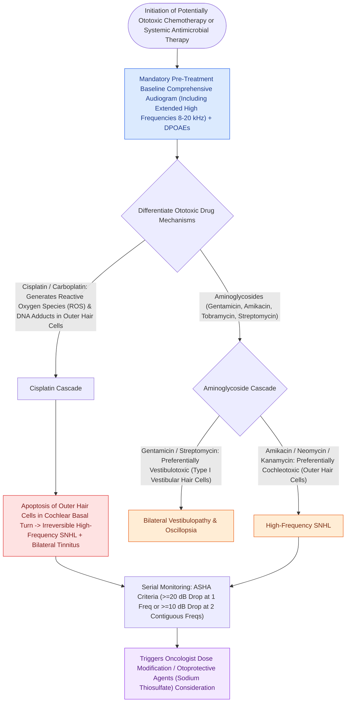

# Platinum and aminoglycoside ototoxicity mandates baseline and serial high-frequency audiometric monitoring

## Active Recall

> [!question]- Which aminoglycosides are chiefly vestibulotoxic versus cochleotoxic?
> *Answer / Clinical Rationale*: Gentamicin and streptomycin are vestibulotoxic; amikacin and kanamycin are cochleotoxic.

> [!question]- Why must ototoxicity monitoring include frequencies above 8 kHz?
> *Answer / Clinical Rationale*: Platinum injury begins in the extreme basal turn — ultra-high-frequency loss precedes conventional-range loss, creating the window to act.

## Core Clinical & Mechanistic Principles
- **Cisplatin**: dose-cumulative, bilateral, high-frequency-first, can progress after completion; injures basal outer hair cells and stria via oxidative stress. **Sodium thiosulfate** is protective in pediatric localized disease when timed after infusion.
- **Aminoglycosides**: gentamicin/streptomycin are predominantly **vestibulotoxic** ([[Bilateral vestibulopathy causes oscillopsia and dark-dependent imbalance from bilateral hair cell loss|bilateral vestibulopathy]], oscillopsia); amikacin/kanamycin predominantly cochleotoxic. The **mitochondrial m.1555A>G** variant confers single-dose susceptibility.
- Loop diuretics cause reversible strial edema but potentiate other ototoxins; deferoxamine, macrolides, and quinine add to the list.
- Monitoring protocol: baseline including **extended high-frequency audiometry (above 8 kHz)** and DPOAEs, then before each platinum cycle — ultra-high frequencies fall first, giving lead time to modify therapy.

### Management & Critical Safety Checks
- Coordinate with oncology: threshold shifts trigger a documented risk-benefit conversation (dose modification, carboplatin substitution, or acceptance) rather than silent progression.
- Aminoglycoside dosing: avoid in known m.1555A>G families; monitor with bedside dynamic visual acuity when vestibulotoxicity is the concern, since audiograms miss it.

## Connected Concepts & Graph Traversal
- **Outer Hair Cell Electromotility**: [[Outer hair cell electromotility driven by prestin amplifies cochlear micromechanics|Prestin Motor Damage]]
- **OAE Serial Monitoring**: [[Otoacoustic emissions evaluate outer hair cell integrity and differentiate cochlear from auditory neuropathy spectrum disorder|OAE Ototoxicity Monitoring]]
- **Bilateral Vestibulopathy Risk**: [[Bilateral vestibulopathy causes oscillopsia and dark-dependent imbalance from bilateral hair cell loss|Aminoglycoside Vestibulotoxicity]]
- **Endocochlear Potential Drive**: [[The stria vascularis generates the endocochlear potential of positive eighty millivolts|Stria Vascularis Toxicity]]
- **Cochlear Implantation Salvage**: [[Cochlear implant candidacy criteria include severe to profound bilateral sensorineural hearing loss|Cochlear Implantation for Severe Loss]]
