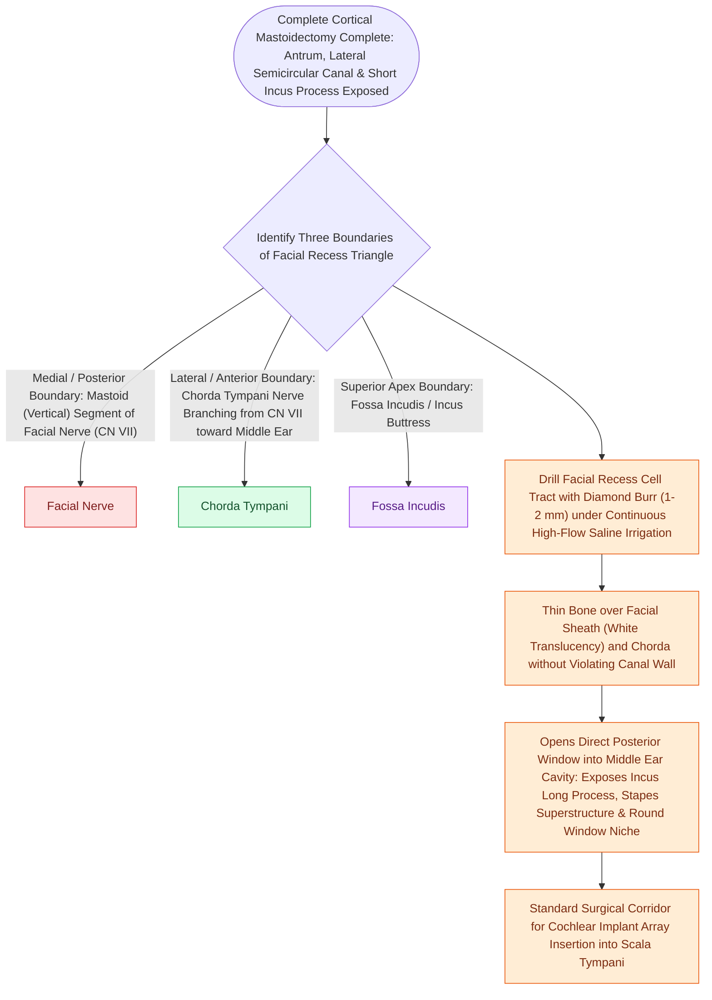

# Posterior tympanotomy facial recess approach opens the corridor between CN VII and chorda tympani

## Active Recall

> [!question]- What are the three boundaries and key angle of the facial recess?
> *Answer / Clinical Rationale*: Medially by the **mastoid facial nerve**, laterally by the **chorda tympani nerve**, and superiorly by the **incus buttress** (chorda-facial angle $\approx 15\text{–}30^\circ$, corridor width $2\text{–}3\text{ mm}$).

> [!question]- Why must the round window niche overhang be drilled, and where is the membrane opened for CI insertion?
> *Answer / Clinical Rationale*: The overhang conceals the membrane; opening the **anteroinferior quadrant** provides an unobstructed vector into the **scala tympani** below the osseous spiral lamina.

> [!question]- What anatomical structure marks the inferior apex of the posterior tympanotomy?
> *Answer / Clinical Rationale*: The **bifurcation / take-off of the chorda tympani nerve** from the descending mastoid segment of the facial nerve.

## Core Clinical & Mechanistic Principles
A **posterior tympanotomy (facial recess approach)** opens a direct $2\text{–}3\text{ mm}$ surgical keyhole from the mastoid cavity into the retrotympanum and mesotympanum, preserving the intact posterior canal wall:

- **The Facial Recess Quantitative Geometry**:
  - *Medial (Posteromedial) Boundary*: Mastoid (vertical) segment of the [[The facial nerve traverses six distinct anatomical segments from the pons to the parotid gland|facial nerve (CN VII)]].
  - *Lateral (Anterolateral) Boundary*: **Chorda tympani nerve** ascending toward the iter chordae posterius.
  - *Superior Boundary*: **Incus buttress / fossa incudis** supporting the short process of the incus.
  - *Inferior Apex*: The take-off angle where the chorda tympani branches from the descending facial nerve (chorda-facial angle $\approx 15\text{–}30^\circ$).

- **Cochlear Implant Target: Round Window Niche & Scala Tympani Vector**:
  1. *Drilling the Overhang*: The true round window membrane faces posteroinferiorly and is shielded by a thick bony overhang (crista semilunaris / niche lip). The overhang must be drilled with a fine diamond burr to expose the secondary tympanic membrane.
  2. *Anteroinferior Membrane Fenestration*: Incise or fenestrate the **anteroinferior quadrant** of the round window membrane. This vector aligns directly with the lumen of the **scala tympani**, keeping the electrode array away from the fragile basilar membrane and osseous spiral lamina.
  3. *Navigating the "Hook"*: The basal turn makes a sharp initial upward/anteromedial curve (the "hook"). Inserting along the scala tympani axis minimizes insertion force and prevents intra-cochlear translocation.
  4. *Vascular Variants*: A **high jugular bulb** (riding superior to the inferior annulus) can obscure the niche, while an aberrant/dehiscent **internal carotid artery** lies anteriorly.

### Boundary-Derived Complications & Safety Rules
- **Chorda Tympani Injury**: Over-lateral drilling stretches or transects the chorda, causing temporary metallic dysgeusia or anterior tongue numbness.
- **Incus Buttress Fracture**: Chipping the buttress destabilizes the incus or transmits mechanical vibration to the stapes.
- **Thermal Facial Nerve Damage**: Drilling bone overlying CN VII without copious continuous irrigation transmits heat through intact bone; skeletonize with diamond burrs under cold saline flow.

## Connected Concepts & Graph Traversal
- **Facial Nerve Aphorisms**: [[The facial nerve traverses six distinct anatomical segments from the pons to the parotid gland|CN VII Intratemporal Ledger]]
- **Cortical Mastoidectomy**: [[Complete cortical mastoidectomy unroofs the mastoid antrum and establishes dependent middle ear drainage|Mastoidectomy Gate Sequence]]
- **Cochlear Implantation**: [[Round window and extended round window insertions minimize intracochlear acoustic trauma|Cochlear Implant Insertion & NRT]]
- **Otic Capsule Foundation**: [[The otic capsule is an immutable endochondral bone that provides fixed surgical reference landmarks|Otic Capsule Invariant]]
- **Endoscopic Visualization**: [[Transcanal endoscopic ear surgery TEES provides line-of-sight visualization into the sinus tympani and epitympanum|TEES Line of Sight]]
- **Facial Recess Boundaries**: [[The facial recess is bounded by the facial nerve, chorda tympani, and fossa incudis|Facial Recess Boundaries]]
