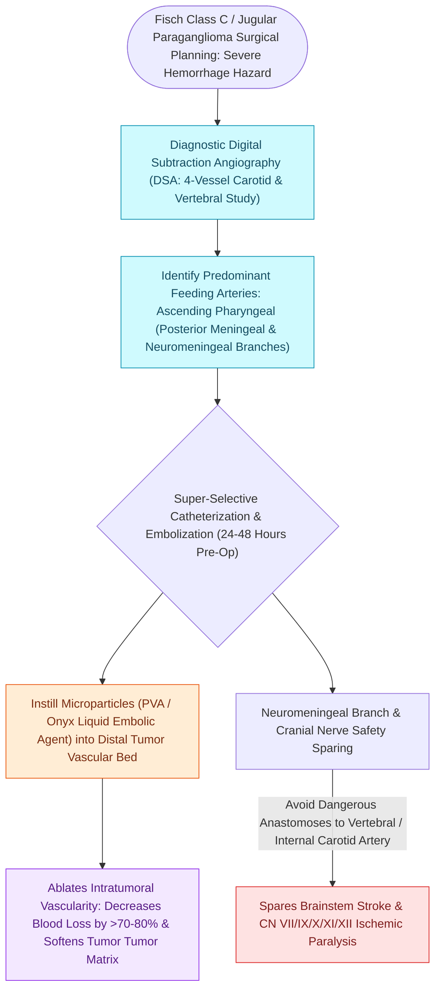

# Preoperative embolization reduces intraoperative blood loss in hypervascular glomus jugulare tumors

## Active Recall

> [!question]- What is the dominant arterial blood supply to a glomus jugulare tumor targeted during embolization?
> *Answer / Clinical Rationale*: The **ascending pharyngeal artery** (neuromeningeal trunk and inferior tympanic branch).

> [!question]- Why is surgical resection performed within 24 to 72 hours following embolization?
> *Answer / Clinical Rationale*: To operate during maximal tumor devascularization **before arterial recanalization or acute peritumoral inflammatory edema develops**.

## Core Clinical & Mechanistic Principles
Endovascular **preoperative superselective embolization** is standard practice for large, hypervascular temporal bone paragangliomas ([[Jugular paragangliomas arise from the glomus body in the adventitia of the jugular bulb|glomus jugulare]] / tympanomastoideum):
- **Clinical Rationale & Benefits**:
  - Paragangliomas possess massive arterial flow and arteriovenous shunting.
  - Embolization reduces intraoperative blood loss by **$>60\text{–}80\%$** (from $>1,500\text{ mL}$ down to $<300\text{–}500\text{ mL}$), softens tumor consistency, and clarifies cranial nerve dissection planes.
- **Arterial Supply & Target Vessels**:
  - **Dominant Feeder**: **Ascending Pharyngeal Artery (APA)** (specifically the neuromeningeal trunk and inferior tympanic branch) in $>85\text{–}90\%$ of cases.
  - **Secondary Feeders**:
    - Posterior auricular artery.
    - Occipital artery (transmastoid branches).
    - Internal maxillary artery (anterior tympanic / middle meningeal branches).
    - Internal Carotid Artery caroticotympanic branches.
- **Embolic Agents & Timing**:
  - Polyvinyl alcohol (PVA) microparticles ($150\text{–}500\ \mu\text{m}$) or liquid embolic agents (Onyx / n-BCA).
  - Surgery is performed within **$24\text{ to }72\text{ hours}$ post-embolization** (before vascular recanalization or intense inflammatory edema occurs).

### Surgical Technique & Critical Safety Checks
- **Cranial Nerve Stroke Warning**: The neuromeningeal branch of the APA supplies cranial nerves IX, X, XI, and XII; embolic reflux into the ICA or vertebral artery causes catastrophic ischemic stroke.

## Connected Concepts & Graph Traversal
- **Glomus Jugulare Pathology**: [[Jugular paragangliomas arise from the glomus body in the adventitia of the jugular bulb|Glomus Jugulare Pathology]]
- **Fisch Classification Staging**: [[Fisch classification categorizes temporal bone and skull base paragangliomas from Class A to Class D|Fisch Classification]]
- **Infratemporal Fossa Type A Approach**: [[Fisch infratemporal fossa approach Type A mobilizes the facial nerve and exposes the jugular foramen|Infratemporal Fossa Type A]]
- **Pulsatile Tinnitus Sign**: [[Pulsatile tinnitus is differentiated into arterial and venous etiologies by auscultation, jugular compression, and targeted vascular imaging|Pulsatile Tinnitus Workup]]
- **Lower Cranial Neuropathies**: [[Cranial nerve polyneuropathies of the skull base are localized by specific anatomical foramen involvement|Jugular Foramen Syndromes]]
