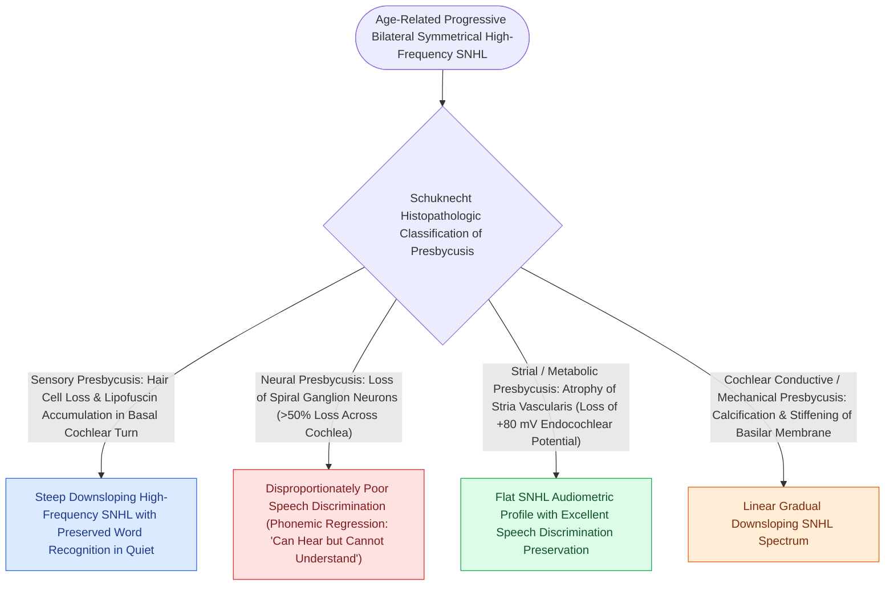

# Presbycusis produces symmetric high-frequency sensorineural loss with disproportionate speech-in-noise decline

## Active Recall

> [!question]- Which Schuknecht subtype produces a flat audiogram and through what structure?
> *Answer / Clinical Rationale*: **Strial (metabolic)** presbycusis — atrophy of the stria vascularis lowers the endocochlear potential across all frequencies.

> [!question]- What finding in a 'presbycusis' referral mandates retrocochlear workup?
> *Answer / Clinical Rationale*: Meaningful asymmetry or word-recognition scores disproportionately poor on one side.

## Core Clinical & Mechanistic Principles
- **Schuknecht patterns**: sensory (basal outer hair cell loss, steep high-frequency slope), neural (ganglion cell loss, word recognition worse than thresholds predict), strial/metabolic (flat loss from stria vascularis atrophy and reduced endocochlear potential), and cochlear conductive — most real ears are mixed.
- The clinical signature is **speech-in-noise difficulty out of proportion to the audiogram** — the cocktail party complaint — reflecting neural/synaptic loss on top of hair cell loss.
- Untreated ARHL is associated with accelerated cognitive decline and social withdrawal; treating it is framed as risk-factor modification, with the evidence strongest in higher-risk groups.
- Asymmetry, rapid progression, or poor unilateral word recognition is not presbycusis — that pattern earns retrocochlear evaluation.

### Management & Critical Safety Checks
- Management: [[Hearing aid selection is driven by audiometric configuration and verified with real-ear measurement|amplification]] fit to configuration with counseling on acclimatization; cochlear implant evaluation when aided word scores fail despite well-fit aids.
- Screen the complaint, not just the thresholds — speech-in-noise testing captures the disability the pure-tone audiogram misses.

## Connected Concepts & Graph Traversal
- **Hearing Aid Amplification**: [[Hearing aid selection is driven by audiometric configuration and verified with real-ear measurement|Hearing Aid Selection]]
- **Prestin Outer Hair Cell Loss**: [[Outer hair cell electromotility driven by prestin amplifies cochlear micromechanics|Prestin Outer Hair Cell Motors]]
- **Stria Vascularis Atrophy**: [[The stria vascularis generates the endocochlear potential of positive eighty millivolts|Stria Vascularis Endocochlear Potential]]
- **Basilar Membrane Tonotopy**: [[The traveling wave along the basilar membrane establishes tonotopic frequency organization|Basilar Membrane Tonotopy]]
- **Subjective Tinnitus Comorbidity**: [[Chronic subjective tinnitus is managed with cognitive behavioral and sound-based therapy rather than cure|Tinnitus in Presbycusis]]
