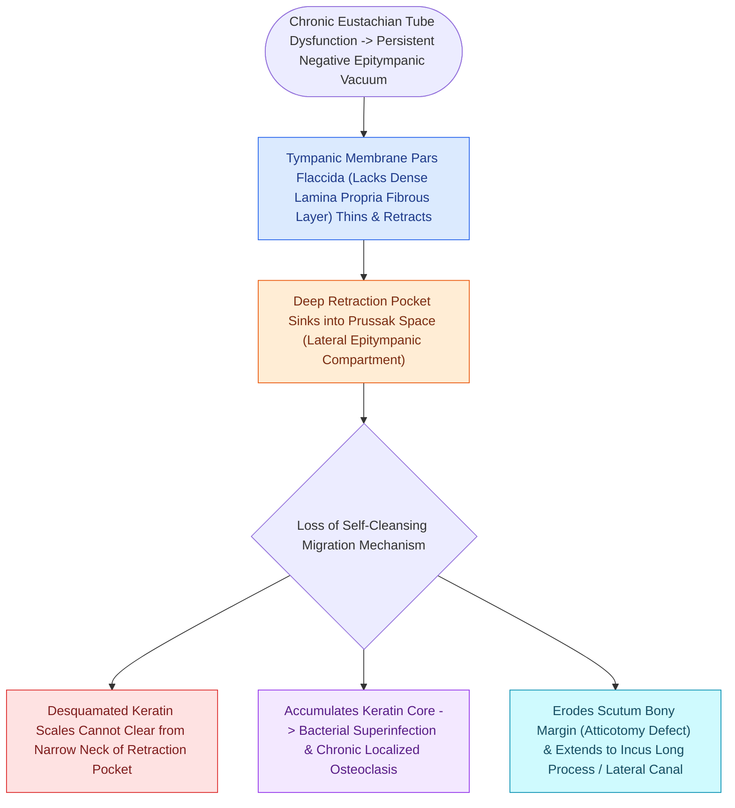

# Primary acquired cholesteatoma arises from retraction pocket invagination of the pars flaccida into Prussak space

## Active Recall

> [!question]- What anatomical boundaries define Prussak's space?
> *Answer / Clinical Rationale*: The **pars flaccida laterally**, the **neck of the malleus medially**, the **lateral malleolar fold/scutum superiorly**, and the **lateral process of the malleus inferiorly**.

> [!question]- What bone is characteristically eroded first by a pars flaccida cholesteatoma expanding from Prussak's space?
> *Answer / Clinical Rationale*: The **scutum (outer attic wall)**.

## Core Clinical & Mechanistic Principles
**Primary acquired cholesteatoma** develops insidiously behind an intact pars tensa due to progressive retraction pocket invagination of the **pars flaccida (Shrapnell's membrane)** into **Prussak's space**:
- **Anatomical Boundaries of Prussak's Space (Superior Recess of Tympanic Membrane)**:
  - **Lateral Boundary**: Pars flaccida (Shrapnell's membrane).
  - **Medial Boundary**: Neck of the malleus.
  - **Superior Boundary**: Lateral malleolar fold / scutum.
  - **Inferior Boundary**: Lateral process of the malleus.
- **Pathogenesis & Spread Patterns**:
  1. Chronic [[Eustachian tube dysfunction divides into dilatory and patulous forms with opposite treatment goals|Eustachian tube dysfunction]] creates negative epitympanic pressure.
  2. Pars flaccida retracts into Prussak's space; desquamated keratin accumulates, preventing normal self-cleaning.
  3. Osteolytic osteoclast activation (driven by TNF-alpha, IL-1, collagenases) erodes the **scutum (outer attic wall)**.
  4. Expands through the **posterior pouch of von Tröltsch** into the **epitympanum (attic)**, engulfing the incus body and malleus head, then spreads posteriorly into the **aditus ad antrum** and **mastoid antrum**.

### Surgical Technique & Critical Safety Checks
- **Early Sign**: Crust or tiny polyp in the attic over the scutum; mandates micro-otoscopic debridement and CT temporal bone.

## Connected Concepts & Graph Traversal
- **Canal Wall Up Mastoidectomy**: [[Canal wall up mastoidectomy preserves the posterior bony external auditory canal wall|Canal Wall Up Mastoidectomy]]
- **Canal Wall Down Mastoidectomy**: [[Canal wall down mastoidectomy lowers the facial ridge and exteriorizes the mastoid into the ear canal|Canal Wall Down Mastoidectomy]]
- **Labyrinthine Fistula Complication**: [[Labyrinthine fistula from cholesteatoma erosions most frequently involves the lateral semicircular canal|Labyrinthine Fistula]]
- **Non-EPI DWI MRI Surveillance**: [[Non-echo-planar diffusion-weighted MRI detects recurrent and residual cholesteatoma as small as two millimeters|Non-EPI DWI MRI]]
- **Auto-Mastoidectomy Demolition**: [[Auto-mastoidectomy occurs when chronic expansive cholesteatoma exteriorizes spontaneously into the canal|Auto-Mastoidectomy]]
