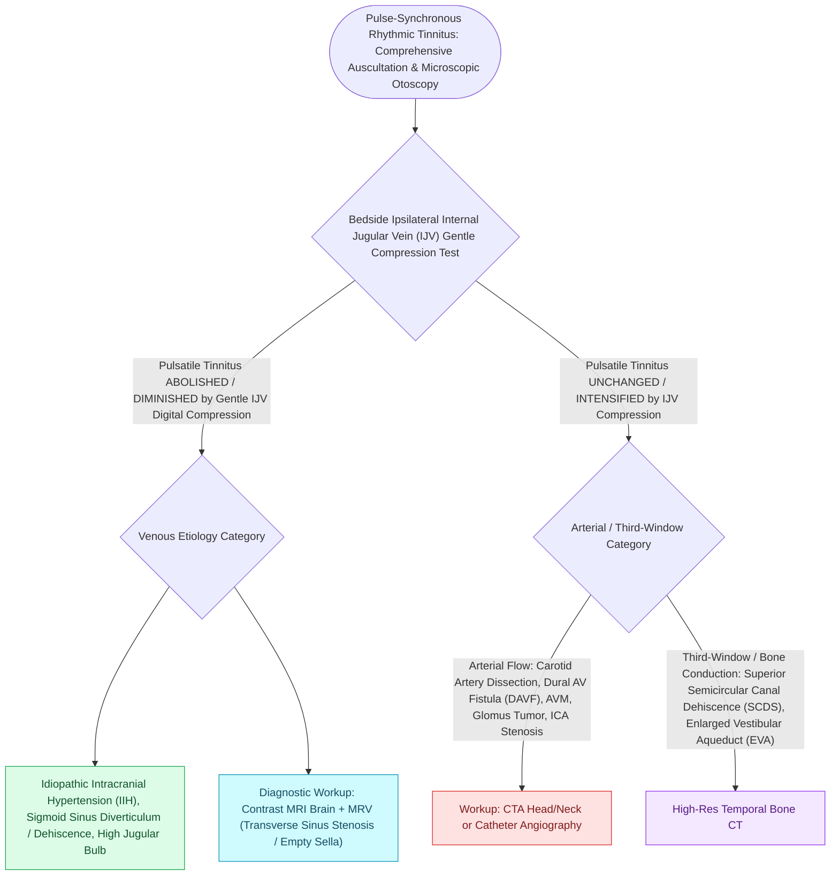

# Pulsatile tinnitus is differentiated into arterial and venous etiologies by auscultation, jugular compression, and targeted vascular imaging

## Active Recall

> [!question]- What physical examination maneuver reliably differentiates a venous source of pulsatile tinnitus from an arterial or arteriovenous source?
> *Answer / Clinical Rationale*: **Gentle light digital compression of the ipsilateral internal jugular vein (IJV)** in the upper neck (or head rotation toward the ipsilateral side) will **completely extinguish or markedly diminish venous pulsatile tinnitus** (such as in idiopathic intracranial hypertension, sigmoid sinus diverticulum/dehiscence, or benign venous hum) by halting turbulent venous return through the skull base. In contrast, **arterial and arteriovenous malformations/fistulas (dAVF, carotid stenosis, aneurysm, aberrant ICA) do not disappear with gentle jugular compression** and may even intensify.

> [!question]- What is the complete diagnostic workup and classic demographic profile for Idiopathic Intracranial Hypertension (IIH / Pseudotumor Cerebri) presenting with pulsatile tinnitus?
> *Answer / Clinical Rationale*: IIH typically presents in **young, overweight/obese females of childbearing age** with low-pitched, whooshing pulse-synchronous tinnitus, visual obscurations, headache, and retro-orbital pain. Workup mandates: (1) **Funduscopic examination** demonstrating bilateral papilledema, (2) **MRI brain and MR Venography (MRV)** showing empty sella turcica, posterior scleral flattening, optic nerve sheath enlargement/tortuosity, and bilateral transverse-sigmoid sinus stenosis, and (3) **Lumbar puncture** demonstrating an elevated opening pressure **$>25\text{ cm }H_2O$** (or $>28\text{ cm }H_2O$ in children) with normal CSF constituents.

> [!question]- What is the single most dangerous vascular etiology of pulsatile tinnitus, and why does a negative non-invasive CTA not fully exclude it when clinical suspicion persists?
> *Answer / Clinical Rationale*: A **dural arteriovenous fistula (dAVF)**, which carries a substantial risk of catastrophic intracranial hemorrhage and venous infarction if cortical venous reflux is present. Because low-flow or subtle microvascular dAVFs can evade non-invasive CTA/MRA, **Digital Subtraction Angiography (Catheter DSA)** remains the definitive gold standard for detecting arteriovenous shunting and grading cortical venous drainage patterns (Borden / Cognard classification).

## Core Clinical & Mechanistic Principles

**Pulsatile tinnitus (pulse-synchronous tinnitus)** indicates turbulent blood flow adjacent to the temporal bone or amplified transmission of normal vascular pulsations through a thinned bony otic capsule (third-window phenomenon):

- **Office Otoscopy & Bell Auscultation First**:
  - **Microscopic Otoscopy**: Sorts retrotympanic vascular masses before imaging or biopsy—including a bright red pulsatile promontory mass ([[Jugular paragangliomas arise from the glomus body in the adventitia of the jugular bulb|glomus tympanicum / jugulare]] with positive **Brown's sign** on pneumatic otoscopy), an anteroinferior salmon-pink **aberrant internal carotid artery**, or a dark blue posteromedial **high-riding dehiscent jugular bulb**.
  - **Bell Auscultation**: Auscultate the mastoid, orbit, and neck in every pulsatile case to detect an objective vascular bruit (**dural AV fistula** or carotid stenosis).
  - **Non-Vascular Somatosound Differential**: [[Superior semicircular canal dehiscence SCDS presents with Tullio phenomenon and sound-induced vertigo|Superior semicircular canal dehiscence (SCDS)]] and patulous Eustachian tube transmit autophony and pulse-synchronous bone-conducted internal sounds without primary vascular pathology, whereas tensor tympani / stapedial myoclonus and palatal myoclonus produce non-pulse-synchronous rhythmic clicking.

### Etiological Topography & Clinical Features

### Medical and Surgical Management Strategies
- **Idiopathic Intracranial Hypertension (IIH)**:
  - Weight reduction, sodium restriction.
  - Carbonic anhydrase inhibitors: **Acetazolamide ($1000-2000\text{ mg/day}$)**.
  - Dural venous sinus stenting (transverse sinus stenting) or ventriculoperitoneal (VP) shunt for refractory vision-threatening papilledema.
- **Sigmoid Sinus Dehiscence / Diverticulum**:
  - Transmastoid sigmoid sinus reconstruction and cortical bone resurfacing.
- **Dural Arteriovenous Fistula (dAVF)**:
  - Endovascular transarterial or transvenous embolization with liquid embolic agents (Onyx / coils).
- **Glomus Tympanicum / Jugulare**:
  - Transcanal / hypotympanotomy resection for Class A/B; preoperative embolization followed by infratemporal fossa approach for Class C/D.

## Connected Concepts & Graph Traversal
- **Glomus Tumor Staging**: [[Fisch classification categorizes temporal bone and skull base paragangliomas from Class A to Class D|Fisch Paraganglioma Staging]]
- **Glomus Jugulare Origin**: [[Jugular paragangliomas arise from the glomus body in the adventitia of the jugular bulb|Glomus Jugulare Paraganglioma]]
- **Superior Canal Dehiscence**: [[High-resolution temporal bone CT with Poschl and Stenvers reformatting confirms superior canal dehiscence|SSCD & Third Mobile Window]]
- **Preoperative Embolization**: [[Preoperative embolization reduces intraoperative blood loss in hypervascular glomus jugulare tumors|Vascular Tumor Embolization]]
- **Subjective Tinnitus Management**: [[Chronic subjective tinnitus is managed with cognitive behavioral and sound-based therapy rather than cure|Subjective Tinnitus & TRT]]
- **Spontaneous CSF Otorrhea & IIH**: [[Spontaneous CSF otorrhea from tegmen dehiscence requires multilayer middle fossa or transmastoid repair|Tegmen Dehiscence & IIH]]
- **Intracranial Pressure Emergencies**: [[Lateral sinus thrombophlebitis presents with picket fence fevers and Griesinger sign requiring intravenous antibiotics and mastoidectomy|Otogenic Sigmoid Thrombosis]]
- **🔗 Objective Clicking Tinnitus Differential (Laryngology)**: [[Oculopalatopharyngeal myoclonus causes continuous one to three Hertz branchial contractions persisting in sleep due to Guillain-Mollaret triangle disruption|Palatal Myoclonus Clicking Tinnitus]]
