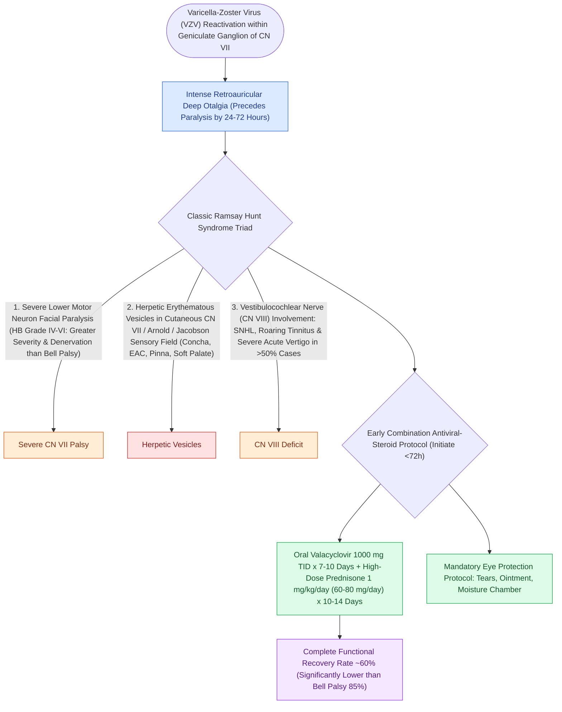

# Ramsay Hunt syndrome herpes zoster oticus presents with severe facial paralysis, otalgia, and auricular vesicles

## Active Recall

> [!question]- What is the classic diagnostic triad of Ramsay Hunt syndrome?
> *Answer / Clinical Rationale*: **Severe facial paralysis**, **intense otalgia**, and **herpetic vesicular eruptions in the concha/ear canal/palate**.

> [!question]- What additional cranial nerve is most frequently involved in Ramsay Hunt syndrome alongside CN VII?
> *Answer / Clinical Rationale*: The **vestibulocochlear nerve (CN VIII)**, causing sensorineural hearing loss, vertigo, and tinnitus.

## Core Clinical & Mechanistic Principles
**Ramsay Hunt Syndrome (Herpes Zoster Oticus)** (described by J. Ramsay Hunt in 1907) is caused by reactivation of latent **Varicella-Zoster Virus (VZV)** within the geniculate ganglion:
- **The Classic Clinical Triad**:
  1. **Severe Peripheral Facial Nerve Paralysis** (typically House-Brackmann Grade IV–VI).
  2. **Severe, Deep, Throbbing Otalgia** (frequently precedes paralysis by days).
  3. **Herpetic Vesicular Eruption** on the cutaneous distribution of the sensory facial nerve (conchal bowl, external auditory canal, antihelix, tragus, soft palate, and anterior 2/3 of tongue).
- **Polyneuropathy & Vestibulocochlear Spread**:
  - VZV frequently spreads to adjacent cranial nerves in the IAC (CN VIII), producing **sensorineural hearing loss, severe vertigo, tinnitus, and nystagmus** in $>50\%$ of patients.
- **Prognosis & Medical Management**:
  - Far worse prognosis than [[Acute Bell's palsy presents with unilateral lower motor neuron facial paralysis treated with early oral steroids|Bell's palsy]] (complete spontaneous recovery rate is only $20\text{–}30\%$ without treatment).
  - **Therapy**: Immediate combination of **High-Dose Oral Corticosteroids (Prednisone 60 mg/day)** AND **Valacyclovir ($1,000\text{ mg}$ TID for 7–10 days)** improves recovery rates to $>60\text{–}70\%$.

### Surgical Technique & Critical Safety Checks
- **Zoster Sine Herpete**: Acute VZV facial paralysis occurring without visible external skin vesicles; confirmed via VZV DNA on PCR of saliva or tear fluid.

## Connected Concepts & Graph Traversal
- **Idiopathic Facial Palsy**: [[Acute Bell's palsy presents with unilateral lower motor neuron facial paralysis treated with early oral steroids|Bell's Palsy Differential]]
- **House-Brackmann Staging**: [[House-Brackmann grading system stratifies facial nerve function from Grade I normal to Grade VI total paralysis|House-Brackmann Scale]]
- **Electrodiagnostic ENoG**: [[Electroneuronography showing greater than ninety percent degeneration within fourteen days indicates severe facial nerve axonal injury|ENoG Prognostication]]
- **🔗 Corneal Lagophthalmos Protection (FPRS)**: [[Upper eyelid platinum weights and lateral tarsal strips protect the cornea in flaccid facial paralysis|Upper Eyelid Weight Implantation]]
- **Suppurative Labyrinthitis Spread**: [[Labyrinthitis presents with acute prolonged vertigo combined with sudden sensorineural hearing loss|Suppurative Labyrinthitis]]
