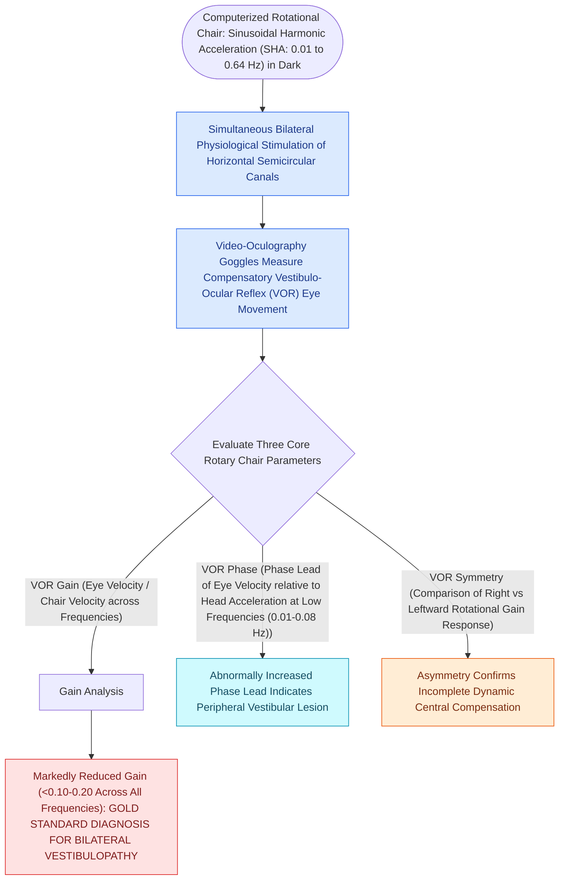

# Rotary chair testing assesses low-frequency bilateral vestibular hypofunction and central compensation

## Active Recall

> [!question]- What is the gold standard diagnostic test for confirming bilateral vestibular hypofunction?
> *Answer / Clinical Rationale*: **Rotary chair testing** (demonstrating depressed VOR gain across multiple rotational frequencies).

> [!question]- What does failure of visual fixation suppression during rotary chair testing indicate?
> *Answer / Clinical Rationale*: **Central pathology**, specifically lesions of the cerebellar flocculus or brainstem pathways.

## Core Clinical & Mechanistic Principles
**Rotational chair testing** is the clinical gold standard for diagnosing and quantifying **bilateral vestibular hypofunction** and assessing central vestibular compensation:
- **Test Protocols**:
  1. **Sinusoidal Harmonic Acceleration (SHA)**: Rotates patient in darkness at discrete frequencies ($0.01, 0.02, 0.04, 0.08, 0.16, 0.32, 0.64\text{ Hz}$).
     - *VOR Gain*: Low across all frequencies in bilateral vestibular loss (e.g., gentamicin toxicity).
     - *VOR Phase*: Phase lead is abnormally increased at low frequencies in peripheral pathology.
     - *VOR Symmetry*: Asymmetry indicates uncompensated [[Bithermal caloric testing calculates Jongkees formula to quantify unilateral vestibular paresis|unilateral weakness]].
  2. **Step Velocity (Velocity Step Test)**: Sudden acceleration to $100^\circ/\text{s}$ followed by sustained rotation, measuring the **Vestibular Time Constant ($T_c$)**.
     - Normal $T_c \approx 12\text{–}18\text{ seconds}$ (augmented by the velocity storage mechanism in the brainstem).
     - Reduced $T_c < 10\text{ seconds}$ indicates peripheral or central vestibular deficiency.

### Surgical Technique & Critical Safety Checks
- **Visual Fixation Suppression**: Normal suppression of nystagmus when a fixation light rotates with the chair confirms intact cerebellar flocculus function.

## Connected Concepts & Graph Traversal
- **Caloric High-Frequency Comparison**: [[Bithermal caloric testing calculates Jongkees formula to quantify unilateral vestibular paresis|Bithermal Caloric Testing]]
- **vHIT High-Frequency Testing**: [[The video head impulse test vHIT identifies high-frequency angular vestibulo-ocular reflex deficits|vHIT Angular Testing]]
- **Bilateral Vestibulopathy Diagnosis**: [[Bilateral vestibulopathy causes oscillopsia and dark-dependent imbalance from bilateral hair cell loss|Bilateral Vestibulopathy]]
- **Nystagmus Biophysical Laws**: [[Ewald's laws and Alexander's law govern the directional dynamics and intensity of vestibular nystagmus|Ewald Laws of Nystagmus]]
- **Vestibular Rehabilitation Recalibration**: [[Vestibular rehabilitation exploits adaptation habituation and substitution to recalibrate gaze and posture|Vestibular Rehabilitation]]
