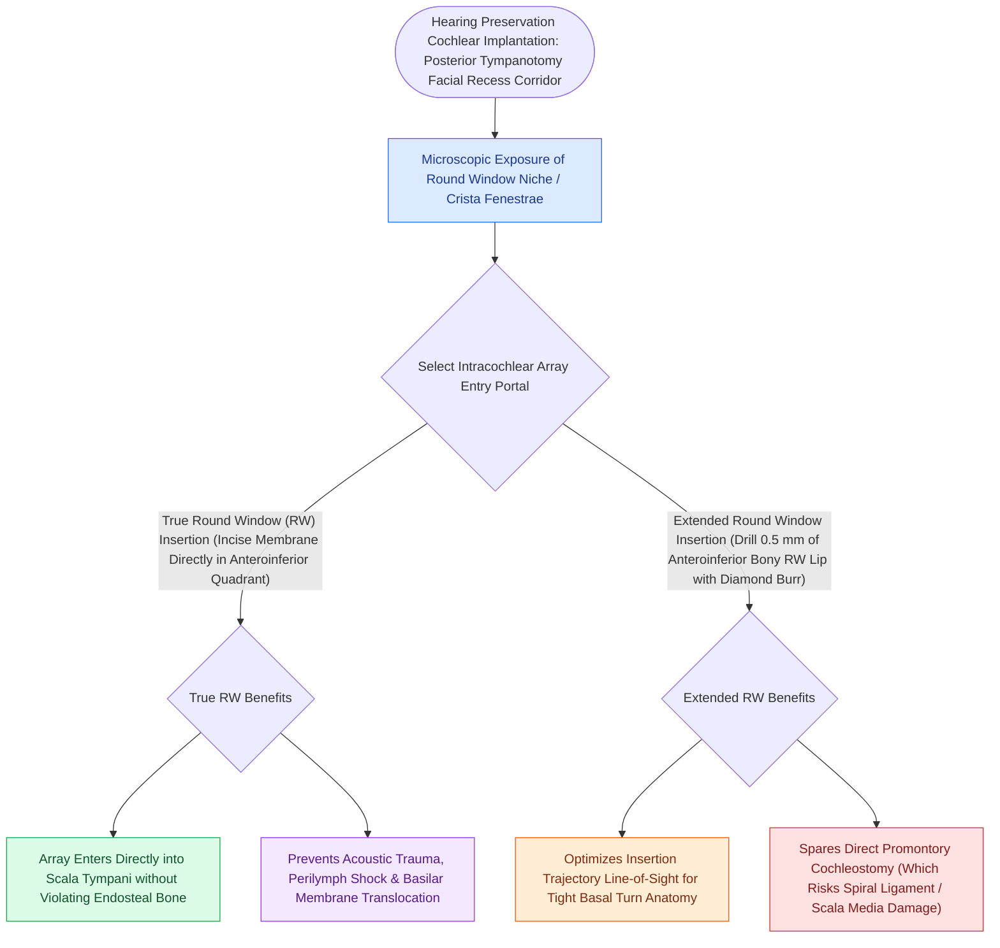

# Round window and extended round window insertions minimize intracochlear acoustic trauma

## Active Recall

> [!question]- Why is round window insertion preferred over promontory cochleostomy for cochlear implant electrode placement?
> *Answer / Clinical Rationale*: It provides direct, atraumatic entry into the **scala tympani**, minimizing the risk of basilar membrane disruption and preserving residual acoustic hearing.

> [!question]- What anatomical structure often covers the true round window membrane in the niche and must be removed?
> *Answer / Clinical Rationale*: A **false membrane (pseudomembrane)**.

## Core Clinical & Mechanistic Principles
Insertion of the cochlear implant electrode array via the **round window (RW)** or **extended round window** is the gold standard for "soft surgery" structure and hearing preservation:
- **Anatomical Round Window Relationships**:
  - Situated in the round window niche on the posteroinferior promontory, shielded by the bony **fustis** and **crista fenestrae**.
  - The true round window membrane is oriented horizontally or obliquely and is often obscured by an overlying false membrane (pseudomembrane).
- **The Three Insertion Approaches**:
  1. **Round Window (RW) Membrane Insertion**: Incise the anteroinferior quadrant of the true RW membrane; insert electrode array directly into the **scala tympani**. Lowest risk of [[Scala tympani electrode array placement preserves residual hearing and avoids basilar membrane translocation|intracochlear trauma]].
  2. **Extended Round Window**: Drill the anteroinferior bony lip of the round window niche to expose the anterior margin of the membrane, aligning the insertion vector with the basal turn.
  3. **Promontory Cochleostomy (Anteroinferior)**: Drilled $0.5\text{–}1.0\text{ mm}$ anteroinferior to the RW niche; higher risk of scala media entry and spiral ligament disruption.

### Surgical Technique & Critical Safety Checks
- **Hearing Preservation Principles**: Slow insertion speed ($0.25\text{–}0.5\text{ mm/sec}$), topical dexamethasone instillation, use of flexible lateral wall arrays, and avoiding suction on open perilymph.

## Connected Concepts & Graph Traversal
- **Scala Tympani Electrode Placement**: [[Scala tympani electrode array placement preserves residual hearing and avoids basilar membrane translocation|Scala Tympani Placement]]
- **Cochlear Implant Candidacy**: [[Cochlear implant candidacy criteria include severe to profound bilateral sensorineural hearing loss|CI Candidacy]]
- **Intraoperative NRT Telemetry**: [[Intraoperative neural response telemetry NRT confirms auditory nerve fiber stimulation|Neural Response Telemetry]]
- **Meningitis Vaccination Prophylaxis**: [[Streptococcus pneumoniae vaccination is mandatory prior to cochlear implantation to prevent post-implantation bacterial meningitis|Pneumococcal Vaccination in CI Recipients]]
- **Posterior Tympanotomy Access**: [[Posterior tympanotomy facial recess approach opens the corridor between CN VII and chorda tympani|Facial Recess Access]]
