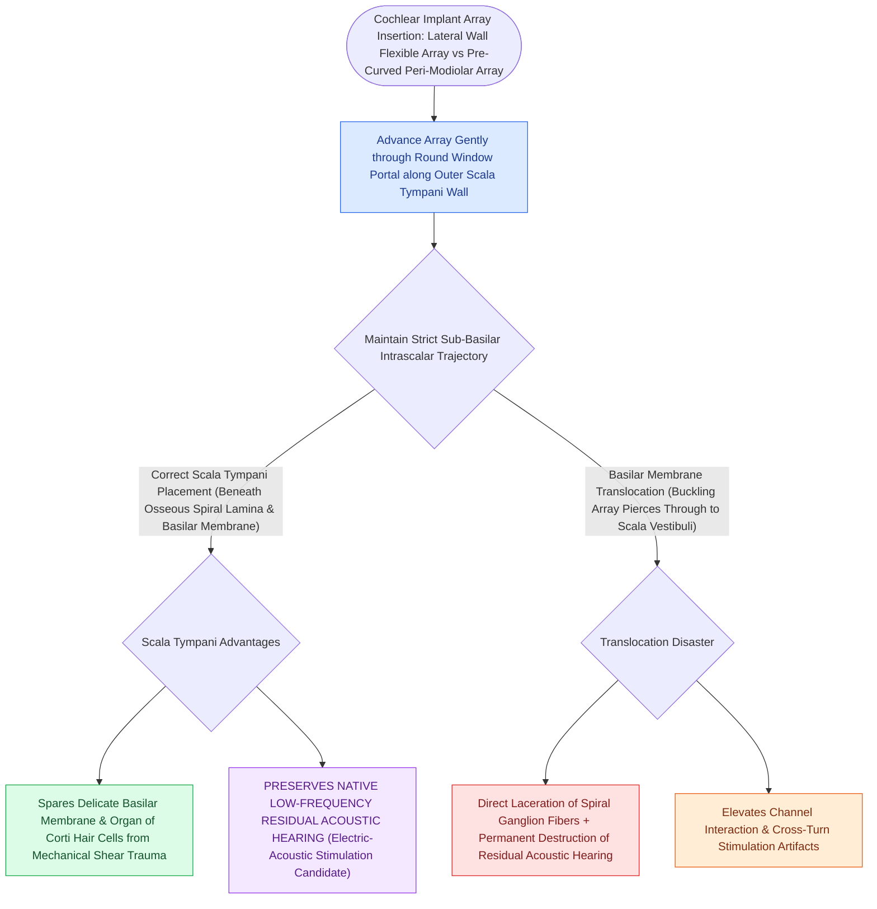

# Scala tympani electrode array placement preserves residual hearing and avoids basilar membrane translocation

## Active Recall

> [!question]- What catastrophic histological event occurs during electrode array translocation in cochlear implantation?
> *Answer / Clinical Rationale*: The electrode array **punctures through the basilar membrane and osseous spiral lamina**, tearing the organ of Corti and translocating into the scala vestibuli.

> [!question]- What are the clinical consequences of intracochlear electrode translocation?
> *Answer / Clinical Rationale*: **Complete loss of residual acoustic hearing**, elevated electrical stimulation thresholds, and poorer speech understanding.

## Core Clinical & Mechanistic Principles
Placement of the cochlear implant electrode array strictly within the **scala tympani (ST)** is the primary anatomical objective of atraumatic cochlear implant surgery:
- **Intracochlear Scala Architecture**:
  - **Scala Tympani (ST)**: The inferior chamber; located immediately adjacent to the spiral ganglion cell bodies in Rosenthal's canal.
  - **Scala Vestibuli (SV)**: The superior chamber; separated from the scala media by [[Endolymphatic hydrops results from impaired resorption of endolymph within the endolymphatic sac|Reissner]]'s membrane.
  - **Scala Media (Cochlear Duct)**: Houses the organ of Corti and basilar membrane.
- **The "Translocation" Hazard**:
  - If the electrode array deviates superiorly during insertion, it punctures the delicate **basilar membrane and osseous spiral lamina**, translocating from the scala tympani into the scala media or scala vestibuli.
  - **Consequences of Translocation**:
    1. **Immediate permanent destruction of residual acoustic hearing**.
    2. Mechanical laceration of spiral ganglion peripheral axons.
    3. Cross-talk and elevated electrical thresholds due to greater distance from the modiolus.

### Surgical Technique & Critical Safety Checks
- **Electrode Designs**:
  - *Lateral Wall (Straight) Arrays*: Sit along the outer scalar wall; lowest insertion trauma, ideal for hearing preservation.
  - *Perimodiolar (Pre-curved) Arrays*: Hug the modiolus; closer proximity to spiral ganglion cells with lower electrical charge requirements.

## Connected Concepts & Graph Traversal
- **Round Window Insertion Craft**: [[Round window and extended round window insertions minimize intracochlear acoustic trauma|Round Window Insertion]]
- **Cochlear Implant Candidacy**: [[Cochlear implant candidacy criteria include severe to profound bilateral sensorineural hearing loss|CI Candidacy]]
- **Intraoperative NRT Verification**: [[Intraoperative neural response telemetry NRT confirms auditory nerve fiber stimulation|Neural Response Telemetry]]
- **Tonotopic Frequency Organization**: [[The traveling wave along the basilar membrane establishes tonotopic frequency organization|Basilar Membrane Tonotopy]]
- **Endocochlear Driving Potential**: [[The stria vascularis generates the endocochlear potential of positive eighty millivolts|Stria Vascularis]]
- **Combined Electric-Acoustic Rehabilitation**: [[Electroacoustic stimulation preserves residual low-frequency acoustic hearing while providing high-frequency electrical cochlear stimulation for steep high-frequency sensorineural loss|Electroacoustic Stimulation / Hybrid CI]]
