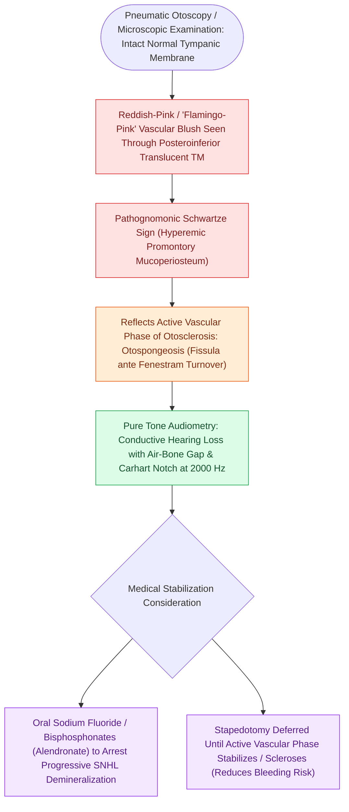

# Schwartze sign indicates active hypervascular otospongeosis over the promontory

## Active Recall

> [!question]- What does a positive Schwartze sign look like on otoscopic examination?
> *Answer / Clinical Rationale*: A **reddish-pink / flamingo-pink vascular blush** visible through an intact TM over the cochlear promontory.

> [!question]- What medical therapy is used to inhibit bone resorption in active, progressive cochlear otosclerosis?
> *Answer / Clinical Rationale*: **Sodium fluoride** or **oral bisphosphonates**.

## Core Clinical & Mechanistic Principles
**Schwartze's sign (Fleming's sign / Rising sun sign)** is the classic otoscopic physical examination finding of active [[Otosclerosis is characterized by abnormal bone remodeling of the otic capsule causing stapes fixation|otospongiosis]]:
- **Otoscopic Appearance**:
  - A reddish-pink, flamingo-pink, or salmon-colored vascular blush visible through a translucent, intact tympanic membrane over the **cochlear promontory** (posterior to the umbo).
- **Pathophysiological Basis**:
  - In the early, active phase of otospongiosis, osteoclasts create extensive vascular channels, forming a hypervascular osteoid network over the otic capsule and promontory.
  - Increased capillary blood flow produces prominent mucosal and subperiosteal hyperemia that shines through the thin tympanic membrane.
- **Clinical Significance**:
  - Identifies **rapidly active, progressive disease** with potential for retrofenestral cochlear extension and sensorineural hearing loss.
  - *Surgical Precaution*: Stapes surgery during an active Schwartze sign carries a higher risk of intraoperative bleeding and mucosal oozing around the oval window niche.

### Surgical Technique & Critical Safety Checks
- **Medical Therapy Consideration**: High-dose **Sodium Fluoride (20–50 mg/day)** or oral bisphosphonates (Alendronate / Zoledronic acid) can be administered to inhibit osteoclastic bone resorption and arrest disease progression in active cochlear otosclerosis.

## Connected Concepts & Graph Traversal
- **Otosclerosis Pathology**: [[Otosclerosis is characterized by abnormal bone remodeling of the otic capsule causing stapes fixation|Otosclerosis Footplate Pathology]]
- **Carhart Notch Artifact**: [[Carhart notch presents as an artificial bone-conduction dip at two thousand Hertz in stapes fixation|Carhart Notch (2,000 Hz Dip)]]
- **Laser Stapedotomy Safety**: [[Laser stapedotomy reduces mechanical trauma and footplate mobilization compared to manual perforators|Laser Stapedotomy]]
- **Floating Footplate Complication**: [[Floating footplate complication during stapedectomy is managed with small inferior fenestration or vein graft|Floating Footplate Complication]]
- **Middle Ear Transformer Physics**: [[The middle ear transformer ratio provides twenty-seven decibels of acoustic impedance matching|Middle Ear Transformer Ratio]]
