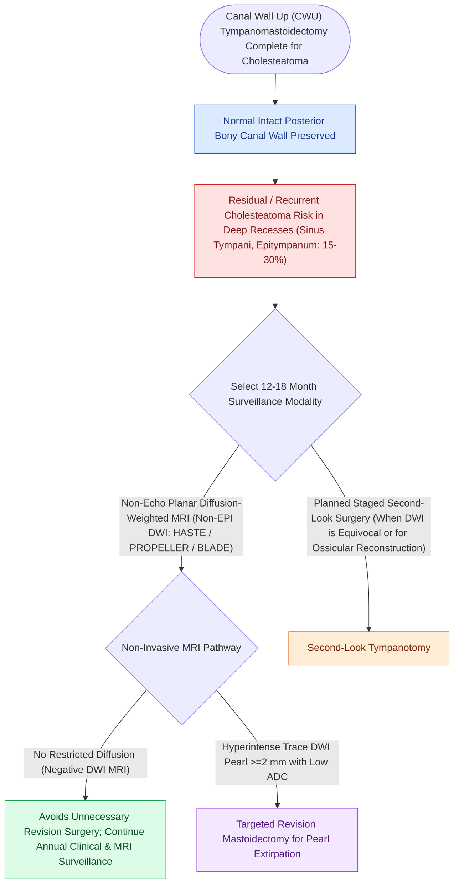

# Second-look surgery or non-EPI DWI MRI is indicated twelve to eighteen months after canal wall up mastoidectomy

## Active Recall

> [!question]- Why is second-look surveillance timed specifically at 12 to 18 months following CWU mastoidectomy?
> *Answer / Clinical Rationale*: To allow microscopic residual squamous rests sufficient time to grow into **detectable $2\text{–}3\text{ mm}$ pearls** before extensive bone destruction can occur.

> [!question]- How has non-EPI DWI MRI modified the classic mandate for routine surgical second-look procedures?
> *Answer / Clinical Rationale*: A negative non-EPI DWI MRI allows **safe non-surgical surveillance**, reserving second-look surgery for positive scans or staged ossiculoplasty.

## Core Clinical & Mechanistic Principles
Following a Canal Wall Up (CWU) mastoidectomy for extensive cholesteatoma, a structured surveillance protocol is mandatory to detect asymptomatic residual disease:
- **Residual vs. Recurrent Cholesteatoma**:
  - **Residual**: Microscopic squamous matrix left behind in deep recesses (sinus tympani, anterior epitympanum, facial recess) during the primary surgery ($15\text{–}25\%$ incidence).
  - **Recurrent**: New retraction pocket developing from [[Eustachian tube dysfunction divides into dilatory and patulous forms with opposite treatment goals|Eustachian tube dysfunction]] ($5\text{–}10\%$).
- **Timing of Surveillance (12 to 18 Months)**:
  - Performing second-look surgery or MRI before 12 months may miss tiny sub-millimeter residual pearls that have not grown large enough to be detected.
  - Waiting $>18\text{–}24\text{ months}$ risks extensive bone erosion, ossicular re-destruction, or [[Labyrinthine fistula from cholesteatoma erosions most frequently involves the lateral semicircular canal|labyrinthine fistula]] formation.
- **Modern Management Algorithm**:
  1. Perform **[[Non-echo-planar diffusion-weighted MRI detects recurrent and residual cholesteatoma as small as two millimeters|non-EPI DWI MRI]] at 12–18 months**.
  2. If MRI is **negative** and TM is healthy: Continue annual clinical/MRI surveillance, avoiding surgery.
  3. If MRI is **positive** ($>2\text{ mm}$ DWI pearl) or if [[Partial ossicular replacement prosthesis PORP requires an intact and mobile stapes superstructure|ossicular reconstruction]] (Stage II ossiculoplasty) is planned: Perform **targeted second-look exploration**.

### Surgical Technique & Critical Safety Checks
- **Transcanal Endoscopic Second-Look**: Mini-invasive exploration of the middle ear and attic using angled endoscopes ($0^\circ, 30^\circ, 45^\circ$), converting formal postauricular revision into a daycare transcanal procedure.

## Connected Concepts & Graph Traversal
- **Non-EPI DWI MRI Diagnostics**: [[Non-echo-planar diffusion-weighted MRI detects recurrent and residual cholesteatoma as small as two millimeters|Non-EPI DWI MRI]]
- **Canal Wall Up Mastoidectomy**: [[Canal wall up mastoidectomy preserves the posterior bony external auditory canal wall|Canal Wall Up Mastoidectomy]]
- **Canal Wall Down Alternative**: [[Canal wall down mastoidectomy lowers the facial ridge and exteriorizes the mastoid into the ear canal|Canal Wall Down Mastoidectomy]]
- **Primary Cholesteatoma Invagination**: [[Primary acquired cholesteatoma arises from retraction pocket invagination of the pars flaccida into Prussak space|Prussak Space Invagination]]
- **Endoscopic TEES Removal**: [[Transcanal endoscopic ear surgery TEES provides line-of-sight visualization into the sinus tympani and epitympanum|TEES Endoscopic Surveillance]]
