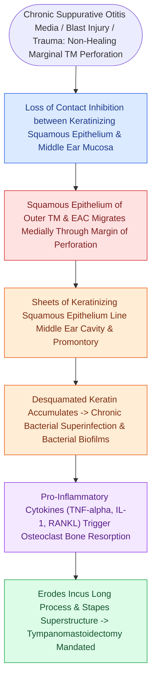

# Secondary acquired cholesteatoma develops from squamous epithelial migration through a tympanic membrane perforation

## Active Recall

> [!question]- How does a secondary acquired cholesteatoma differ fundamentally in origin from a primary acquired cholesteatoma?
> *Answer / Clinical Rationale*: Primary arises from **retraction pocket invagination of the pars flaccida**, whereas secondary arises from **squamous epithelial migration through an existing TM perforation**.

> [!question]- Which ossicular components are most vulnerable to osteolytic erosion in secondary posterosuperior cholesteatoma?
> *Answer / Clinical Rationale*: The **long process of the incus** and the **stapes superstructure**.

## Core Clinical & Mechanistic Principles
**Secondary acquired cholesteatoma** arises when keratinizing squamous epithelium from the external auditory canal or lateral tympanic membrane migrates through a pre-existing tympanic membrane perforation into the middle ear:
- **Etiological Precursors**:
  - Posterosuperior marginal perforations.
  - Total/subtotal perforations with loss of the fibrous annulus.
  - Retained or extruded [[Tympanostomy tube placement follows guideline criteria for chronic effusion and recurrent acute otitis media|tympanostomy tubes]] with inward epithelial tracking.
  - Blast or penetrative temporal bone trauma.
- **Pathological Spread Vectors**:
  - Migrates through the posterosuperior perforation directly into the **sinus tympani**, **facial recess**, and **retro-facial cells**.
  - Erodes the **long process of the incus** and **stapes superstructure** (the most vulnerable ossicular structures).
  - Tracks superiorly medial to the incus into the posterior epitympanum and mastoid antrum.

### Surgical Technique & Critical Safety Checks
- **Sinus Tympani Challenge**: The sinus tympani is the deepest middle ear recess, lying medial to the facial nerve; residual disease here is the leading cause of persistent cholesteatoma.

## Connected Concepts & Graph Traversal
- **Primary Acquired Counterpart**: [[Primary acquired cholesteatoma arises from retraction pocket invagination of the pars flaccida into Prussak space|Primary Acquired Cholesteatoma]]
- **Tympanic Membrane Grafting**: [[Underlay and overlay tympanoplasty techniques have distinct advantages and complication profiles|Underlay vs Overlay Tympanoplasty]]
- **Canal Wall Down Mastoidectomy**: [[Canal wall down mastoidectomy lowers the facial ridge and exteriorizes the mastoid into the ear canal|CWD Mastoidectomy]]
- **Ossicular Superstructure Damage**: [[Partial ossicular replacement prosthesis PORP requires an intact and mobile stapes superstructure|PORP Reconstruction]]
- **Traumatic Perforation Precursor**: [[Traumatic tympanic membrane perforations heal spontaneously in the majority of cases without early surgery|Traumatic TM Perforation]]
