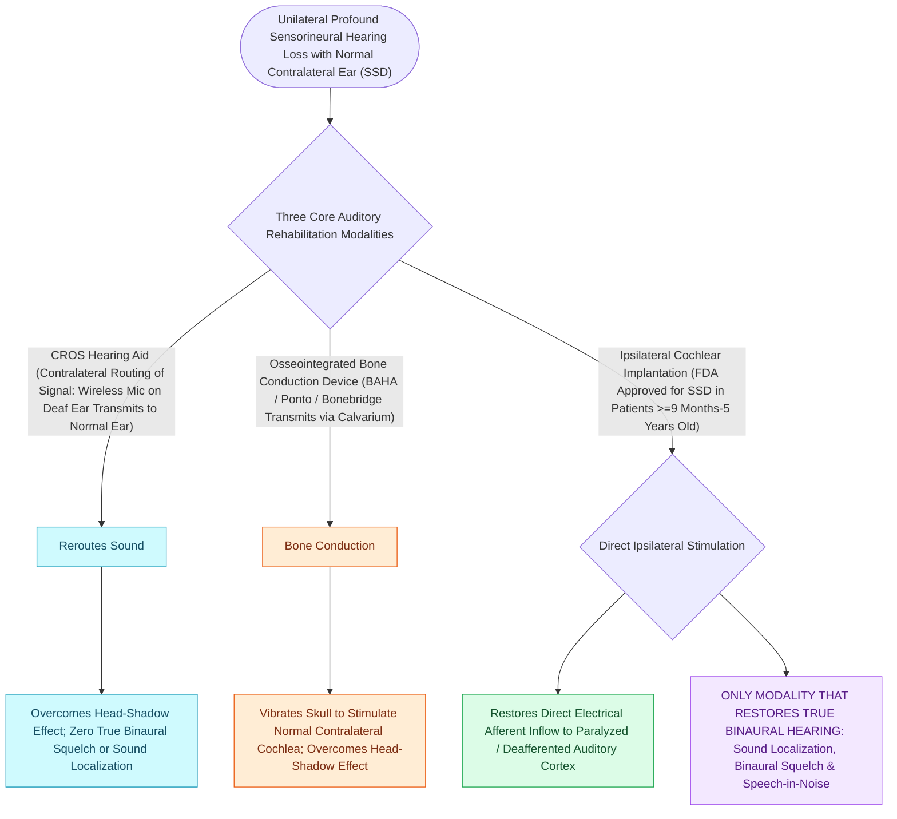

# Single-sided deafness is rehabilitated via CROS hearing aids, osseointegrated bone conduction implants, and cochlear implantation

## Active Recall

> [!question]- What are the three primary binaural auditory deficits experienced by patients with single-sided deafness (SSD)?
> *Answer / Clinical Rationale*: (1) **Head Shadow Effect**: High-frequency acoustic signals ($>1000\text{ Hz}$) originating on the deaf side are attenuated by $6-12\text{ dB}$ by the skull before reaching the contralateral ear, severely degrading speech intelligibility; (2) **Loss of Binaural Squelch / Speech-in-Noise Processing**: Inability of the central auditory system to compare interaural timing and intensity differences ($\Delta t$ and $\Delta I$) to filter out background ambient noise; (3) **Loss of Spatial Sound Localization**: Inability to identify the horizontal directional origin of acoustic stimuli.

> [!question]- How do CROS hearing aids, osseointegrated bone conduction implants (BAHA), and Cochlear Implants (CI) differ in their physiological mechanisms and ability to restore binaural hearing?
> *Answer / Clinical Rationale*: - **CROS / Bi-CROS & BAHA / Transcranial Systems**: Act as **sound re-routing devices**, transferring acoustic signals picked up on the deaf side across to the *contralateral normal hearing cochlea*. They successfully **eliminate the head shadow effect** and improve speech understanding from the deaf side, but **DO NOT restore true binaural hearing, binaural squelch, or horizontal sound localization** (because all sound is perceived by a single cochlea). - **Cochlear Implantation (CI)**: Directly stimulates the spiral ganglion neurons of the **deaf-sided cochlea**, re-establishing bilateral auditory input to the auditory cortex. It is the **ONLY modality that restores true binaural hearing, central binaural summation/squelch, and spatial sound localization**.

> [!question]- What is the prerequisite hearing status of the contralateral (normal) ear for a patient to be a candidate for a bone conduction implant (BAHA) in single-sided deafness?
> *Answer / Clinical Rationale*: The contralateral "good" ear must have **normal or near-normal bone conduction thresholds**, with a **pure-tone average (PTA) bone conduction threshold of $\le 20\text{ dB HL}$** across 500, 1000, 2000, and 3000 Hz. If the hearing ear has significant sensorineural loss, bone-conducted sound from the deaf side cannot be perceived clearly.

## Core Clinical & Mechanistic Principles

**Single-Sided Deafness (SSD)** (severe-to-profound unilateral sensorineural hearing loss with normal or near-normal contralateral hearing) presents unique acoustic and psychosocial handicaps:

### Acoustic Physics of Single-Sided Deafness
- **Interaural Time Difference (ITD)**: The human head produces a time disparity of $\approx 0.6\text{ ms}$ for low-frequency sounds ($<1500\text{ Hz}$) between ears.
- **Interaural Level Difference (ILD)**: The head attenuates high-frequency sounds ($>1500\text{ Hz}$) by up to $15-20\text{ dB}$ on the shadowed side.
- **Cochlear Implantation in SSD**:
  - Restores access to both ITD and ILD cues.
  - Significantly reduces severe unilateral [[Chronic subjective tinnitus is managed with cognitive behavioral and sound-based therapy rather than cure|tinnitus]] in up to $80-90\%$ of implanted SSD patients by restoring afferent auditory input.

## Connected Concepts & Graph Traversal
- **BAHA Implantation Mechanics**: [[Bone-anchored hearing implants BAHA stimulate the cochlea directly via bone conduction pathways|BAHA Bone Conduction Pathways]]
- **Cochlear Implant Candidacy**: [[Cochlear implant candidacy criteria include severe to profound bilateral sensorineural hearing loss|CI Candidacy Guidelines]]
- **Sudden SNHL Emergency**: [[Idiopathic sudden sensorineural hearing loss requires prompt systemic corticosteroids and intratympanic salvage injection|Sudden SNHL Management]]
- **Vestibular Schwannoma SSD**: [[Koos grading system classifies vestibular schwannomas from Stage I intracanalicular to Stage IV brainstem compression|Vestibular Schwannoma & SSD]]
- **Hearing Aid Verification**: [[Hearing aid selection is driven by audiometric configuration and verified with real-ear measurement|Hearing Aid Programming & REM]]
- **Subjective Tinnitus Management**: [[Chronic subjective tinnitus is managed with cognitive behavioral and sound-based therapy rather than cure|Tinnitus in SSD]]
