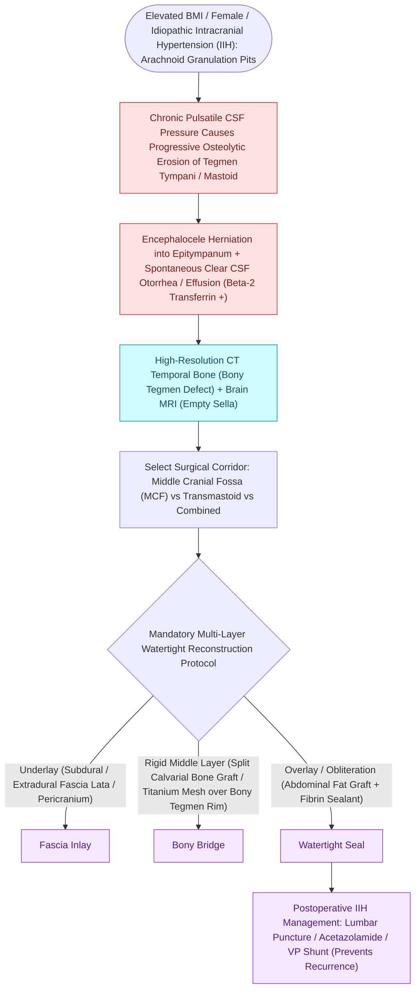

# Spontaneous CSF otorrhea from tegmen dehiscence requires multilayer middle fossa or transmastoid repair

## Active Recall

> [!question]- Which confirmatory protein assay establishes that middle ear fluid is CSF?
> *Answer / Clinical Rationale*: **Beta-2 transferrin** (CSF- and perilymph-specific).

> [!question]- Why is isolated patching often insufficient in spontaneous tegmen leaks?
> *Answer / Clinical Rationale*: Because the driver is frequently elevated intracranial pressure; without ICP management the next thin tegmen cell leaks.

## Core Clinical & Mechanistic Principles
- **Operative Invariants & Fault Lines**: The roof of the middle ear cleft (**tegmen tympani**) and mastoid (**tegmen mastoideum**) represents a thin bony boundary beneath the temporal lobe dura. Spontaneous dehiscence frequently clusters along embryologic suture lines and pneumatized skull base corridors.
- **Ventilation Dynamics & Recidivism**: Chronic negative pressure combined with elevated intracranial pressure creates pulsatile dural pitting and herniation into the epitympanum or mastoid antrum.
- Typical patient: middle-aged, obese, often with idiopathic intracranial hypertension physiology — the lateral skull base analog of spontaneous sinonasal leaks.
- Presents as unilateral serous 'effusion' that drains clear salty fluid after tube placement, conductive hearing loss, or recurrent meningitis; **beta-2 transferrin** confirms CSF.
- [[Tegmen erosion with dural exposure increases the risk of meningoencephalocele and CSF leak|Tegmen defects]] admit **meningoencephaloceles** into the mastoid/epitympanum; herniated tissue is non-functional and is reduced or amputated at repair.
- High-resolution CT localizes the bony defect; MRI (T2 coronal) distinguishes encephalocele from opacified air cells.

### Management & Critical Safety Checks
- Repair is multilayer (bone or cartilage plus fascia, inlay and onlay) via **middle cranial fossa** craniotomy for larger/multiple or medial defects, **transmastoid** for small lateral defects, or combined.
- Treat the pressure driver: weight management and acetazolamide or ICP evaluation reduce recurrence — patching the roof without addressing the rain invites a second leak.

## Connected Concepts & Graph Traversal
- **Adult OME Effusion Mimic**: [[Adult unilateral otitis media with effusion mandates nasopharyngoscopy to exclude nasopharyngeal carcinoma|Nasopharyngoscopy in Adult OME]]
- **Tegmen Erosion Pathology**: [[Tegmen erosion with dural exposure increases the risk of meningoencephalocele and CSF leak|Tegmen Dural Exposure]]
- **Post-Op CSF Fistula Protocol**: [[Cerebrospinal fluid CSF leak and pseudomeningocele require lumbar drainage, fat obliteration, and re-exploration|CSF Leak Lumbar Drainage]]
- **Translabyrinthine Dural Defect**: [[The translabyrinthine approach provides direct exposure of the internal auditory canal with complete hearing sacrifice|Translabyrinthine Approach]]
- **Pulsatile Tinnitus Sign**: [[Pulsatile tinnitus is differentiated into arterial and venous etiologies by auscultation, jugular compression, and targeted vascular imaging|Pulsatile Tinnitus in IIH]]
