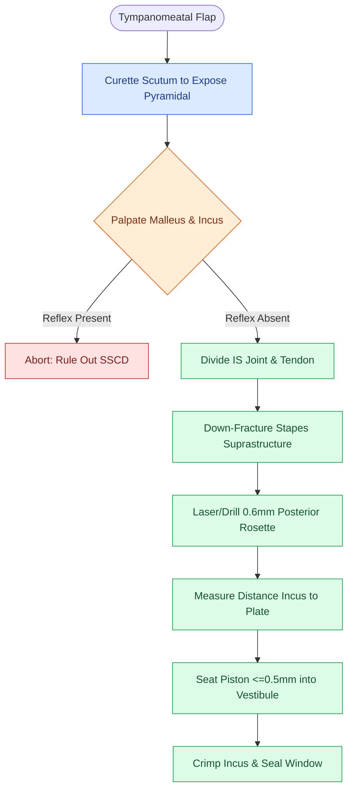

# Stapedotomy utilizes a micro-drill or laser fenestration of the posterior footplate

## Active Recall

> [!question]- What is the "Utricle Rule" regarding stapedotomy piston protrusion into the vestibule?
> *Answer / Clinical Rationale*: The piston must protrude **$\le 0.5\text{ mm}$ into the vestibule**, because the **utricle lies only $\approx 1.0\text{ mm}$ deep** to the posterior footplate in the elliptical recess; excessive depth causes persistent vertigo and vestibular trauma.

> [!question]- Why does otosclerosis selectively affect the anterior footplate, and how does this dictate the fenestra site?
> *Answer / Clinical Rationale*: Otosclerosis originates at the **fissula ante fenestram** immediately anterior to the oval window. Fenestration is placed in the **posterior half of the footplate**, where bone is normal and free of disease.

> [!question]- How does the presence of an acoustic stapedial reflex differentiate otosclerosis from third-window lesions?
> *Answer / Clinical Rationale*: A low-frequency air-bone gap with **present stapedial reflexes** indicates a **third-window lesion (e.g., SSCD)**; an air-bone gap with **absent stapedial reflexes** confirms true **stapes fixation (otosclerosis)**.

## Core Clinical & Mechanistic Principles
**Small-fenestra stapedotomy** is the quantitative standard of care for restoring sound conduction in [[Otosclerosis is characterized by abnormal bone remodeling of the otic capsule causing stapes fixation|otosclerosis]], replacing the fixed stapes footplate with a calibrated piston:

- **The Stapedotomy Quantitative Triad & Vestibular Geometry**:
  - *Stapes Footplate Dimensions*: Approximately **$3.0\text{ mm}$ long by $1.4\text{ mm}$ wide**, seated within the annular ligament of the oval window.
  - *Posterior Fenestra*: Fenestration ($0.5\text{–}0.8\text{ mm}$ diameter) is placed strictly in the **posterior half** of the footplate. Otosclerotic remodeling begins anteriorly at the **fissula ante fenestram** (the embryonic cartilaginous rest anterior to the oval window), leaving the posterior footplate thinner, less vascular, and mechanically free.
  - *Prosthesis Length & The Utricle Rule*: Distance from the lateral surface of the incus long process to the footplate is measured with a calibrated gauge (typically **$4.0\text{–}4.5\text{ mm}$**). The piston must protrude **$\le 0.5\text{ mm}$ into the vestibule**. The **utricle lies $\approx 1.0\text{ mm}$ deep to the posterior footplate** in the elliptical recess; an overlong piston ($>0.5\text{ mm}$ protrusion) causes chronic vestibular erosion, intractable positional vertigo, and sensorineural loss.

- **Step-by-Step Surgical Execution**:
  1. *[[Endaural and postauricular surgical approaches provide tailored exposure for middle ear pathology|Transcanal Approach]] & Scutum Curettage*: Elevate a tympanomeatal flap (6 to 12 o'clock); curette the posterosuperior scutum just enough to see the **pyramidal eminence, stapedius tendon, and tympanic CN VII** while protecting the chorda tympani.
  2. *Palpation & Third-Window Check*: Palpate the malleus to confirm chain mobility. *Clinical Rule*: A mobile malleus and incus in the presence of a low-frequency conductive air-bone gap mandates checking acoustic stapedial reflexes—present reflexes indicate a **third window (SSCD / wide cochlear aqueduct)**, whereas absent reflexes indicate stapes fixation.
  3. *Down-Fracture Timing*: Divide the incudostapedial joint and stapedius tendon before down-fracturing the arch toward the promontory. Attempting to fracture the arch before dividing the joint risks incus subluxation; fracturing before creating the fenestra in a mobile footplate causes a **[[Floating footplate complication during stapedectomy is managed with small inferior fenestration or vein graft|floating footplate]]**.
  4. *Laser / Micro-drill Fenestration & Piston Inset*: Create the $0.5\text{–}0.8\text{ mm}$ posterior rosette/fenestra with a $KTP/CO_2$ laser or $0.6\text{-mm}$ skeeter drill. Inset the $0.4\text{–}0.6\text{ mm}$ piston, crimp tightly around the incus, and seal with a soft tissue pledget or blood clot.

### Operative Catastrophes & Rescue Algorithms
- **Overhanging / Dehiscent Facial Nerve**: The tympanic segment of CN VII is dehiscent over the oval window in up to $50\%$ of ears. If the nerve completely shadows the footplate, abort the procedure and convert to bone-conduction [[Hearing aid selection is driven by audiometric configuration and verified with real-ear measurement|hearing aids]] to prevent facial paralysis.
- **Perilymph Gusher**: High-pressure CSF/perilymph flood from an abnormally patent cochlear aqueduct or internal auditory canal fundus defect. *Management*: Immediately elevate head of bed $30\text{–}45^\circ$, insert the piston and seal the oval window with large fascia grafts, avoid suctioning within the vestibule, and place a lumbar drain if drainage persists.
- **Floating Footplate**: The entire footplate mobilizes before fenestration. *Management*: Abort immediate manipulation; create a micro-fenestration at the inferior margin or place a total stapedectomy tissue seal to avoid plunging the footplate into the vestibule.

## Connected Concepts & Graph Traversal
- **Otosclerosis Biology**: [[Otosclerosis is characterized by abnormal bone remodeling of the otic capsule causing stapes fixation|Otosclerosis Otic Capsule Remodeling]]
- **Otic Capsule Foundation**: [[The otic capsule is an immutable endochondral bone that provides fixed surgical reference landmarks|Otic Capsule Invariant]]
- **Perilymph Gusher**: [[Gushing footplate indicates a congenital perilymph fistula from an abnormally patent cochlear aqueduct|Perilymph Gusher & Cochlear Aqueduct]]
- **Cochleariform Constant**: [[The cochleariform process serves as the constant middle ear landmark triangulating the geniculate ganglion, tympanic CN VII, and tensor tympani tendon|Cochleariform Process Triangulation]]
- **Laser Stapedotomy**: [[Laser stapedotomy reduces mechanical trauma and footplate mobilization compared to manual perforators|Laser vs Drill Stapedotomy]]
- **Floating Footplate**: [[Floating footplate complication during stapedectomy is managed with small inferior fenestration or vein graft|Floating Footplate Management]]
