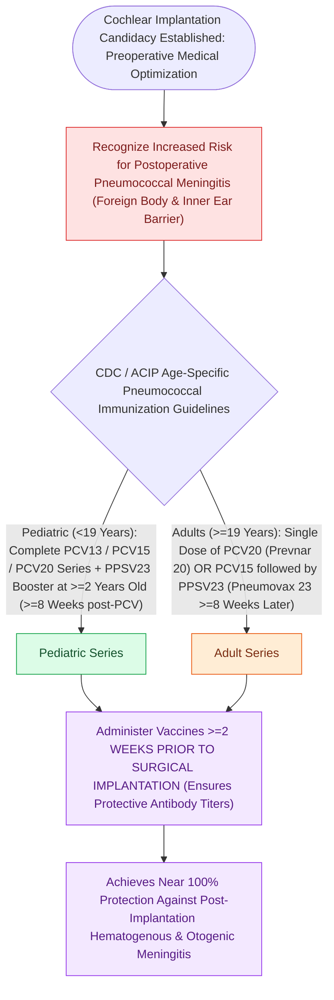

# Streptococcus pneumoniae vaccination is mandatory prior to cochlear implantation to prevent post-implantation bacterial meningitis

## Active Recall

> [!question]- Why are cochlear implant recipients at a significantly elevated risk (greater than thirty-fold) for bacterial meningitis compared to age-matched peers?
> *Answer / Clinical Rationale*: The insertion of an electrode array through the round window or cochleostomy creates a permanent potential direct conduit between the **middle ear cavity** and the **perilymphatic / cerebrospinal fluid spaces** (via the cochlear aqueduct, lamina cribrosa, or internal auditory canal fundus). Any subsequent episode of acute otitis media (most commonly caused by ***Streptococcus pneumoniae***) can rapidly track along the electrode track into the labyrinth and subarachnoid space, causing life-threatening pneumococcal meningitis.

> [!question]- What is the current CDC / ACIP pneumococcal vaccination schedule for pediatric and adult cochlear implant candidates?
> *Answer / Clinical Rationale*: (1) **Adults ($\ge 19\text{ years}$)**: Single dose of **PCV20 (Prevnar 20)** OR **PCV15 (Vaxneuvance) followed by PPSV23 (Pneumovax 23) $\ge 8\text{ weeks}$ later**. (2) **Children ($<19\text{ years}$)**: Complete age-appropriate PCV series (PCV15 or PCV20); if PCV15 is used, a dose of **PPSV23 is administered $\ge 8\text{ weeks}$ after the last PCV dose** (at age $\ge 2\text{ years}$).

> [!question]- What is the mandatory minimum time interval between completing the pneumococcal vaccination series and performing cochlear implant surgery?
> *Answer / Clinical Rationale*: The vaccination series must be completed **at least 2 weeks (14 days) prior to surgical implantation** to allow adequate protective anti-capsular antibody titers to develop. If surgery cannot be delayed (e.g., rapid progressive post-meningitic labyrinthitis ossificans), vaccination is administered immediately and the series completed postoperatively.

## Core Clinical & Mechanistic Principles

Post-cochlear implantation bacterial meningitis carries high mortality and morbidity. *Streptococcus pneumoniae* accounts for the vast majority of cases:

### Pathophysiological Mechanism & Historical Context
- **Electrode Conduit Pathophysiology**:
  - The electrode entry site (cochleostomy or [[Round window and extended round window insertions minimize intracochlear acoustic trauma|round window membrane]] seal) undergoes fibrous tissue encapsulation.
  - Middle ear bacteria from [[Uncomplicated acute otitis media in pediatric and adult patients is treated with first-line high-dose amoxicillin|acute otitis media]] or upper respiratory infections track along the smooth silicone sheath directly into the **scala tympani perilymph**, communicating via the **cochlear aqueduct** with the subarachnoid space.
- **Historical Positioner-Associated Risk**:
  - In 2002, a high incidence of meningitis was traced to cochlear implants manufactured with an adjunct **wedge positioner** (which created a larger cochleostomy defect and delayed fibrous sealing); positioners were permanently withdrawn from the market.

### Critical Safety Guidelines for Otitis Media in CI Patients
- **Post-Implantation AOM Protocol**:
  - Any acute otitis media in a patient with a cochlear implant must be treated aggressively with **prompt high-dose systemic oral antibiotics (amoxicillin-clavulanate $90\text{ mg/kg/day}$)** and immediate otologic evaluation.
  - If middle ear effusion fails to clear promptly or signs of labyrinthitis/meningismus emerge, urgent **myringotomy and tympanostomy tube placement** is indicated to decompress the middle ear cleft.

## Connected Concepts & Graph Traversal
- **CI Candidacy Criteria**: [[Cochlear implant candidacy criteria include severe to profound bilateral sensorineural hearing loss|CI Candidacy Guidelines]]
- **Round Window Insertion**: [[Round window and extended round window insertions minimize intracochlear acoustic trauma|Round Window Insertion Mechanics]]
- **AOM Management**: [[Uncomplicated acute otitis media in pediatric and adult patients is treated with first-line high-dose amoxicillin|AOM First-Line Medical Therapy]]
- **Labyrinthitis Ossificans**: [[Labyrinthitis presents with acute prolonged vertigo combined with sudden sensorineural hearing loss|Labyrinthitis & Cochlear Ossification Risk]]
- **Otogenic Meningitis**: [[Otogenic intracranial complications escalate from meningitis to sigmoid sinus thrombosis and brain abscess|Otogenic Meningitis Spread]]
- **🔗 Pediatric Newborn Hearing (Pediatrics)**: [[Connexin 26 mutations in GJB2 and congenital CMV infection are leading causes of non-syndromic pediatric sensorineural hearing loss|Newborn Hearing Screening & JCIH 1-3-6]]
- **Revision Implantation Prerequisite**: [[Cochlear implant failure is categorized into hard failure and soft failure requiring systematic integrity testing before revision explantation and reimplantation|Hard vs Soft CI Failure]]
