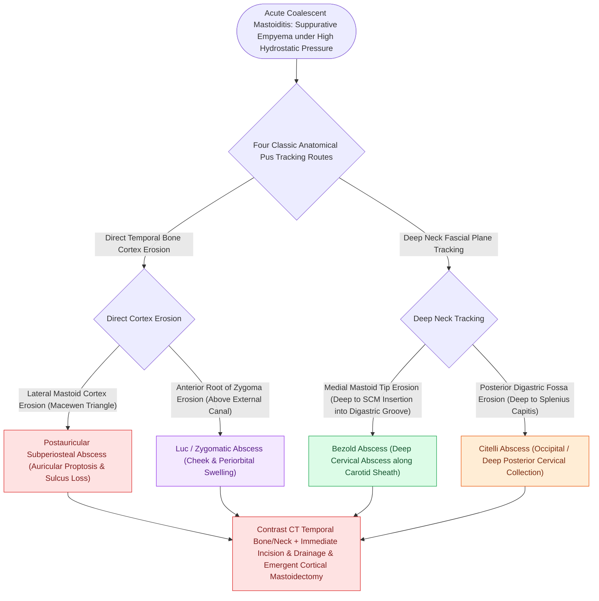

# Subperiosteal mastoid abscesses are categorized into postauricular, Bezold, Citelli, and zygomatic abscesses based on anatomical planes of pus tracking

## Active Recall

> [!question]- What anatomical pathway and muscular planes define a Bezold's abscess, and what life-threatening deep fascial extension can occur?
> *Answer / Clinical Rationale*: A **Bezold's abscess** occurs when coalescent mastoid suppuration erodes through the **thin medial cortex of the mastoid tip at the digastric groove (incisura digastrica)**. Pus escapes deep into the **sternocleidomastoid (SCM) muscle sheath** and deep cervical fascia, tracking into the **parapharyngeal space** and down the carotid sheath into the **superior and posterior mediastinum** (acute purulent descending mediastinitis).

> [!question]- What are the distinct cortical erosion sites and clinical presentations of a Postauricular (Luc's) abscess, a Citelli's abscess, and a Zygomatic root abscess?
> *Answer / Clinical Rationale*: - **Postauricular Abscess (Luc's / Classical Subperiosteal Abscess)**: Pus erodes through the **lateral mastoid cortex** (frequently at the cribriform area of Macewen's triangle), creating a fluctuant postauricular collection that **displaces the pinna anteriorly and inferiorly**. - **Citelli's Abscess**: Pus erodes through the **posterior mastoid tip cortex** or petrosquamous suture into the **posterior belly of the digastric muscle** and occipital space. - **Zygomatic Root Abscess**: Infection tracks anteriorly through extensively pneumatized zygomatic air cells, presenting as **swelling, erythema, and fluctuance anterior and superior to the pinna**, over the zygomatic arch and temporal fossa with prominent periorbital edema.

> [!question]- What is the mandatory surgical management for any subperiosteal mastoid abscess?
> *Answer / Clinical Rationale*: **Complete cortical mastoidectomy** (unroofing the mastoid cortex, opening the antrum, establishing middle ear drainage via myringotomy $\pm$ tube, and thoroughly exenterating disease down to the mastoid tip) combined with **dependent incision and drainage (I&D)** of the subperiosteal/cervical abscess collection and intravenous broad-spectrum antipseudomonal/antistaphylococcal antibiotics.

## Core Clinical & Mechanistic Principles

In **acute coalescent mastoiditis**, progressive resorption of bony mastoid trabeculae (trabecular [[Acute coalescent mastoiditis causes trabecular osteoclasis and subperiosteal abscess formation|osteoclasis]] driven by pressure and matrix metalloproteinases) creates an empyema that eventually breaks through the cortical plates along distinct anatomical pathways:

### Surgical Technique & Craft Nuances
- **Bezold's Abscess Surgical Protocol**:
  1. **Postauricular Incision Extension**: Extend postauricular incision into the upper neck along the anterior border of the SCM muscle.
  2. **Complete Mastoid Tip Amputation**: Drill away both the lateral and medial cortical plates of the mastoid tip to unroof the digastric ridge and drain the incisura digastrica.
  3. **Counter-Incision in Neck**: Place a separate dependent counter-incision over the lower SCM collection and insert a Penrose or corrugated rubber drain to prevent re-accumulation.
  4. **Facial Nerve Protection**: The vertical mastoid segment of $CN\ VII$ lies immediately medial and anterior to the digastric ridge at the stylomastoid foramen; avoid medial plunge drilling during tip exenteration.

## Connected Concepts & Graph Traversal
- **Mastoiditis Pathophysiology**: [[Acute coalescent mastoiditis causes trabecular osteoclasis and subperiosteal abscess formation|Coalescent Mastoiditis Mechanics]]
- **Cortical Mastoidectomy**: [[Complete cortical mastoidectomy unroofs the mastoid antrum and establishes dependent middle ear drainage|Cortical Mastoidectomy Surgical Steps]]
- **🔗 Deep Neck Space Spread (Head and Neck)**: [[Deep neck space infections spread along cervical fascial planes between the pharynx, mediastinum, and skull base|Cervical Fascial Planes]]
- **Sigmoid Sinus Thrombosis**: [[Lateral sinus thrombophlebitis presents with picket fence fevers and Griesinger sign requiring intravenous antibiotics and mastoidectomy|Sigmoid Sinus Thrombosis]]
- **AOM First-Line Therapy**: [[Uncomplicated acute otitis media in pediatric and adult patients is treated with first-line high-dose amoxicillin|AOM First-Line Medical Management]]
- **Facial Nerve Landmark**: [[The Macewen triangle and Henle spine indicate the surface projection of the mastoid antrum|Macewen Triangle Landmarks]]
