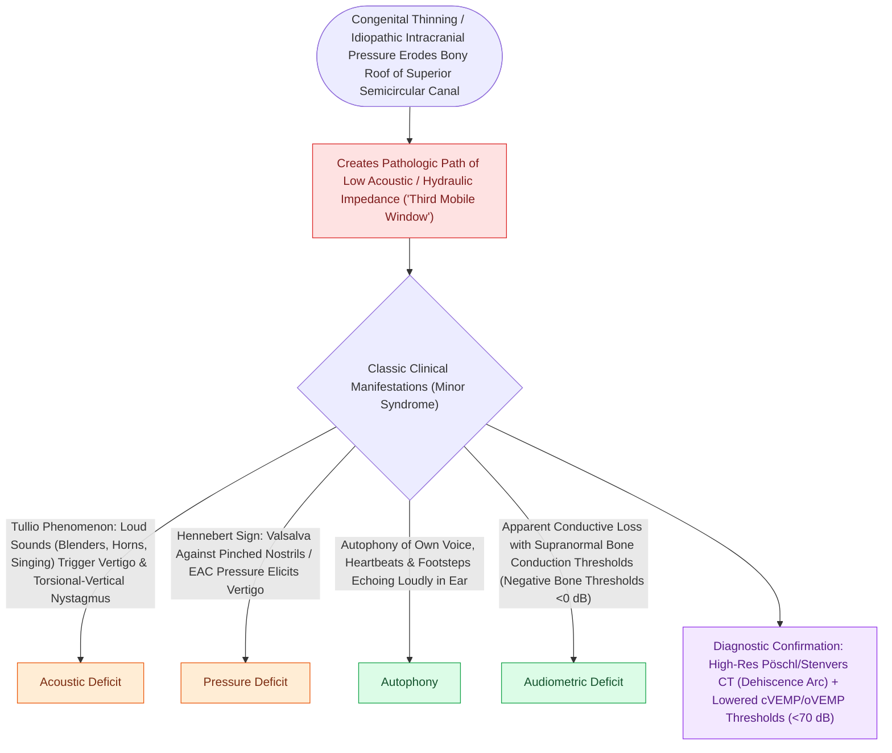

# Superior semicircular canal dehiscence SCDS presents with Tullio phenomenon and sound-induced vertigo

## Active Recall

> [!question]- What is the Tullio phenomenon in Superior Semicircular Canal Dehiscence?
> *Answer / Clinical Rationale*: **Vertigo, oscillopsia, or nystagmus induced by loud acoustic sounds**.

> [!question]- What unique bone-conduction finding is characteristic of SCDS on pure-tone audiometry?
> *Answer / Clinical Rationale*: **Supranormal bone conduction thresholds** (e.g., $-5\text{ to }-10\text{ dB HL}$) with an apparent low-frequency air-bone gap.

## Core Clinical & Mechanistic Principles
**Superior Semicircular Canal Dehiscence (SCDS / Minor's Syndrome)** (described by Lloyd Minor in 1998) is caused by a bony defect in the floor of the middle cranial fossa overlying the superior semicircular canal (SSCC):
- **Pathognomonic Clinical Symptoms**:
  1. **Tullio Phenomenon**: Vertigo, [[Bilateral vestibulopathy causes oscillopsia and dark-dependent imbalance from bilateral hair cell loss|oscillopsia]], or nystagmus triggered by **loud sounds** (e.g., telephone ring, church bells, applause, shouting).
  2. **Hennebert Sign**: Vertigo and nystagmus induced by **external canal pressure changes** (pneumatic otoscopy, tragal compression, Valsalva against pinched nostrils).
  3. **Autophony**: Abnormally loud hearing of one's own voice ("barrel voice") and internal body sounds (audible eye movements, heartbeat, footfalls, joint crepitus).
  4. **Conductive Hyperacusis**: Ability to hear a $512\text{-Hz}$ tuning fork placed on the medial malleolus of the ankle in the affected ear!
- **Audiometric Hallmarks**:
  - **Pseudo-conductive hearing loss**: Low-frequency air-bone gap ($10\text{–}30\text{ dB}$) with **supranormal bone conduction thresholds ($-5\text{ to }-10\text{ dB HL}$)**.

### Surgical Technique & Critical Safety Checks
- **Nystagmus Vector**: Sound or positive pressure causes ampullopetal endolymph flow, producing **vertical-torsional nystagmus** (slow phase moves down and ipsilaterally; fast phase beats up and contralaterally).

## Connected Concepts & Graph Traversal
- **High-Resolution CT Poschl Views**: [[High-resolution temporal bone CT with Poschl and Stenvers reformatting confirms superior canal dehiscence|Poschl & Stenvers CT Views]]
- **Surgical MCF & Transmastoid Repair**: [[Middle cranial fossa and transmastoid canal plugging or resurfacing repair superior canal dehiscence|MCF vs Transmastoid Repair]]
- **cVEMP Hypersensitivity**: [[cVEMP evaluates the saccule and inferior vestibular nerve via uncrossed sternocleidomastoid inhibition|cVEMP Saccular Thresholds]]
- **Pulsatile Tinnitus Symptom**: [[Pulsatile tinnitus is differentiated into arterial and venous etiologies by auscultation, jugular compression, and targeted vascular imaging|Third-Window Pulsatile Tinnitus]]
- **Otic Capsule Anatomy**: [[The otic capsule is an immutable endochondral bone that provides fixed surgical reference landmarks|Otic Capsule Constants]]
