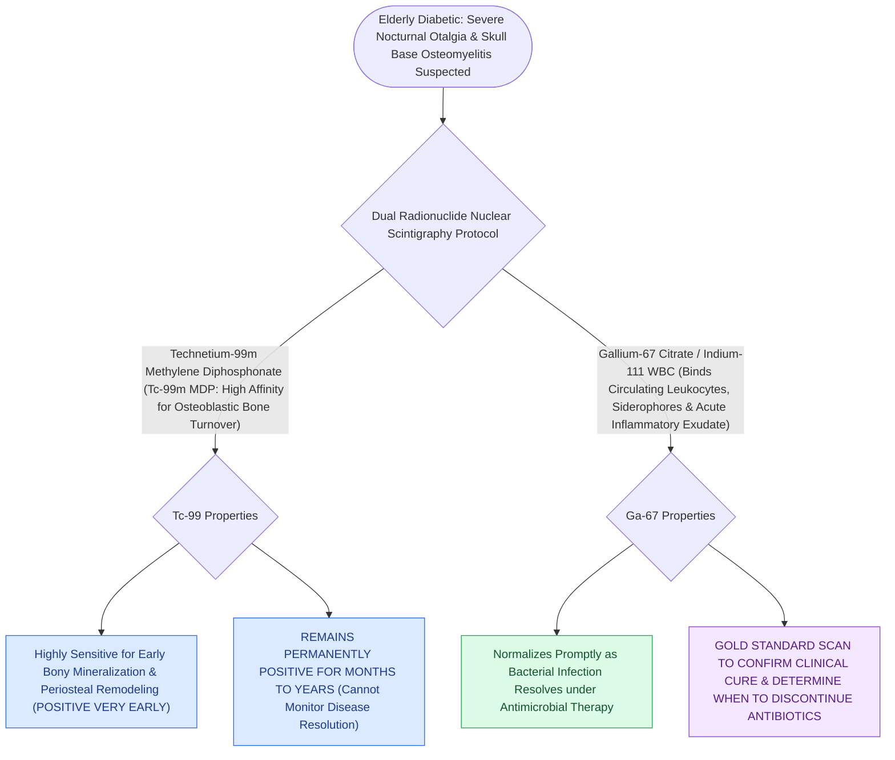

# Technetium-99 and Gallium-67 scans differentiate osteoblastic bone involvement from active soft tissue infection in necrotizing otitis externa

## Active Recall

> [!question]- Why is a Technetium-99m bone scan useless for determining when to discontinue antibiotic therapy in necrotizing otitis externa?
> *Answer / Clinical Rationale*: Technetium-99m binds to hydroxyapatite and reflects osteoblastic activity. Because compensatory bony remodeling and osseous repair continue for 6 to 12 months (or longer) after all pathogenic microorganisms have been eradicated, the scan remains persistently "hot" even in fully cured patients, falsely suggesting ongoing infection.

> [!question]- What physiological mechanism allows Gallium-67 citrate to confirm active infection eradication?
> *Answer / Clinical Rationale*: Gallium-67 binds to lactoferrin, active neutrophils, and bacterial siderophores. When the bacterial burden is eliminated and acute inflammation subsides, leukocyte degranulation ceases, resulting in rapid clearance of tracer uptake and normalization of the scan to baseline.

## Core Clinical & Mechanistic Principles
[[Malignant necrotizing otitis externa is an invasive pseudomonal skull base osteomyelitis in elderly diabetic patients|Malignant necrotizing otitis externa (NOE)]] represents an invasive *Pseudomonas aeruginosa* or fungal osteomyelitis of the temporal bone and central skull base. Diagnostic workup and therapeutic monitoring require dual nuclear imaging modalities with distinct cellular affinities:

1. **Technetium-99m ($^{99\text{m}}\text{Tc}$) Bone Scintigraphy**:
   - $^{99\text{m}}\text{Tc}$-methylene diphosphonate binds to hydroxyapatite crystals in areas of active osteoblastic bone remodeling. It is exquisitely sensitive ($>95\%$) for detecting early bony cortex involvement before demineralization is visible on high-resolution CT. However, because bone remodeling and osteoblastic repair persist for months to years following clinical cure, $^{99\text{m}}\text{Tc}$ remains positive indefinitely and **cannot be used to assess treatment response or therapeutic resolution**.
2. **Gallium-67 ($^{67}\text{Ga}$) Citrate Scintigraphy / $^{111}\text{In}$-WBC Scans**:
   - $^{67}\text{Ga}$ binds to circulating transferrin, lactoferrin in actively degranulating neutrophils, and siderophores produced by proliferating bacteria and fungi. Because it localizes specifically to active leukocyte infiltration and acute inflammation, $^{67}\text{Ga}$ uptake normalizes rapidly as the active infection resolves under targeted intravenous antibiotic therapy. It serves as the **definitive nuclear imaging modality for confirming microbiological cure and guiding antibiotic cessation**.

### Diagnostic Workup & Clinical Protocol
- **Initial Staging**:
  - High-resolution CT (HRCT) of the temporal bones details cortical bone erosion at the stylomastoid foramen and petrous apex.
  - Contrast-enhanced MRI of the skull base defines soft-tissue infiltration, dural enhancement, and [[Koos grading system classifies vestibular schwannomas from Stage I intracanalicular to Stage IV brainstem compression|cranial neuropathy]] (specifically CN VII, IX, X, XI, and XII).
  - $^{99\text{m}}\text{Tc}$ confirms temporal bone osteoblastic involvement.
## References
1. Carfrae, M.J., Kesser, B.W. (2008). Malignant otitis externa. *Otolaryngol Clin North Am*, 41(3):537-549.
2. Naples, J.G., Brant, J.A., Ruckenstein, M.J. (2020). Infections of the External Ear. In Flint, P.W., et al. (Eds.), *Cummings Otolaryngology Head and Neck Surgery* 7e (pp. 2093-2100). Philadelphia, PA: Elsevier.
3. Grandis, J.R., Curtin, H.D., Yu, V.L. (1995). Necrotizing (malignant) external otitis: Prospective study of 16 patients with clinical and radiologic correlation. *Radiology*, 196(2):499-504.

## Connected Concepts & Graph Traversal
- **Physiological Basis**: [[Malignant necrotizing otitis externa is an invasive pseudomonal skull base osteomyelitis in elderly diabetic patients|Necrotizing Otitis Externa]]
- **Anatomical Extension**: [[The facial nerve traverses six distinct anatomical segments from the pons to the parotid gland|Facial Nerve Fallopian Canal]]
- **🔗 Neuropathy Grading (FPRS)**: [[The House-Brackmann facial nerve grading system standardizes facial paralysis severity|House-Brackmann Facial Paralysis]]
- **Uncomplicated Precursor**: [[Acute otitis externa is managed with topical antimicrobial-steroid drops and aural debridement|Acute Otitis Externa]]
- **🔗 Deep Space Spread (Head and Neck)**: [[The parapharyngeal space is an inverted pyramid connecting peritonsillar, masticator, parotid, and retropharyngeal spaces|Parapharyngeal Space]]
