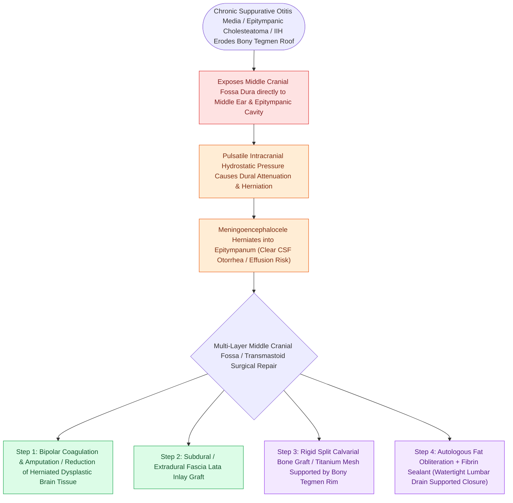

# Tegmen erosion with dural exposure increases the risk of meningoencephalocele and CSF leak

## Active Recall

> [!question]- What are the primary complications of an untreated bony tegmen erosion?
> *Answer / Clinical Rationale*: **Meningoencephalocele**, **cerebrospinal fluid (CSF) leak**, **meningitis**, and **temporal lobe brain abscess**.

> [!question]- How is a large ($>1\text{ cm}$) tegmen defect with brain herniation repaired?
> *Answer / Clinical Rationale*: Via a **combined transmastoid and middle cranial fossa approach** using a multilayer repair (bipolar amputation of herniated tissue, rigid bone/cartilage graft, and vascularized fascia/muscle flap).

## Core Clinical & Mechanistic Principles
Chronic expansive [[Primary acquired cholesteatoma arises from retraction pocket invagination of the pars flaccida into Prussak space|cholesteatoma]] or aggressive mastoid drilling can erode the **tegmen tympani or tegmen mastoidi**, exposing middle cranial fossa dura:
- **Complications of Tegmen Defects**:
  1. **Meningoencephalocele**: Herniation of meninges and non-functional temporal lobe brain parenchyma through the bony defect into the mastoid or epitympanum.
  2. **Cerebrospinal Fluid (CSF) Otorrhea / Otorhinorrhea**.
  3. **Intracranial Complications**: Meningitis, temporal lobe brain abscess, and subdural empyema.
- **Surgical Repair Principles (Multilayer Closure)**:
  - **Small Defects ($<5\text{ mm}$)**: Repaired transmastoidally using an **underlay/overlay sandwich of cartilage and temporalis fascia**.
  - **Large Defects ($>1.0\text{ cm}$) or Massive Encephaloceles**:
    - **Combined Transmastoid / Middle Cranial Fossa (MCF) Approach**:
      1. Bipolar cauterize and amputate herniated, non-functional encephalocelic brain tissue.
      2. Elevate middle fossa dura off the petrous ridge via MCF craniotomy.
      3. Place a rigid bone graft (split calvarial bone or cortical mastoid bone) or titanium mesh over the bony defect extradurally.
      4. Support from below with fascia, cartilage, and regional temporalis muscle flap.

### Surgical Technique & Critical Safety Checks
- **Biomaterials**: Bioactive bone cements (Norian, HydroSet) provide excellent rigid extradural reconstruction.

## Connected Concepts & Graph Traversal
- **Spontaneous CSF Otorrhea Repair**: [[Spontaneous CSF otorrhea from tegmen dehiscence requires multilayer middle fossa or transmastoid repair|Multilayer Tegmen Repair]]
- **Postoperative CSF Fistula Salvage**: [[Cerebrospinal fluid CSF leak and pseudomeningocele require lumbar drainage, fat obliteration, and re-exploration|CSF Leak Lumbar Drainage]]
- **Primary Cholesteatoma Erosion**: [[Primary acquired cholesteatoma arises from retraction pocket invagination of the pars flaccida into Prussak space|Cholesteatoma Bone Erosion]]
- **Cortical Mastoid Skeletonization**: [[Complete cortical mastoidectomy unroofs the mastoid antrum and establishes dependent middle ear drainage|Tegmen Mastoideum Landmarks]]
- **Adult OME Mimic**: [[Adult unilateral otitis media with effusion mandates nasopharyngoscopy to exclude nasopharyngeal carcinoma|Adult Unilateral Effusion]]
