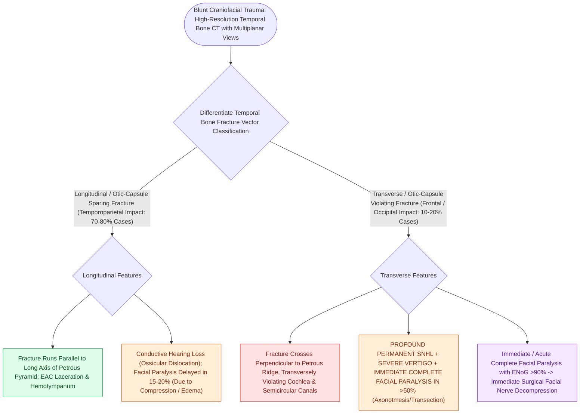

# Temporal bone longitudinal and transverse fractures cause delayed or immediate facial paralysis

## Active Recall

> [!question]- What is the clinical significance of immediate vs. delayed facial paralysis following a temporal bone fracture?
> *Answer / Clinical Rationale*: **Immediate paralysis** suggests **nerve transection or bony impalement** (requiring surgical exploration); **delayed paralysis** suggests **edema or hematoma** (treated medically with steroids).

> [!question]- What percentage of transverse (otic capsule-violating) temporal bone fractures involve facial nerve injury?
> *Answer / Clinical Rationale*: Approximately **$30\text{ to }50\%$**.

## Core Clinical & Mechanistic Principles
Temporal bone fractures are clinically categorized by their relationship to the **[[The otic capsule is an immutable endochondral bone that provides fixed surgical reference landmarks|otic capsule]]** (the primary invariant of the temporal bone) and their orientation relative to the petrous ridge:

- **The Modern Paradigm: Otic Capsule Sparing (OCS) vs Otic Capsule Violating (OCV)**:
  1. **Otic Capsule Sparing (OCS / Traditional "Longitudinal" Pattern, $\approx 80\%$)**:
     - *Path of Least Resistance*: Force travels from a lateral temporoparietal impact through pneumatized air cell tracts, along the squama, EAC roof, and middle ear roof, strictly **sparing the dense endochondral otic capsule**.
     - *Neural Casualty*: The **geniculate ganglion and tympanic segment** are the first neural structures compromised. Facial palsy occurs in **$10\text{–}20\%$** and is characteristically **delayed and incomplete in onset** (secondary to progressive neural edema and expanding perineural hematoma in the Fallopian canal).
     - *Auditory & Dural Findings*: Conductive hearing loss (tympanic membrane laceration, hemotympanum, incudomalleal / incudostapedial joint disruption); [[Cerebrospinal fluid CSF leak and pseudomeningocele require lumbar drainage, fat obliteration, and re-exploration|CSF otorrhea]] via torn EAC skin/TM.
     - *Management*: Conservative observation and high-dose oral/IV corticosteroids; excellent prognosis ($>95\%$ full spontaneous recovery) because the nerve sheath remains intact.
  2. **Otic Capsule Violating (OCV / Traditional "Transverse" Pattern, $\approx 20\%$)**:
     - *Fracture Vector*: Severe frontal, occipital, or crushing trauma that shatters directly through the dense petrous bone, internal auditory canal, and labyrinthine capsule.
     - *Neural Casualty*: Facial paralysis occurs in **$30\text{–}50\%$**, is characteristically **immediate and complete at the scene** (due to direct bony spike transection, avulsion, or intraneural maceration in the labyrinthine or IAC segment).
     - *Auditory & Dural Findings*: Immediate permanent profound sensorineural hearing loss ("dead ear"), violent acute vestibular nystagmus/vertigo, hemotympanum behind an intact drum, and **CSF rhinorrhea** (CSF leaks through the fractured labyrinth/IAC into the middle ear and drains down the Eustachian tube).
     - *Management*: Emergent high-resolution CT ($0.5\text{-mm}$ cuts) and urgent electrodiagnostic testing (ENoG / EMG). Immediate complete paralysis with radiological disruption warrants **surgical exploration and nerve decompression / interposition grafting** (via middle fossa / transmastoid if hearing is preserved, or translabyrinthine if the ear is dead).

### Key Consultation Supplies
- Coaxial surgical headlight, loupes, or binocular operating microscope
- Metallic ear speculums (sizes 3, 4, 5 mm)
- Frazier suction tips (sizes 3 Fr, 5 Fr)
- 512 Hz aluminum tuning fork
- Sterile suction trap (for Beta-2 transferrin CSF collection)
- Eye protection supplies: Preservative-free tears, lacri-lube ointment, moisture chamber, paper tape
- High-resolution temporal bone CT without contrast ($0.5\text{ mm}$ cuts) order
- High-dose systemic corticosteroid prescription (if delayed facial paralysis or hearing loss)

## References
1. Wilkerson, B.J., et al. (2020). Management of Temporal Bone Trauma. In Flint, P.W., et al. (Eds.), *Cummings Otolaryngology Head and Neck Surgery* 7e (pp. 2207-2219). Philadelphia, PA: Elsevier.
2. Diaz, R.C., et al. (2013). Middle Ear and Temporal Bone Trauma. In Johnson, J.J., Rosen, C.A. (Eds.), *Bailey’s Head and Neck Surgery-Otolaryngology* 5e (pp. 2410-2432). Baltimore, MD: Lippincott Williams & Wilkins.
3. Fusetti, S., et al. Treatment of Temporal Bone (Lateral Skull Base). *AO Foundation Surgery Reference*.

## Connected Concepts & Graph Traversal
- **Facial Fallopian Segments**: [[The facial nerve traverses six distinct anatomical segments from the pons to the parotid gland|Fallopian Canal Anatomy]]
- **Electrodiagnostic ENoG Testing**: [[Electroneuronography showing greater than ninety percent degeneration within fourteen days indicates severe facial nerve axonal injury|ENoG Degeneration Criteria]]
- **Direct Epineurial Repair**: [[Immediate direct epineurial end-to-end repair is the gold standard for transected facial nerve injury|Immediate Epineurial Repair]]
- **Traumatic TM Perforation**: [[Traumatic tympanic membrane perforations heal spontaneously in the majority of cases without early surgery|Traumatic TM Perforations]]
- **🔗 Corneal Lagophthalmos Protection (FPRS)**: [[Upper eyelid platinum weights and lateral tarsal strips protect the cornea in flaccid facial paralysis|Upper Eyelid Weight Insertion]]
