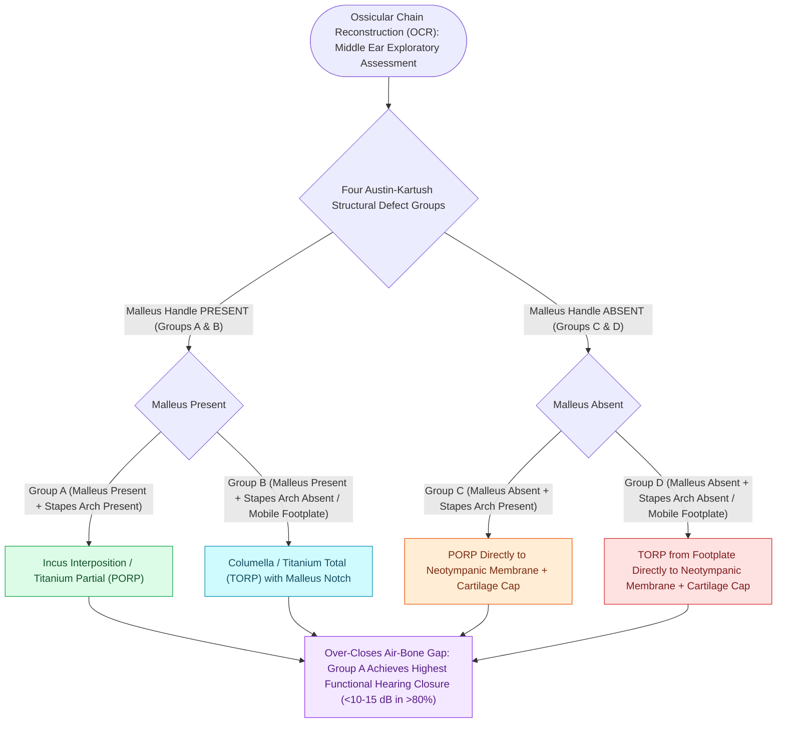

# The Austin-Kartush classification categorizes ossicular chain defects based on the presence of the malleus handle and stapes arch

## Active Recall

> [!question]- What are the four classical Austin groups (Groups A, B, C, and D) based on the presence or absence of the malleus handle and stapes superstructure?
> *Answer / Clinical Rationale*: (1) **Group A ($M+ S+$)**: Malleus handle *present*, Stapes arch *present* (isolated incus long process necrosis); best prognostic group, reconstructed with incus interposition or partial ossicular replacement prosthesis (PORP). (2) **Group B ($M+ S-$)**: Malleus handle *present*, Stapes arch *absent* (mobile footplate intact); reconstructed with total ossicular replacement prosthesis (TORP) to malleus. (3) **Group C ($M- S+$)**: Malleus handle *absent*, Stapes arch *present*; reconstructed with PORP to tympanic membrane. (4) **Group D ($M- S-$)**: Malleus handle *absent*, Stapes arch *absent*; worst prognostic group, reconstructed with TORP to tympanic membrane.

> [!question]- What are the two Kartush modifications (Group 0 and Group E) added to the original Austin classification?
> *Answer / Clinical Rationale*: (1) **Group 0**: Intact ossicular chain with **ossicular fixation** (e.g., otosclerosis or malleus head ankylosis) rather than discontinuity. (2) **Group E**: **Total footplate fixation / obliteration** or absent mobile footplate (tympanosclerosis / fibrous obliteration), requiring drillout or stapedotomy rather than simple TORP placement.

> [!question]- Why does the presence of the malleus handle ($M+$) significantly improve postoperative hearing outcomes in ossiculoplasty?
> *Answer / Clinical Rationale*: The **malleus handle stabilizes the prosthesis head** against lateral displacement, maintains **catenary membrane tension** on the tympanic membrane graft, and preserves the **ossicular lever ratio ($1.3:1$)**, resulting in an average $5-10\text{ dB}$ better closure of the postoperative air-bone gap compared to malleus-absent ($M-$) reconstructions.

## Core Clinical & Mechanistic Principles

The **Austin-Kartush classification** is the universally accepted surgical taxonomy for middle ear ossicular discontinuity, directing prosthesis selection and predicting hearing outcomes:

### Surgical Technique & Craft Nuances
- **Cartilage Interposition Standard**: A slice of **tragal or conchal cartilage ($0.5\text{ mm}$ thickness)** is placed between the titanium/hydroxyapatite prosthesis head and the tympanic membrane graft to prevent extrusion and lateral extrusion necrosis.
- **Prosthesis Sizing Rule**:
  - **PORP**: Typically $1.75\text{ to }2.5\text{ mm}$ from stapes capitulum to undersurface of malleus/cartilage.
  - **TORP**: Typically $3.5\text{ to }4.5\text{ mm}$ from footplate to undersurface of malleus/cartilage.
  - Sizing must provide gentle tension without bowing the graft laterally (which creates blunting and residual CHL) or compressing the footplate (which causes sensorineural [[Noise-induced hearing loss produces a four-kilohertz notch and is governed by damage-risk exchange rates|acoustic trauma]]).

## Connected Concepts & Graph Traversal
- **PORP Reconstruction**: [[Partial ossicular replacement prosthesis PORP requires an intact and mobile stapes superstructure|PORP Surgical Technique]]
- **TORP Reconstruction**: [[Total ossicular replacement prosthesis TORP bridges the malleus or tympanic membrane to the stapes footplate|TORP Surgical Technique]]
- **Cartilage Cap Interposition**: [[Cartilage interposition over ossicular prostheses prevents extrusion through the tympanic membrane|Cartilage Interposition Standard]]
- **Middle Ear Transformer Mechanics**: [[The middle ear transformer ratio provides twenty-seven decibels of acoustic impedance matching|Middle Ear Transformer Ratio]]
- **Tympanometric Discontinuity**: [[Tympanometry classifies middle ear compliance and pressure into Jerger Types A, As, Ad, B, and C|Type Ad Hypermobile Tympanogram]]
- **Stapes Fixation Differentiation**: [[Otosclerosis is characterized by abnormal bone remodeling of the otic capsule causing stapes fixation|Otosclerosis vs Discontinuity]]
