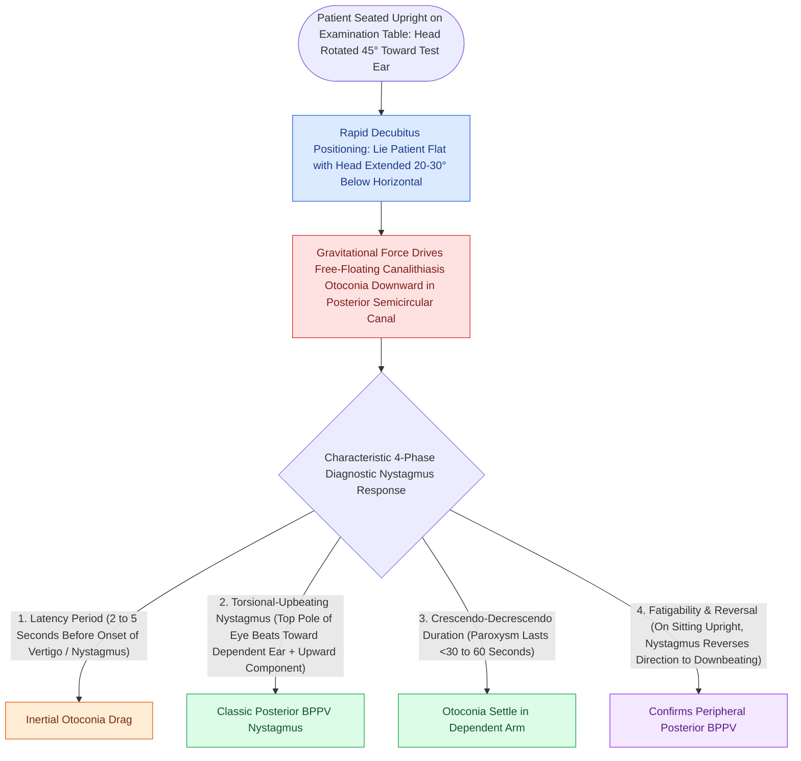

# The Dix-Hallpike maneuver produces torsional upbeating nystagmus in posterior canal BPPV

## Active Recall

> [!question]- What are the direction and characteristics of nystagmus in a positive right posterior canal Dix-Hallpike test?
> *Answer / Clinical Rationale*: A **mixed torsional upbeating nystagmus** (top pole of eyes beating toward the right ear and upward toward the forehead), with a 2–10 sec latency and $<60\text{ sec}$ duration.

> [!question]- What happens to the direction of nystagmus when the patient returns to the upright seated position after a positive Dix-Hallpike test?
> *Answer / Clinical Rationale*: The nystagmus **reverses direction** (becoming torsional downbeating).

## Core Clinical & Mechanistic Principles
The **Dix-Hallpike maneuver** is the diagnostic gold standard for posterior semicircular canal [[Benign paroxysmal positional vertigo BPPV results from canalithiasis or cupulolithiasis in semicircular canals|BPPV]]:
- **Execution Protocol**:
  1. Patient sits upright on the exam table with head turned **$45^\circ$ toward the test ear**.
  2. Rapidly lay patient back into the supine position with the **head extended $20\text{–}30^\circ$ below the horizontal plane of the table** (maintaining $45^\circ$ turn).
  3. Observe eyes under Frenzel goggles / infrared VNG for at least 30–60 seconds.
- **Pathognomonic Nystagmus Profile (Posterior Canal Canalithiasis)**:
  - **Latency**: $2\text{–}10\text{ seconds}$ before onset of vertigo and nystagmus.
  - **Direction**: **Mixed torsional upbeating nystagmus**:
    - *Torsional Component*: Fast phase beats with the top pole of the eyes toward the **dependent (affected / down) ear**.
    - *Vertical Component*: Fast phase beats **upward (toward the forehead)**.
  - **Duration**: Paroxysmal, crescendo-decrescendo, resolving within **$<30\text{–}60\text{ seconds}$**.
  - **Reversal upon Sitting**: Upon returning to sitting, the nystagmus reverses direction (torsional downbeating).
  - **Fatigability**: Repeated testing produces progressively weaker responses.

### Surgical Technique & Critical Safety Checks
- **Anterior Canal BPPV**: Produces **torsional downbeating nystagmus** (top pole beating toward affected ear).

## Connected Concepts & Graph Traversal
- **Definitive Particle Repositioning**: [[The Epley particle repositioning maneuver clears otoconia from the posterior canal into the utricle|Epley Repositioning Maneuver]]
- **Horizontal Canal Diagnostic Maneuver**: [[Horizontal canal BPPV is diagnosed with the supine roll test and treated with the Lempert barbecue maneuver|Supine Roll Test for HC-BPPV]]
- **Nystagmus Biophysical Laws**: [[Ewald's laws and Alexander's law govern the directional dynamics and intensity of vestibular nystagmus|Ewald Laws of Semicircular Canals]]
- **Otolith Utricular Source**: [[oVEMP evaluates the utricle and superior vestibular nerve via crossed inferior oblique excitation|Utricular Otoconia Origin]]
- **Vestibular Neuritis Sparing**: [[Vestibular neuritis causes acute spontaneous prolonged vertigo without auditory symptoms|Vestibular Neuritis Differential]]
