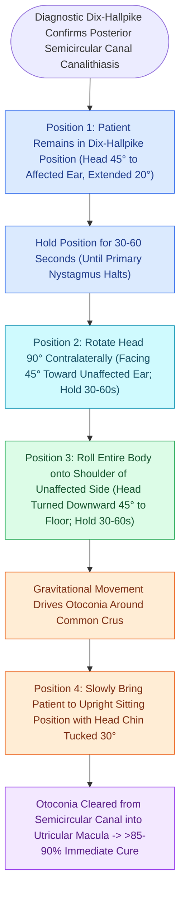

# The Epley particle repositioning maneuver clears otoconia from the posterior canal into the utricle

## Active Recall

> [!question]- How long should each position be maintained during an Epley maneuver?
> *Answer / Clinical Rationale*: At least **$30\text{ to }60\text{ seconds}$** (or for the duration of nystagmus plus 30 seconds).

> [!question]- What alternative repositioning maneuver is especially effective for posterior canal cupulolithiasis?
> *Answer / Clinical Rationale*: The **Semont (liberatory) maneuver**.

## Core Clinical & Mechanistic Principles
The **Epley Canalith Repositioning Procedure (CRP)** is a four-step therapeutic maneuver designed to migrate free-floating otoconia out of the [[The Dix-Hallpike maneuver produces torsional upbeating nystagmus in posterior canal BPPV|posterior]] semicircular canal back into the utricle:
- **Step-by-Step Execution Protocol (e.g., Right Posterior Canal)**:
  1. **Position 1 (Dix-Hallpike)**: Patient placed in right Dix-Hallpike position (head turned $45^\circ$ to right, neck extended $20^\circ$). Hold for **$30\text{–}60\text{ seconds}$** (or until nystagmus stops $+30\text{ sec}$). Otoconia move to the midpoint of the canal.
  2. **Position 2 (Head Turn $90^\circ$)**: Slowly rotate head $90^\circ$ to the left (head now turned $45^\circ$ to the left, still extended $20^\circ$). Hold for 30–60 seconds. Otoconia move toward the common crus.
  3. **Position 3 (Body & Head Roll $90^\circ$)**: Patient rolls onto left shoulder/side while turning head another $90^\circ$ to the left (nose pointed $45^\circ$ toward the floor). Hold for 30–60 seconds. Otoconia enter the common crus and drop into the utricle.
  4. **Position 4 (Sit Up)**: Patient is brought upright while keeping the chin tucked down. Hold for 1 minute.

### Surgical Technique & Critical Safety Checks
- **Semont (Liberatory) Maneuver**: Alternative rapid side-to-side swing maneuver, particularly effective for **cupulolithiasis** to dislodge adherent otoconia before repositioning.

## Connected Concepts & Graph Traversal
- **Diagnostic Dix-Hallpike Maneuver**: [[The Dix-Hallpike maneuver produces torsional upbeating nystagmus in posterior canal BPPV|Dix-Hallpike Maneuver]]
- **Horizontal Canal Repositioning**: [[Horizontal canal BPPV is diagnosed with the supine roll test and treated with the Lempert barbecue maneuver|Lempert Barbecue Maneuver]]
- **Nystagmus Biophysical Laws**: [[Ewald's laws and Alexander's law govern the directional dynamics and intensity of vestibular nystagmus|Ewald Laws of Semicircular Canals]]
- **Vestibular Rehabilitation Adjunct**: [[Vestibular rehabilitation exploits adaptation habituation and substitution to recalibrate gaze and posture|Vestibular Rehabilitation]]
- **PPPD Functional Transition**: [[Persistent postural-perceptual dizziness is a chronic functional vestibular disorder treated with rehabilitation and SSRIs|Post-BPPV PPPD Transition]]
- **Epley-Refractory Rescue Maneuvers**: [[Canalith repositioning maneuvers for atypical and refractory BPPV employ the Semont, Gufoni, and Yacovino maneuvers to clear debris from horizontal and vertical semicircular canals|Semont, Gufoni & Yacovino Maneuvers]]
