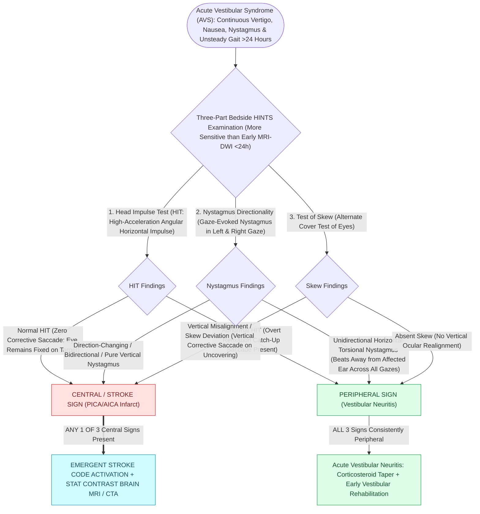

# The HINTS examination separates vestibular neuritis from posterior circulation stroke in acute vestibular syndrome

## Active Recall

> [!question]- Why does a NORMAL head impulse test alarm rather than reassure in AVS?
> *Answer / Clinical Rationale*: An intact VOR with ongoing spontaneous nystagmus means the periphery is working — the lesion is central.

> [!question]- What does HINTS-plus add and which vascular territory does it catch?
> *Answer / Clinical Rationale*: Bedside hearing assessment; new SNHL flags AICA/labyrinthine artery infarction masquerading as labyrinthitis.

## Core Clinical & Mechanistic Principles
- Applies **only** to continuous [[Vestibular neuritis causes acute spontaneous prolonged vertigo without auditory symptoms|acute vestibular syndrome]] with spontaneous nystagmus — not to episodic or positional vertigo, where it is uninterpretable.
- Benign (peripheral) pattern: **abnormal head impulse** (corrective catch-up saccade), **unidirectional** horizontal nystagmus obeying Alexander's law, **no skew deviation**. A dangerous exam is any of: normal head impulse, direction-changing or vertical nystagmus, or skew.
- In experienced hands HINTS outperforms early diffusion MRI, which is **falsely negative in a meaningful fraction of posterior circulation strokes within the first 48 hours**.
- **HINTS-plus** adds bedside hearing: new unilateral loss in AVS raises AICA-territory infarct (labyrinthine artery), the exception to 'hearing loss means peripheral.'

### Management & Critical Safety Checks
- A dangerous or discordant exam is stroke-pathway activation regardless of a clean early MRI; a fully benign triad with a compatible story is treated as neuritis with [[Vestibular rehabilitation exploits adaptation habituation and substitution to recalibrate gaze and posture|vestibular rehabilitation]] and brief symptomatic suppression only.
- Chart the exam in components — a summary word without the three findings is not reviewable.

## Connected Concepts & Graph Traversal
- **Acute Peripheral Neuritis**: [[Vestibular neuritis causes acute spontaneous prolonged vertigo without auditory symptoms|Vestibular Neuritis]]
- **vHIT High-Frequency Confirmation**: [[The video head impulse test vHIT identifies high-frequency angular vestibulo-ocular reflex deficits|vHIT Angular Deficits]]
- **Nystagmus Directional Laws**: [[Ewald's laws and Alexander's law govern the directional dynamics and intensity of vestibular nystagmus|Alexander Law of Nystagmus]]
- **Caloric Paresis Confirmation**: [[Bithermal caloric testing calculates Jongkees formula to quantify unilateral vestibular paresis|Bithermal Caloric Testing]]
- **Suppurative Labyrinthitis Spread**: [[Labyrinthitis presents with acute prolonged vertigo combined with sudden sensorineural hearing loss|Suppurative Labyrinthitis]]
