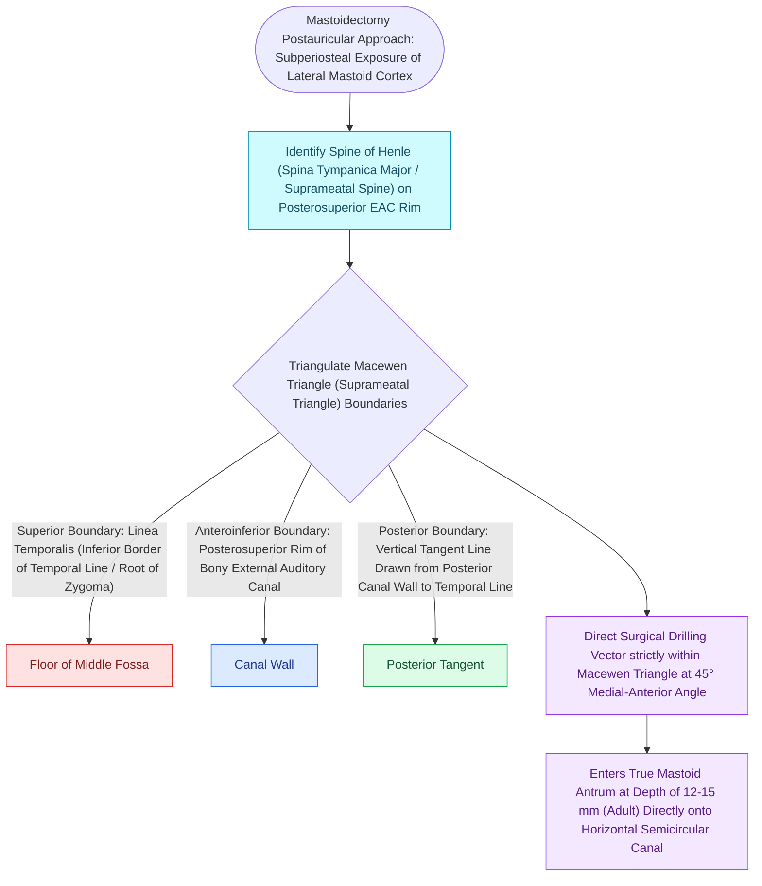

# The Macewen triangle and Henle spine indicate the surface projection of the mastoid antrum

## Active Recall

> [!question]- What three anatomical boundaries define Macewen's triangle?
> *Answer / Clinical Rationale*: The **linea temporalis superiorly**, the **posterosuperior margin of the bony EAC / spine of Henle anteriorly**, and a **vertical tangent line to the posterior canal wall posteriorly**.

> [!question]- What underlying anatomical chamber does Macewen's triangle project over?
> *Answer / Clinical Rationale*: The **mastoid antrum** (located $1.0\text{–}1.5\text{ cm}$ deep to the cortex).

## Core Clinical & Mechanistic Principles
The **Macewen triangle (suprameatal triangle)** is the constant surface anatomical landmark on the outer cortex of the [[Complete cortical mastoidectomy unroofs the mastoid antrum and establishes dependent middle ear drainage|mastoid]] bone indicating the position of the underlying **mastoid antrum**:
- **Three Anatomical Boundaries**:
  1. **Superior Boundary**: The **linea temporalis (supramastoid crest)**, continuing horizontally backward from the posterior root of the zygomatic arch.
  2. **Anterior / Anteroinferior Boundary**: The **posterosuperior margin of the bony external auditory canal** (marked by the **spine of Henle / spina suprameatum**).
  3. **Posterior Boundary**: A vertical line drawn tangent to the posterior curve of the external auditory meatus connecting the spine of Henle to the supramastoid crest.
- **Surgical Relevance**:
  - Drilling initiated directly through the cribriform area within the Macewen triangle leads straight medially into the **mastoid antrum** at a depth of **$1.0\text{–}1.5\text{ cm}$** in adults.

### Surgical Technique & Critical Safety Checks
- **Dural Level Warning**: In low-lying middle cranial fossa dura, the tegmen may lie inferior to the linea temporalis; verify dural height on preoperative temporal bone CT.

## Connected Concepts & Graph Traversal
- **Cortical Mastoid Skeletonization**: [[Complete cortical mastoidectomy unroofs the mastoid antrum and establishes dependent middle ear drainage|Cortical Mastoid Landmarks]]
- **Posterior Tympanotomy Access**: [[Posterior tympanotomy facial recess approach opens the corridor between CN VII and chorda tympani|Facial Recess Posterior Tympanotomy]]
- **Surgical Approach Tailoring**: [[Endaural and postauricular surgical approaches provide tailored exposure for middle ear pathology|Postauricular Approach]]
- **Otic Capsule Constants**: [[The otic capsule is an immutable endochondral bone that provides fixed surgical reference landmarks|Otic Capsule Constant]]
- **Anatomical Foundation**: [[Canal wall down mastoidectomy lowers the facial ridge and exteriorizes the mastoid into the ear canal|Canal Wall Down Mastoidectomy]]
