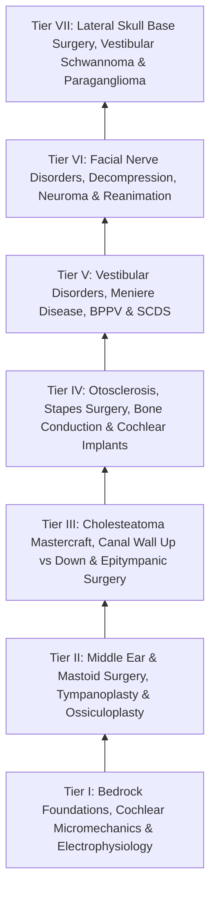

# The Otology and Lateral Skull Base Knowledge Graph provides a structured mastery curriculum

> [!NOTE] **Subspecialty Knowledge Cards Census & Curriculum Architecture**
> | Metric | Value | Details |
> | :--- | :--- | :--- |
> | **Atomic Cards (Notes)** | **186** | Granular single-concept clinical and surgical factoids |
> | **Source Coverage** | **186 / 186 (100%)** | Full attribution to authoritative surgical textbooks |
> | **Active Recall Questions** | **418 total (2.2/card)** | Integrated retrieval prompts with mechanistic rationales |
> | **Illustrated Cards** | **37 notes (57 figs)** | High-yield operative line drawings and anatomical diagrams |
> | **Personal Notes Guard** | **100% verified** | Cryptographically guarded resident notes region |
> | **Active Wiki-Links** | **1,312 links** | Bidirectional knowledge graph traversal web |
> | **Mastery Pyramid** | **7 Progressive Tiers** | From Bedrock Foundations to High-Stakes Complication Rescue |

---

## Tier I: Bedrock Foundations — Micromechanics, Electrophysiology & Diagnostic Audiology

### 📖 Tier I Clinical Foundations & Craft Nuances

### **1\. Cochlear Micromechanics & Hair Cell Electrophysiology**

> * **Fluid Dynamics & [[The traveling wave along the basilar membrane establishes tonotopic frequency organization|Traveling Wave]] (von Békésy):** Stapes footplate displacement creates a non-compressible fluid wave within the perilymph-filled *scala vestibuli*, which translocates across the basilar membrane to the *scala tympani* and dissipates at the round window membrane.  
> * **Tonotopic Organization:** The basilar membrane is narrow, thick, and stiff at the **base (high frequencies: $8\text{–}20\text{ kHz}$)** and becomes progressively wider, thinner, and more compliant toward the **apex (low frequencies: $250\text{–}500\text{ Hz}$)**.  
> * **Hair Cell Transduction:**  
  * *Inner Hair Cells (IHCs):* Single row (\~3,500). True sensory transducers innervated by 90–95% of afferent auditory nerve fibers (Type I spiral ganglion neurons). Stereocilia shearing opens apical mechanotransduction (MET) channels, allowing endolymphatic $K^+$ influx ($+80\text{ mV}$ [[The stria vascularis generates the endocochlear potential of positive eighty millivolts|endocochlear potential]] maintained by the *stria vascularis* Na+/K+ ATPase), depolarizing cell and releasing glutamate.  
  * *Outer Hair Cells (OHCs):* Three rows (\~12,000). Electromotile amplifiers driven by the transmembrane motor protein **prestin**. Contract and elongate in phase with acoustic stimuli, amplifying basilar membrane displacement by 40–50 dB. Generates *[[Otoacoustic emissions evaluate outer hair cell integrity and differentiate cochlear from auditory neuropathy spectrum disorder|Otoacoustic Emissions]] (OAEs)*.

### **2\. Audiometric & Electrophysiological Diagnostics**

| Diagnostic Modality | Electrophysiological / Biomechanical Generator | Diagnostic Utility & Pathology Criteria   |
| :---- | :---- | :---- |
| **Auditory Brainstem Response (ABR)** | Far-field potentials (Waves I–V): • **Wave I:** Distal CN VIII. • **Wave II:** Proximal CN VIII at brainstem. • **Wave III:** Cochlear Nucleus. • **Wave IV:** Superior Olivary Complex (SOC). • **Wave V:** Lateral Lemniscus / Inferior Colliculus. | • Interaural Wave V latency difference $>0.2\text{–}0.3\text{ ms}$ or I–V interpeak latency $>4.4\text{ ms}$ indicates retrocochlear lesion (Vestibular Schwannoma). • Objective threshold estimation in pediatric populations. |
| **Electrocochleography (ECochG)** | Cochlear Microphonic (CM), Summating Potential (SP - OHC non-linear displacement), Action Potential (AP - distal CN VIII firing). | **SP/AP Ratio $>0.40$ (transtympanic) or $>0.50$ (extratympanic)** indicates endolymphatic hydrops (Meniere’s Disease) or superior canal dehiscence. |
| **Vestibular Evoked Myogenic Potentials (VEMP)** | • **cVEMP (Cervical):** Saccule → Inferior Vestibular Nerve → Sternocleidomastoid (Inhibitory potential, p13-n23). • **oVEMP (Ocular):** Utricle → Superior Vestibular Nerve → Contralateral Inferior Oblique (Excitatory, n10-p15). | • **SSCD:** Pathologically low acoustic thresholds ($<70\text{–}80\text{ dB nHL}$) and abnormally elevated amplitudes on cVEMP/oVEMP. • Identifies inferior vs. superior vestibular nerve branch deficits. |
| **Video Head Impulse Test (vHIT)** | High-frequency vestibulo-ocular reflex (VOR) gain (eye velocity / head velocity) for each of the 6 individual semicircular canals. | VOR gain $<0.8$ (horizontal) or $<0.7$ (verticals) accompanied by overt or covert catch-up saccades indicates peripheral vestibular hypofunction. |

### **3\. The Three Temporal Bone Invariants & Relational Coordinates**

> * **[[The otic capsule is an immutable endochondral bone that provides fixed surgical reference landmarks|The Three Surgical Invariants]]:**  
  1. *Otic Capsule Invariant:* Dense endochondral bone ossified by 20 weeks' gestation without Haversian remodeling. Provides unchanging spatial reference anchors (lateral canal dome, cochleariform process, oval window, promontory) in diseased or distorted ears.  
  2. *Facial Nerve Pathfinder:* The tenant precedes the temporal bone; bone accommodates the nerve, generating dehiscences (up to 50% at oval window) and predictable anterior-lateral displacement in congenital atresia.  
  3. *Pneumatization Variable:* Air cells vary from cellular to dense sclerotic blocks; always landmark on capsule and nerve, never on air cells (Körner's septum trap).  
> * **[[The cochleariform process serves as the constant middle ear landmark triangulating the geniculate ganglion, tympanic CN VII, and tensor tympani tendon|The Cochleariform Process Triad]]:** The middle ear's indestructible pole star, triangulating: (1) tensor tympani tendon laterally to malleus; (2) geniculate ganglion $1\text{–}2\text{ mm}$ anterosuperiorly; (3) tympanic facial nerve posteriorly above the oval window.  
> * **[[The infant mastoid lacks a developed tip placing the facial nerve in a subcutaneous vulnerable position at the stylomastoid foramen|The Infant Temporal Bone Vulnerability]]:** Rudimentary mastoid process prior to 2 years places the stylomastoid foramen and facial nerve in a superficial, subcutaneous position, mandating a high, posteriorly curved postauricular incision. Incomplete tympanic ring fusion leaves a patent *Foramen of Huschke* communicating with the TMJ/parotid.  
> * **[[The greater and lesser petrosal nerves function as parasympathetic couriers connecting middle ear nerves to the lacrimal and parotid glands|The Two Petrosal Couriers]]:** GSPN (CN VII) traverses petrous ICA to Vidian nerve and lacrimal gland; Lesser Petrosal (CN IX via Jacobson's plexus) traverses foramen ovale to otic ganglion and parotid gland (basis of Frey syndrome and tympanic neurectomy).

Self-Assessment Checkpoint: Tier I Foundations (Click to Expand)

**Q1: Why does an [[Vestibular schwannomas arise from the Schwann cell sheath of the inferior or superior vestibular nerve|acoustic neuroma]] compress Wave I vs Wave V differently on [[Auditory brainstem response waves I through V identify retrocochlear and brainstem pathology|ABR]]?**  
*A:* Wave I is generated by the distal cochlear nerve fibers within the cochlea and internal auditory canal lateral to the tumor, remaining preserved in latency. Wave V is generated at the level of the lateral lemniscus/inferior colliculus in the upper brainstem. Tumor compression along the proximal eighth nerve slows axonal conduction velocity, prolonging the Wave I–V interpeak interval ($>4.4\text{ ms}$).  
**Q2: Why do [[cVEMP evaluates the saccule and inferior vestibular nerve via uncrossed sternocleidomastoid inhibition|cVEMP]] thresholds drop below 70 dB in Superior Semicircular Canal Dehiscence (SSCD)?**  
*A:* SSCD acts as a "[[Third mobile window pathophysiology causes hyperacusis to bone-conducted sounds and acoustic energy dissipation|third mobile window]]" into the inner ear, decreasing the acoustic impedance of the labyrinth. This permits low-intensity acoustic sound pressure to over-stimulate the saccular macula, triggering an abnormally hyperactive vestibulocollic inhibitory reflex at lower stimulus intensities.

---

## Tier II: Tympanic Membrane, Middle Ear Mechanics & Tympanoplasty

### 📖 Tier II Clinical Foundations & Craft Nuances

### **1\. Middle Ear Transformer Mechanics**

The middle ear matches the low acoustic impedance of air to the high acoustic impedance of inner ear perilymph (an acoustic energy loss of \~30 dB without the transformer mechanism) through three mechanical advantages:

> 1. **[[The tympanic membrane areal ratio of seventeen to one provides the primary impedance gain|Areal Ratio]] Advantage ($\sim 21:1$ total, $14:1$ effective):** Vibrating area of the tympanic membrane ($55\text{ mm}^2$) relative to the stapes footplate area ($3.2\text{ mm}^2$), yielding a 14-fold pressure amplification ($\text{Pressure} \= \text{Force} / \text{Area}$).  
> 2. **Ossicular Lever Advantage ($\sim 1.3:1$):** The length of the manubrium of the malleus ($9.0\text{ mm}$) relative to the long process of the incus ($7.0\text{ mm}$).  
> 3. **Catenary (Curved Membrane) Lever Advantage ($\sim 2:1$):** The curved displacement of the conical tympanic membrane buckles under sound pressure, concentrating displacement forces at the manubrium.  
> 4. **Total Transformer Gain:** $14 \times 1.3 \times 2 \approx 36.4:1$ ($\approx 25\text{–}30\text{ dB}$ of acoustic energy recovery).

### **2\. Tympanoplasty Techniques & Classification**

| Wullstein Class | Ossicular Configuration & Graft Placement | Acoustic Expectation   |
| :---- | :---- | :---- |
| **Type I (Myringoplasty)** | Intact, fully mobile ossicular chain; graft placed directly on malleus/annulus. | Normal transformer mechanism restored; closure of air-bone gap (ABG) to $\le 10\text{ dB}$. |
| **Type II** | Eroded malleus manubrium; graft placed onto incus body/remnant. | Minor loss of lever ratio; ABG typically $10\text{–}15\text{ dB}$. |
| **Type III (Myringostapediopexy / PORP)** | Malleus and incus absent; graft sits directly onto the intact, mobile stapes head (columella effect) or Partial Ossicular Replacement Prosthesis (PORP). | Loss of lever ratio, areal ratio preserved; ABG typically $15\text{–}25\text{ dB}$. |
| **Type IV (Cavitary / TORP)** | Stapes suprastructure absent; mobile footplate. Graft placed directly onto footplate or Total Ossicular Replacement Prosthesis (TORP) with cavum minor over round window. | Relies on round window acoustic shielding; ABG $25\text{–}35\text{ dB}$. |
| **Type V** | Fixed stapes footplate; fenestration of the horizontal semicircular canal. | Historical interest only; replaced by stapedectomy. |

### **3\. Underlay vs. Overlay Tympanoplasty Technique**

> * **Underlay (Medial Grafting):** Graft (temporalis fascia, tragal perichondrium/cartilage) is placed medial to the tympanic membrane remnant and the malleus handle.  
  * *Advantages:* Technically straightforward, high success rate for posterior/central perforations, avoids lateral blunting and epithelial pearl cysts.  
  * *Pitfalls:* Lower take rate in large anterior perforations due to lack of anterior vascular support.  
> * **Overlay (Lateral Grafting):** Canal skin is stripped; squamous layer of TM remnant completely denuded; graft placed lateral to the fibrous layer of the TM but medial to the repositioned canal skin.  
  * *Advantages:* Exceptional graft take for total, subtotal, or anterior marginal perforations.  
  * *Complications:* Anterior sulcus blunting, lateralization of the graft away from the malleus (causing severe persistent conductive hearing loss), and epithelial inclusion cholesteatoma.  
> * **[[Cartilage island tympanoplasty resists negative middle ear pressure and recurrent retraction|Cartilage Island Tympanoplasty]]:** Tragal or conchal cartilage thinned to $0.4\text{–}0.5\text{ mm}$ with attached perichondrium. Resistant to negative middle ear pressure retraction pockets, recurrent infection, and eustachian tube dysfunction.

### **4\. Epitympanic Diaphragm & Selective Dysventilation**

> * **[[The epitympanic diaphragm and tympanic isthmus govern attic ventilation and selective epitympanic dysventilation|Epitympanic Aeration Architecture]]:**  
  * *Epitympanic Diaphragm:* Formed by the tensor fold, incudomalleal mucosal folds, and the ossicular chain, creating an anatomical partition between epitympanum and mesotympanum.  
  * *Tympanic Isthmus:* Main aeration gate between mesotympanum and attic, bounded by tensor tendon and stapes/pyramid.  
  * *Prussak’s Space Drainage:* Prussak's space does not ventilate through the isthmus; it drains posteriorly through the *posterior pouch of von Tröltsch* into the superior incudal space and aditus ad antrum.  
  * *Selective Epitympanic Dysventilation:* A complete tensor fold combined with isthmus obstruction generates isolated negative pressure and attic retraction despite a fully functioning Eustachian tube and well-aerated mesotympanum (corrected by transcanal endoscopic tensor fold resection).

Self-Assessment Checkpoint: Tier II Tympanoplasty (Click to Expand)

**Q1: Why must a piece of cartilage or cortical bone be placed over the head of a titanium PORP/TORP beneath the tympanic membrane graft?**  
*A:* The direct contact between a rigid metallic prosthesis and the vibrating, vascularizing tympanic membrane graft produces chronic localized pressure ischemia and necrosis, leading to prosthesis extrusion through the TM in up to 30% of cases without an interposed cartilage cap.  
**Q2: What is the mechanical consequence of tympanic membrane graft lateralization during [[Underlay and overlay tympanoplasty techniques have distinct advantages and complication profiles|overlay tympanoplasty]]?**  
*A:* Lateralization detaches the reconstructed eardrum from the manubrium of the malleus, creating a deep air-filled or fibrotic lateral sulcus. Acoustic vibrations captured by the TM cannot be mechanically transmitted to the ossicular chain, resulting in a persistent maximum conductive hearing loss ($50\text{–}60\text{ dB}$).

---

## Tier III: Chronic Otitis Media, Cholesteatoma & Mastoidectomy

### 📖 Tier III Clinical Foundations & Craft Nuances

### **1\. Pathogenesis & Classification of Cholesteatoma**

> * **Theories of Origin:**  
  1. *Retraction Pocket (Invagination) Theory (Bezold / Wittmaack):* Chronic ET dysfunction creates sustained negative middle ear pressure, sucking the pars flaccida into [[Primary acquired cholesteatoma arises from retraction pocket invagination of the pars flaccida into Prussak space|Prussak]]'s space or pars tensa into the retrotympanum. Desquamated keratin fails to self-clean.  
  2. *Epithelial Invasion / Migration Theory (Habermann):* Squamous epithelium migrates through a peripheral TM perforation along edges.  
  3. *Basal Cell Hyperplasia (Ruedi):* Micro-ulceration induces papillary ingrowth into submucosa.  
  4. *[[Congenital cholesteatoma presents as an anterosuperior white mass behind an intact tympanic membrane|Congenital Cholesteatoma]] (Levenson Criteria):* White pearly mass medial to normal intact TM, normal pars tensa/flaccida, no history of otorrhea, prior otologic surgery, or recurrent otitis media. Arises from entrapped embryonic epidermoid rests (Michaels' rest in anterosuperior middle ear).  
> * **Critical Microscopic Recesses:**  
  * **Prussak’s Space:** Bound laterally by pars flaccida (Shrapnell’s membrane), superiorly by lateral malleal fold, inferiorly by short process/neck of malleus. Primary site of primary acquired attic cholesteatoma.  
  * **Sinus Tympani:** Deep recess in the retrotympanum bounded superiorly by the ponticulus and subiculum, medially by the posterior semicircular canal and labyrinthine bone, and laterally by the pyramidal eminence and facial nerve. \*The most common site of hidden residual cholesteatoma.\*  
  * **Facial Recess ([[Posterior tympanotomy facial recess approach opens the corridor between CN VII and chorda tympani|Posterior Tympanotomy]]):** Bound medially by the mastoid segment of the facial nerve, laterally by the chorda tympani nerve, and superiorly by the incudal buttress (fossa incudis).

### **2\. Complete Cortical Mastoidectomy & Posterior Tympanotomy Protocol**

> 1. **Postauricular Incision & Periosteal Flap:** Make postauricular incision $0.5\text{ cm}$ behind sulcus; elevate anterior and posterior Palva flaps. Identify anatomical landmarks on the cortical surface: **Spine of Henle**, **Macewen’s Triangle** ([[The Macewen triangle and Henle spine indicate the surface projection of the mastoid antrum|suprameatal triangle]]), and the **temporal line** (linea temporalis, marking inferior limit of middle fossa dura).  
> 2. **Cortical Saucerization:** Using large cutting burrs ($5\text{–}6\text{ mm}$) with continuous suction-irrigation, saucerize the mastoid cortex. Delineate boundaries: Tegmen mastoideum superiorly, sigmoid sinus posteriorly, and posterior external auditory canal wall anteriorly.  
> 3. **Antrum Identification:** Drill through Koerner’s septum (petrosquamous suture line) into the mastoid antrum. Identify the lateral semicircular canal (white, dense bone) and the short process of the incus within the fossa incudis.  
> 4. **Skeletonization of Critical Structures:** Transition to diamond burrs ($2\text{–}3\text{ mm}$) with irrigation to skeletonize: (a) Tegmen tympani, (b) Sigmoid sinus plate, (c) Digastric ridge (leading directly to stylomastoid foramen and facial nerve exit), and (d) Mastoid segment of CN VII leaving a thin protective eggshell layer of bone.  
> 5. **Posterior Tympanotomy (Facial Recess Opening):** Thin the posterior canal wall bone. Using small diamond burrs ($1.0\text{–}1.5\text{ mm}$) under high magnification, open the facial recess bounded by CN VII (medial), Chorda Tympani (lateral), and Fossa Incudis (superior). Enter the middle ear cavity, providing direct visualization of the round window niche, incudostapedial joint, promontory, and hypotympanum.

### **3\. Canal Wall Up (CWU) vs. Canal Wall Down (CWD) Decision Matrix**

| Feature / Criterion | Canal Wall Up (CWU) / Intact Canal Wall | Canal Wall Down (CWD) / Modified Radical   |
| :---- | :---- | :---- |
| **Anatomical Alteration** | Posterior EAC wall preserved; normal anatomy maintained. | Posterior bony canal wall taken down to facial ridge; creates open mastoid bowl. |
| **Clinical Indications** | Limited attic/antral disease; reliable patient for follow-up; non-labyrinthine fistula ears. | Extensive bone destruction; only-hearing ear; lateral canal labyrinthine fistula; unresectable sinus tympani disease; poor patient compliance. |
| **Recidivism & Second-Look** | High recidivism ($20\text{–}30\\%$); mandatory second-look surgery or non-EPI diffusion-weighted MRI at 9–12 months. | Very low recidivism ($<5\\%$); cavity is directly inspectable and cleanable in clinic. |
| **Postoperative Limitations** | No water precautions needed once healed; standard hearing aid fitting possible. | Lifelong water precautions; periodic mastoid cavity debridement; caloric vertigo with cold wind/water exposure. |

Self-Assessment Checkpoint: Tier III Mastoidectomy (Click to Expand)

**Q1: What are the three surgical boundaries of the facial recess, and why is opening it critical?**  
*A:* Boundaries: (1) Mastoid segment of CN VII medially, (2) Chorda tympani nerve laterally, and (3) Fossa incudis superiorly. Opening the recess permits direct instrument access from the mastoid cavity into the retrotympanum and middle ear without taking down the posterior bony ear canal wall, allowing round window visualization for cochlear implant electrode insertion.  
**Q2: How should an extensive lateral semicircular canal [[Labyrinthine fistula from cholesteatoma erosions most frequently involves the lateral semicircular canal|labyrinthine fistula]] covered by cholesteatoma matrix be managed in an only-hearing ear?**  
*A:* In an only-hearing ear or during a closed CWU procedure, the matrix should be *left in place* over the fistula and converted to a Canal Wall Down (CWD) exteriorized cavity. Stripping the matrix off a large membranous labyrinth fistula tears the endosteum, causing perilymph drainage, [[Labyrinthitis presents with acute prolonged vertigo combined with sudden sensorineural hearing loss|suppurative labyrinthitis]], and permanent dead ear.

---

## Tier IV: Otosclerosis, Stapedotomy & Implantable Auditory Devices

### 📖 Tier IV Clinical Foundations & Craft Nuances

### **1\. Otosclerosis Pathophysiology & Diagnostic Workup**

> * **Pathobiology:** Autosomal dominant with incomplete penetrance (\~40%). Primary metabolic bone dysplasia of the otic capsule characterized by alternating phases of osteoclast-mediated bone resorption (*otospongiosis*; vascular hypervascularity \= Schwartze’s sign) and dense, disordered bone deposition (*sclerosis*). Most common site of predilection: **fissula ante fenestram** (immediately anterior to the oval window).  
> * **Audiometric Presentation:** Progressive conductive/mixed hearing loss, absent acoustic reflexes (stiffness tilt), and **Carhart’s Notch** (pseudo-sensorineural notch with a $5\text{ dB}$ dip at $500\text{ Hz}$, $10\text{ dB}$ at $1\text{ kHz}$, $15\text{ dB}$ at $2\text{ kHz}$, and $5\text{ dB}$ at $4\text{ kHz}$ resulting from the mechanical disruption of ossicular inertial bone conduction resonance).

### **2\. Laser Stapedotomy: Step-by-Step Surgical Execution**

> 1. **Tympanomeatal Flap:** Endaural or transcanal incision from 6 to 12 o’clock $6\text{–}8\text{ mm}$ lateral to the annulus; elevate flap into middle ear, dissecting fibrous annulus out of the tympanic sulcus.  
> 2. **Exposure & Verification:** Curette or drill the posterosuperior scutum bone to expose the incudostapedial (IS) joint, pyramidal eminence, stapedius tendon, and tympanic segment of CN VII. Palpate malleus to confirm malleus/incus mobility while observing *stapes fixation*.  
> 3. **Laser Fenestration:** Use $\text{CO}_2$ or KTP laser ($0.6\text{–}0.8\text{ mm}$ rosettes at $1.5\text{–}2.0\text{ W}$) to:  
   * Vaporize the stapedius tendon.  
   * Vaporize the posterior crus of the stapes.  
   * Create a precise circular rosette ($0.6\text{–}0.8\text{ mm}$) in the posterior-inferior 1/3 of the stapes footplate (where the distance to the saccule and utricle is greatest).  
> 4. **Crural Fracture & Superstructure Removal:** Divide the IS joint with a joint knife; gently down-fracture the anterior crus toward the promontory; remove stapes suprastructure.  
> 5. **Piston Sizing & Placement:** Measure distance from the medial surface of the incus long process to the footplate (typically $4.0\text{–}4.5\text{ mm}$; add $0.25\text{–}0.5\text{ mm}$ for perilymph protrusion). Place a $0.6\text{-mm}$ diameter fluoroplastic/platinum or Nitinol piston into the fenestration; crimp securely to the incus. Seal fenestration margins with autologous blood, fat, or vein graft.

### **3\. Cochlear Implantation (CI) & Bone Conduction Systems**

| Device Class | Biophysical Mechanism | Candidacy Criteria & Insertion Nuance   |
| :---- | :---- | :---- |
| **Cochlear Implant (CI)** | Direct electrical tonotopic stimulation of Spiral Ganglion Neurons in the modiolus via multi-channel intracochlear electrode array. | • Moderate-to-profound bilateral SNHL; AzBio/CNC sentence scores $\le 50\text{–}60\\%$ in best-aided condition. • **Soft Surgery Protocol:** Round window membrane entry through anteroinferior quadrant; slow insertion ($>60\text{ s}$) into *scala tympani*. Avoid translocating across osseous spiral lamina / basilar membrane into *scala vestibuli* to preserve residual acoustic hearing. |
| **Bone-Anchored / Active Transcutaneous (BAHA / Osia)** | Direct osseointegrated skull vibration bypassing external and middle ear conductive mechanisms directly to both cochleae. | • Conductive/Mixed hearing loss (aural atresia, chronic draining ears) with bone conduction threshold $\le 45\text{–}55\text{ dB HL}$. • Single-Sided Deafness (SSD): Transmits sound transcranially from deaf side to normal contralateral cochlea. |

Self-Assessment Checkpoint: Tier IV Stapes & Implants (Click to Expand)

**Q1: What is a "[[Floating footplate complication during stapedectomy is managed with small inferior fenestration or vein graft|floating footplate]]" during stapedectomy, and what is the mandatory immediate rescue strategy?**  
*A:* A floating footplate occurs when the stapes footplate is completely detached from the annular ligament without an opening into the vestibule, free-floating over the perilymph. **CRITICAL RESCUE:** Do NOT attempt to spear or drill it directly (which pushes it into the vestibule, causing severe saccular damage and permanent sensorineural deafness). Perform a small inferior promontorial "control hole" with a micro-drill to slip a 0.3-mm right-angle hook beneath the footplate edge and extract it safely.  
**Q2: Why is the round window approach preferred over a separate bony cochleostomy during cochlear implantation for hearing preservation?**  
*A:* Entering directly through the round window membrane enters the *scala tympani* atraumatically without generating bone dust, acoustic drilling trauma, or damaging the spiraling spiral ligament and osseous spiral lamina, minimizing intracochlear inflammation and fibrotic scarring.

---

## Tier V: Vestibular Disorders, Endolymphatic Sac & Semicircular Canal Dehiscence

### 📖 Tier V Clinical Foundations & Craft Nuances

### **1\. Superior Semicircular Canal Dehiscence (SSCD / Minor’s Syndrome)**

> * **Pathophysiology:** Bony defect in the arcuate eminence of the anterior skull base creating a third mobile window. Acoustic and mechanical energy shunts away from the cochlea through the dehiscent canal.  
> * **Clinical Manifestations:** [[Superior semicircular canal dehiscence SCDS presents with Tullio phenomenon and sound-induced vertigo|Tullio phenomenon]] (sound-induced vertigo/torsional nystagmus), Hennebert sign (pressure-induced vertigo), autophony (hearing own voice/heartbeat/eye movements), and apparent conductive hearing loss with bone conduction thresholds better than $0\text{ dB HL}$ (supranormal bone conduction).  
> * **Surgical Reconstruction:**  
  * *Middle Cranial Fossa (MCF) Approach:* Craniotomy superior to zygomatic root; extradural temporal lobe elevation to arcuate eminence. Dehiscence is directly visualized and **plugged** with bone wax, bone pate, and fascia, or **resurfaced** with cortical bone graft and hydroxyapatite cement.  
  * *Transmastoid Approach:* Mastoidectomy skeletonizing superior canal ampulla and crus; fenestration anterior and posterior to dehiscence with intraluminal plugging using bone chips/fascia.

### **2\. Meniere’s Disease (Endolymphatic Hydrops) Algorithmic Escalation**

\========================================================================================  
                  MENIERE'S DISEASE TREATMENT ESCALATION CASCADE  
\========================================================================================  
\[DIAGNOSIS: Episodic Vertigo (20 min–12 hr) \+ Low-Freq SNHL \+ Tinnitus \+ Aural Fullness\]  
                                   │  
                LEVEL 1: CONSERVATIVE / MEDICAL  
                • Low-sodium diet (<1,500–2,000 mg/day)  
                • Hydrochlorothiazide / Triamterene or Acetazolamide  
                • [[Low-sodium diet, hydrochlorothiazide, and betahistine form the first-line medical therapy for Meniere disease|Betahistine]] (vasodilator / H3-antagonist)  
                                   │  
                     (Failed Medical > 3–6 Months)  
                                   ▼  
                LEVEL 2: NON-ABLATIVE DESTRUCTIVE / SURGICAL  
                • [[Intratympanic dexamethasone and gentamicin provide non-ablative and chemical ablative control of Meniere vertigo|Intratympanic Dexamethasone]] Injections (Hearing-sparing)  
                • [[Endolymphatic sac decompression and shunt surgery alleviate hydrops while preserving auditory function|Endolymphatic Sac Decompression]] / Shunting (Mastoidectomy,  
                  skeletonize Donaldson's Line, decompress sac off posterior dura)  
                                   │  
                     (Intractable Vertigo Persists)  
                                   ▼  
                LEVEL 3: CHEMICAL ABLATION (NON-HEARING PRESERVING / SPARING)  
                • Intratympanic Gentamicin (Titration Protocol)  
                  (Preferentially destroys dark cells and Type I vestibular hair cells)  
                                   │  
                     (Failed Chemical / Non-Serviceable Hearing)  
                                   ▼  
                LEVEL 4: DEFINITIVE SURGICAL ABLATION  
                • Serviceable Hearing: Selective Retrosigmoid Vestibular Neurectomy  
                • Non-Serviceable Hearing: Transmastoid Labyrinthectomy  
\========================================================================================

### **3\. Benign Paroxysmal Positional Vertigo (BPPV)**

| Canal & Variant | Diagnostic Maneuver & Nystagmus Vector | Repositioning Maneuver   |
| :---- | :---- | :---- |
| **Posterior Canal Canalithiasis (90%)** | **Dix-Hallpike Test:** Geotropic, torsional (fast phase beating toward dependent ear) and **upbeating** nystagmus with latency (2–5 s) and fatigue ($<60\text{ s}$). | **Epley Maneuver** (or Semont Liberatory maneuver). |
| **Horizontal Canal (Geotropic)** | **Supine Head Roll Test (Pagnini-McClure):** Pure horizontal geotropic nystagmus beating toward ground; *stronger side is affected side* (Ewald's 2nd Law). | **Barbecue Roll (Lempert 360°)** or Gufoni Maneuver. |
| **Horizontal Canal (Apogeotropic)** | **Supine Head Roll Test:** Horizontal apogeotropic nystagmus beating away from ground (Cupulolithiasis or canalithiasis in anterior arm); *weaker side is affected side*. | Modified Gufoni (toward affected side) or head-shaking to convert to geotropic. |

Self-Assessment Checkpoint: Tier V Vestibular Disorders (Click to Expand)

**Q1: What is Donaldson’s Line, and what is its surgical significance in endolymphatic sac decompression?**  
*A:* Donaldson’s Line is an imaginary surgical line extending posteriorly along the axis of the horizontal semicircular canal, bisecting the posterior semicircular canal perpendicular to its plane. The **endolymphatic sac lies immediately inferior and medial to this line** on the posterior fossa dura anterior to the sigmoid sinus.  
**Q2: Why does intratympanic gentamicin preferentially destroy vestibular function while sparing hearing?**  
*A:* Gentamicin is selectively vestibulotoxic; it is preferentially taken up by the dark cells of the crista ampullaris and Type I vestibular hair cells, whereas amikacin and neomycin are predominantly cochleotoxic to outer hair cells.

---

## Tier VI: Facial Nerve Disorders, Decompression & Intratemporal Trauma

### 📖 Tier VI Clinical Foundations & Craft Nuances

### **1\. Neuropathy Classification & Electrodiagnosis**

| Seddon Class | Sunderland Degree | Histopathological Architecture | Prognosis & Recovery Profile   |
| :---- | :---- | :---- | :---- |
| **Neuropraxia** | First Degree | Physiological conduction block; endoneurium, perineurium, and axon completely intact. | 100% complete spontaneous recovery within days to weeks; no synkinesis. |
| **Axonotmesis** | Second Degree | Axon severed; Wallerian degeneration distally; endoneurial sheath intact. | Complete recovery expected ($1\text{ mm/day}$ axonal regrowth); minimal synkinesis. |
| **Axonotmesis** | Third Degree | Axon and endoneurium disrupted; perineurium intact. | Incomplete recovery; moderate-to-severe synkinesis due to intrafascicular miswiring. |
| **Axonotmesis** | Fourth Degree | Perineurium disrupted; epineurium intact. | Poor recovery; severe synkinesis, muscle weakness, partial neuroma formation. |
| **Neurotmesis** | Fifth Degree | Complete anatomical transection of entire nerve trunk and sheath. | No recovery without surgical exploration, direct repair, or interposition cable grafting. |

> * **[[Electroneuronography showing greater than ninety percent degeneration within fourteen days indicates severe facial nerve axonal injury|Electroneuronography]] (ENoG) & [[Acute Bell's palsy presents with unilateral lower motor neuron facial paralysis treated with early oral steroids|Bell]]’s Palsy Decompression Criteria (Fisch Protocol):**  
  * Measures Compound Muscle Action Potential (CMAP) peak-to-peak amplitude compared to normal contralateral side.  
  * **Surgical Indication:** If ENoG shows **$\ge 90\\%$ degeneration within 14 days of onset** AND [[Electromyography EMG detects voluntary motor unit potentials and fibrillations indicating denervation|electromyography]] (EMG) shows **absence of voluntary motor unit action potentials (no active recruitment)**, surgical decompression of the meatal segment and [[The labyrinthine segment is the narrowest portion of the Fallopian canal and most vulnerable to edema|labyrinthine segment]] of CN VII via [[The middle cranial fossa approach provides hearing preservation for intracanalicular schwannomas with lateral fundus extension|Middle Cranial Fossa approach]] significantly improves full functional recovery (House-Brackmann I/II).

### **2\. Temporal Bone Fractures & Facial Nerve Decompression**

> * **Modern Classification:**  
  * *Otic Capsule-Sparing (OCS, 90%):* Blow to temporoparietal region; fracture parallel to petrous ridge. Conductive hearing loss (ossicular disruption, hemotympanum), low incidence of facial paralysis (20%), low CSF leak risk.  
  * *Otic Capsule-Violating (OCV, 10%):* Blow to occipital region; fracture across petrous pyramid into otic capsule. Profound sensorineural hearing loss, severe vestibular destruction, high incidence of facial nerve paralysis (50%, often transection), and persistent [[Cerebrospinal fluid CSF leak and pseudomeningocele require lumbar drainage, fat obliteration, and re-exploration|CSF otorrhea]]/rhinorrhea.  
> * **Surgical Decompression Approaches:**  
  * *Transmastoid / Extralabyrinthine:* Decompresses mastoid segment and tympanic segment anterior to the cochleariform process.  
  * *Middle Cranial Fossa (MCF):* Indicated for paralysis involving the **labyrinthine segment and [[The first genu marks the location of the geniculate ganglion and origin of the greater superficial petrosal nerve|geniculate ganglion]]** (the narrowest segment of the [[The facial nerve traverses six distinct anatomical segments from the pons to the parotid gland|fallopian canal]], $<0.7\text{ mm}$ width) with preserved hearing.  
  * *Translabyrinthine:* Complete exposure of all segments of CN VII from brainstem to stylomastoid foramen in patients with complete sensorineural dead ears.

Self-Assessment Checkpoint: Tier VI Facial Nerve (Click to Expand)

**Q1: Why is the labyrinthine segment the most common site of entrapment and edema in Bell's palsy and temporal bone trauma?**  
*A:* The labyrinthine segment is the narrowest portion of the entire fallopian canal ($0.68\text{ mm}$ mean diameter) and lacks a vascular plexus collateral network. Any acute inflammatory swelling or intraneural edema rapidly generates critical compartment syndrome ischemia, choking axonal transport at the meatal foramen.  
**Q2: Differentiate the immediate management of acute-onset complete facial paralysis versus delayed-onset partial paralysis following temporal bone trauma.**  
*A:* *Immediate-onset complete paralysis* strongly indicates high-grade mechanical disruption, transection, or impingement by a displaced bony spicule, warranting high-resolution CT and urgent surgical exploration/decompression. *Delayed-onset paralysis* (developing days later) indicates secondary neural edema or sheath hematoma, which responds excellently to high-dose systemic corticosteroids without acute surgical decompression.

---

## Tier VII: Lateral Skull Base Surgery: Vestibular Schwannoma, Paragangliomas & Petroclival Corridors

### 📖 Tier VII Clinical Foundations & Craft Nuances

### **1\. Vestibular Schwannoma Surgical Corridors**

| Approach | Anatomical Exposure & Bone Resection | Hearing Preservation | Clinical Selection & Limitations   |
| :---- | :---- | :---- | :---- |
| **Translabyrinthine** | Complete mastoidectomy \+ Labyrinthectomy (drilling horizontal, superior, posterior canals) \+ Opening of entire IAC fundus to porus acousticus. | **NO** (Sacrifices inner ear mechanism). | Any tumor size in non-serviceable hearing (AAO-HNS Class C/D); excellent early identification of CN VII at the fundus (Bill's bar landmark); minimal cerebellar retraction. |
| **Retrosigmoid / Suboccipital** | Suboccipital craniotomy posterior to sigmoid sinus; cerebellar retraction; drilling of posterior wall of IAC. | **YES** (Potential to preserve cochlear nerve). | Tumors with serviceable hearing extending into cerebellopontine angle (CPA); *Limitation:* Inability to expose the lateral fundus of the IAC without opening the posterior semicircular canal/vestibule (risking hearing loss). |
| **Middle Cranial Fossa (MCF)** | Temporal craniotomy; extradural subtemporal elevation; unroofing of the superior surface of the IAC from above. | **YES** (Highest hearing preservation rates). | Small intracanalicular tumors ($<1.5\text{ cm}$) with deep fundal extension and excellent speech discrimination; requires temporal lobe retraction (avoid in age $>65$). |

\========================================================================================  
            INTERNAL AUDITORY CANAL (IAC) FUNDUS ANATOMICAL DIVISION  
\========================================================================================  
                                 SUPERIOR  
                     \[Bill's Bar (Vertical Crest)\]  
                                 │  
           ANTERIOR              │              POSTERIOR  
    (Facial Nerve - CN VII)     │   (Superior Vestibular Nerve)  
    ─────────────────────────────┼───────────────────────────────  
      (Falciform Crest / Transverse Crest - Horizontal)  
    ─────────────────────────────┼───────────────────────────────  
    (Cochlear Nerve - CN VIII)   │   (Inferior Vestibular Nerve)  
                                 │   \[Singular Nerve - Post Ampulla\]  
                                 INFERIOR  
\========================================================================================  
Mnemonic: "7-Up, Coke Down" (CN 7 is anterosuperior, Cochlear nerve is anteroinferior).  
\========================================================================================

### **2\. Jugular Foramen & Temporal Bone Paragangliomas (Fisch Classification)**

> * **[[Fisch classification categorizes temporal bone and skull base paragangliomas from Class A to Class D|Fisch Classification]]:**  
  * *Type A:* Confined to the middle ear promontory ([[Jugular paragangliomas arise from the glomus body in the adventitia of the jugular bulb|Glomus Tympanicum]]). Transcanal / tympanoplasty approach.  
  * *Type B:* Involving hypotympanum and mastoid cortex without bone destruction of the infralabyrinthine compartment. Transmastoid/extended facial recess approach.  
  * *Type C:* Involving the infralabyrinthine compartment and petrous bone with destruction of the jugular bulb and carotid canal:  
    * C1: Involving vertical carotid canal.  
    * C2: Involving vertical and horizontal carotid canal.  
    * C3: Extending to petrous apex and foramen lacerum.  
  * *Type D:* Intracranial extension (D1: intradural $<2\text{ cm}$; D2: intradural $>2\text{ cm}$; D3: inoperable intradural).  
> * **Infratemporal Fossa Approach Type A (Fisch IFIT-A):** Subtotal petrosectomy with permanent anterior transposition of the facial nerve; blind sac closure of the external auditory canal; resection of the jugular bulb, sigmoid sinus ligation, and control of the petrous internal carotid artery.

Self-Assessment Checkpoint: Tier VII Lateral Skull Base (Click to Expand)

**Q1: What is 'Bill's Bar' and how does it prevent facial nerve transection during translabyrinthine surgery?**  
*A:* Bill's bar (the vertical crest of the IAC fundus) is a solid ridge of petrous bone separating the facial nerve (anterosuperior) from the superior vestibular nerve (posterosuperior). Palpating Bill's bar with a micro-hook provides an absolute, infallible landmark to dissect the superior vestibular nerve away from the facial nerve without avulsing CN VII.  
**Q2: Why is permanent anterior transposition of the facial nerve required in a Fisch [[Fisch infratemporal fossa approach Type A mobilizes the facial nerve and exposes the jugular foramen|Infratemporal Fossa Type A]] approach?**  
*A:* The descending mastoid segment of the facial nerve crosses directly lateral to the jugular bulb and vertical internal carotid artery. To safely resect large glomus jugulare tumors involving the infralabyrinthine space and gain circumferential access to the petrous ICA, CN VII must be fully mobilized from the stylomastoid foramen to the geniculate ganglion and transposed anteriorly into the parotid bed.

---

## Tier S: Otologic Emergencies, Clinical Audiology & Vestibular Medicine

### 📖 Tier S Clinical Foundations & Craft Nuances

- **Otogenic Intracranial Complications**: [[Otogenic intracranial complications escalate from meningitis to sigmoid sinus thrombosis and brain abscess|Intracranial Otitis Complications]]
- **Gradenigo Syndrome**: [[Gradenigo triad of otorrhea, retroorbital pain, and abducens nerve palsy indicates suppurative petrous apicitis|Petrous Apicitis & Gradenigo]]
- **Sigmoid Sinus Thrombosis**: [[Lateral sinus thrombophlebitis presents with picket fence fevers and Griesinger sign requiring intravenous antibiotics and mastoidectomy|Sigmoid Sinus Thrombosis]]
- **Perilymphatic Fistula**: [[Perilymphatic fistula causes fluctuating hearing loss and pressure-induced vertigo after barotrauma or stapes surgery|Perilymphatic Fistula]]
- **Tegmen Dehiscence**: [[Spontaneous CSF otorrhea from tegmen dehiscence requires multilayer middle fossa or transmastoid repair|Tegmen Dehiscence & CSF Otorrhea]]
- **Congenital Cholesteatoma**: [[Congenital cholesteatoma presents as an anterosuperior white mass behind an intact tympanic membrane|Congenital Cholesteatoma]]
- **Congenital Aural Atresia**: [[Congenital aural atresia candidacy is graded by the ten-point Jahrsdoerfer scale|Jahrsdoerfer Atresia Grading]]
- **Eustachian Tube Dysfunction**: [[Eustachian tube dysfunction divides into dilatory and patulous forms with opposite treatment goals|Eustachian Tube Dysfunction]]
- **Adult Unilateral OME**: [[Adult unilateral otitis media with effusion mandates nasopharyngoscopy to exclude nasopharyngeal carcinoma|Adult Unilateral OME Red Flag]]
- **Tympanostomy Tubes**: [[Tympanostomy tube placement follows guideline criteria for chronic effusion and recurrent acute otitis media|Tympanostomy Tube Guidelines]]
- **Presbycusis**: [[Presbycusis produces symmetric high-frequency sensorineural loss with disproportionate speech-in-noise decline|Presbycusis]]
- **Noise-Induced Hearing Loss**: [[Noise-induced hearing loss produces a four-kilohertz notch and is governed by damage-risk exchange rates|Noise-Induced Hearing Loss]]
- **Ototoxicity**: [[Platinum and aminoglycoside ototoxicity mandates baseline and serial high-frequency audiometric monitoring|Ototoxicity Monitoring]]
- **Hearing Aids**: [[Hearing aid selection is driven by audiometric configuration and verified with real-ear measurement|Hearing Aid Selection]]
- **Tinnitus**: [[Chronic subjective tinnitus is managed with cognitive behavioral and sound-based therapy rather than cure|Chronic Tinnitus Management]]
- **Pulsatile Tinnitus**: [[Pulsatile tinnitus is differentiated into arterial and venous etiologies by auscultation, jugular compression, and targeted vascular imaging|Pulsatile Tinnitus Evaluation]]
- **Autoimmune Inner Ear Disease**: [[Autoimmune inner ear disease causes rapidly progressive bilateral sensorineural loss responsive to corticosteroids|Autoimmune Inner Ear Disease (AIED)]]
- **HINTS Exam**: [[The HINTS examination separates vestibular neuritis from posterior circulation stroke in acute vestibular syndrome|HINTS Examination]]
- **Vestibular Migraine**: [[Vestibular migraine is the most common cause of episodic spontaneous vertigo|Vestibular Migraine]]
- **PPPD**: [[Persistent postural-perceptual dizziness is a chronic functional vestibular disorder treated with rehabilitation and SSRIs|PPPD]]
- **Bilateral Vestibulopathy**: [[Bilateral vestibulopathy causes oscillopsia and dark-dependent imbalance from bilateral hair cell loss|Bilateral Vestibulopathy]]
- **Vestibular Rehabilitation**: [[Vestibular rehabilitation exploits adaptation habituation and substitution to recalibrate gaze and posture|Vestibular Rehabilitation]]
- **IAC Lipoma**: [[Internal auditory canal lipomas demonstrate T1 hyperintensity with fat saturation signal loss and mandate conservative observation|IAC Lipoma & Fat-Sat MRI]]

---

## Operative Verification & High-Stakes Otologic Complication Matrix

| Tier | Procedural Milestone | Key Anatomical / Technical Landmark | Failure Mode to Anticipate | Rescue / Prevention Maneuver   |
| :---- | :---- | :---- | :---- | :---- |
| **I** | Audiometric & Electrophysiologic Workup | ABR Waves I–V; cVEMP p13-n23 threshold | Missing an intracanalicular acoustic neuroma due to normal pure-tone audiometry | Perform contrast-enhanced thin-cut internal auditory canal MRI for unilateral tinnitus or asymmetric speech discrimination. |
| **II** | Tympanoplasty & Ossiculoplasty | Malleus manubrium; Anterior sulcus; Cartilage cap | Graft lateralization or titanium PORP/TORP extrusion through reconstructed TM | Tuck graft medial to anterior fibrous annulus; place rigid $0.5\text{-mm}$ cartilage disk between prosthesis head and TM. |
| **III** | Mastoidectomy & Facial Recess | Lateral semicircular canal; CN VII mastoid segment; Chorda tympani | Thermal/mechanical injury to CN VII during facial recess thinning or drill burr skip | Continuous high-volume suction-irrigation; use diamond burrs running strictly parallel to the course of the nerve. |
| **IV** | Stapedotomy | Posterior 1/3 of footplate; Incus long process | Depressed floating footplate into vestibule causing acute suppurative labyrinthitis/dead ear | Avoid deep vertical spearing; create inferior promontory control micro-hole to elevate footplate edge safely. |
| **V** | Endolymphatic Sac & SSCD Plugging | Donaldson's line; Arcuate eminence; Superior canal ampulla | Tearing of posterior fossa dura/sigmoid sinus or membranous canal disruption during plugging | Stay inferior to Donaldson's line; plug canal lumina with precise bone wax/fascia without suctioning perilymph. |
| **VI** | Facial Nerve Decompression | Meatal foramen; Labyrinthine segment; Geniculate ganglion | Incomplete decompression by stopping at geniculate without opening meatal foramen | Via MCF approach, drill petrous bone medial to geniculate to decompress meatal segment into the IAC. |
| **VII** | Translabyrinthine / CPA Tumor Resection | Bill's bar; Transverse crest; Sigmoid sinus; Petrous ICA | Postoperative CSF leak (rhinorrhea/wound leak) or facial nerve paralysis | Obliterate Eustachian tube and middle ear with muscle/bone wax; harvest abdominal fat graft; watertight dural closure. |

---

## **Tier S: Otologic Emergencies, Clinical Audiology & Vestibular Medicine**
- **Otogenic Intracranial Complications**: [[Otogenic intracranial complications escalate from meningitis to sigmoid sinus thrombosis and brain abscess|Intracranial Otitis Complications]]
- **Gradenigo Syndrome**: [[Gradenigo triad of otorrhea, retroorbital pain, and abducens nerve palsy indicates suppurative petrous apicitis|Petrous Apicitis & Gradenigo]]
- **Sigmoid Sinus Thrombosis**: [[Lateral sinus thrombophlebitis presents with picket fence fevers and Griesinger sign requiring intravenous antibiotics and mastoidectomy|Sigmoid Sinus Thrombosis]]
- **Perilymphatic Fistula**: [[Perilymphatic fistula causes fluctuating hearing loss and pressure-induced vertigo after barotrauma or stapes surgery|Perilymphatic Fistula]]
- **Tegmen Dehiscence**: [[Spontaneous CSF otorrhea from tegmen dehiscence requires multilayer middle fossa or transmastoid repair|Tegmen Dehiscence & CSF Otorrhea]]
- **Congenital Cholesteatoma**: [[Congenital cholesteatoma presents as an anterosuperior white mass behind an intact tympanic membrane|Congenital Cholesteatoma]]
- **Congenital Aural Atresia**: [[Congenital aural atresia candidacy is graded by the ten-point Jahrsdoerfer scale|Jahrsdoerfer Atresia Grading]]
- **Eustachian Tube Dysfunction**: [[Eustachian tube dysfunction divides into dilatory and patulous forms with opposite treatment goals|Eustachian Tube Dysfunction]]
- **Adult Unilateral OME**: [[Adult unilateral otitis media with effusion mandates nasopharyngoscopy to exclude nasopharyngeal carcinoma|Adult Unilateral OME Red Flag]]
- **Tympanostomy Tubes**: [[Tympanostomy tube placement follows guideline criteria for chronic effusion and recurrent acute otitis media|Tympanostomy Tube Guidelines]]
- **Presbycusis**: [[Presbycusis produces symmetric high-frequency sensorineural loss with disproportionate speech-in-noise decline|Presbycusis]]
- **Noise-Induced Hearing Loss**: [[Noise-induced hearing loss produces a four-kilohertz notch and is governed by damage-risk exchange rates|Noise-Induced Hearing Loss]]
- **Ototoxicity**: [[Platinum and aminoglycoside ototoxicity mandates baseline and serial high-frequency audiometric monitoring|Ototoxicity Monitoring]]
- **Hearing Aids**: [[Hearing aid selection is driven by audiometric configuration and verified with real-ear measurement|Hearing Aid Selection]]
- **Tinnitus**: [[Chronic subjective tinnitus is managed with cognitive behavioral and sound-based therapy rather than cure|Chronic Tinnitus Management]]
- **Pulsatile Tinnitus**: [[Pulsatile tinnitus is differentiated into arterial and venous etiologies by auscultation, jugular compression, and targeted vascular imaging|Pulsatile Tinnitus Evaluation]]
- **Autoimmune Inner Ear Disease**: [[Autoimmune inner ear disease causes rapidly progressive bilateral sensorineural loss responsive to corticosteroids|Autoimmune Inner Ear Disease (AIED)]]
- **HINTS Exam**: [[The HINTS examination separates vestibular neuritis from posterior circulation stroke in acute vestibular syndrome|HINTS Examination]]
- **Vestibular Migraine**: [[Vestibular migraine is the most common cause of episodic spontaneous vertigo|Vestibular Migraine]]
- **PPPD**: [[Persistent postural-perceptual dizziness is a chronic functional vestibular disorder treated with rehabilitation and SSRIs|PPPD]]
- **Bilateral Vestibulopathy**: [[Bilateral vestibulopathy causes oscillopsia and dark-dependent imbalance from bilateral hair cell loss|Bilateral Vestibulopathy]]
- **Vestibular Rehabilitation**: [[Vestibular rehabilitation exploits adaptation habituation and substitution to recalibrate gaze and posture|Vestibular Rehabilitation]]
- **IAC Lipoma**: [[Internal auditory canal lipomas demonstrate T1 hyperintensity with fat saturation signal loss and mandate conservative observation|IAC Lipoma & Fat-Sat MRI]]

---
