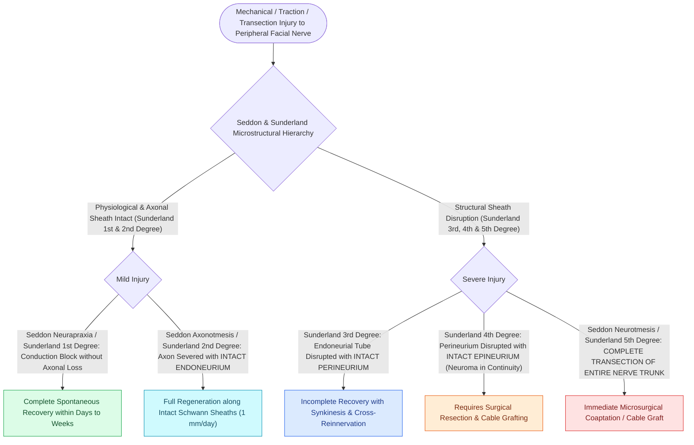

# The Seddon and Sunderland classifications grade peripheral nerve injury from Class I neuropraxia to Class V neurotmesis

## Active Recall

> [!question]- How do the five Sunderland degrees of nerve injury correlate with Seddon's three-part classification (Neuropraxia, Axonotmesis, and Neurotmesis)?
> *Answer / Clinical Rationale*: - **Sunderland I = Seddon Neuropraxia**: Local conduction block (myelin sheath distortion/ischemia), axons intact, no Wallerian degeneration, $100\%$ complete spontaneous recovery (House-Brackmann Grade I). - **Sunderland II = Seddon Axonotmesis**: Axonal disruption with **intact endoneurial tubes**; Wallerian degeneration occurs distal to lesion; excellent regeneration along pristine conduits ($100\%$ recovery, HB I). - **Sunderland III = Seddon Axonotmesis / Early Neurotmesis**: Disruption of axon AND **endoneurial tubes**, but **perineurium is intact**; cross-reinnervation into adjacent endoneurial tubes produces **moderate synkinesis** (HB III). - **Sunderland IV = Seddon Neurotmesis**: Disruption of axon, endoneurium, AND **perineurium** (fascicle ruptured), epineurium intact; severe scarring and disorganized neuroma formation; poor spontaneous recovery with severe synkinesis (HB IV–V). - **Sunderland V = Seddon Neurotmesis**: **Complete nerve transection** through epineurium; $0\%$ spontaneous recovery without surgical end-to-end coaptation or nerve grafting (HB V–VI).

> [!question]- At what post-injury timepoint does Wallerian degeneration become electrically measurable on electroneurography (ENoG)?
> *Answer / Clinical Rationale*: **$72\text{ hours (3 days)}$ post-injury**. Distal axonal stumps retain electrical excitability and can conduct compound muscle action potentials (CMAPs) for up to $48-72\text{ hours}$ after injury, even following complete nerve transection. ENoG testing performed prior to 72 hours will falsely register normal downfield conduction.

> [!question]- What anatomical connective tissue layer determines whether regenerating axons cause clinical synkinesis (miswiring)?
> *Answer / Clinical Rationale*: The **endoneurium**. In Sunderland Class I and II injuries, the intact endoneurial basement membrane guides each sprouting axon directly back to its original native motor endplate (zero synkinesis). When the **endoneurium is disrupted (Sunderland Class III and above)**, regenerating axonal sprouts enter foreign endoneurial channels and innervate divergent muscle groups (e.g., eye-closure fibers innervating orbicularis oris $\rightarrow$ blink-induced mouth twitching).

## Core Clinical & Mechanistic Principles

The microstructural hierarchy of peripheral nerves consists of three distinct connective tissue sheaths: **endoneurium** (surrounds individual axons), **perineurium** (envelops fascicles and forms the blood-nerve barrier), and **epineurium** (invests the entire nerve trunk):

### Pathophysiology of Degeneration and Aberrant Reinnervation
- **Wallerian Degeneration**:
  - Macrophages and Schwann cells clear distal axonal debris within $7-14\text{ days}$.
  - Proximal axonal growth cones sprout at a rate of **$1.0\text{ mm/day}$ ($1\text{ inch/month}$)**.
- **Synkinesis & Crocodile Tears (Bogorad Syndrome)**:
  - In Sunderland Class III–V injuries, parasympathetic secretomotor fibers from the [[The first genu marks the location of the geniculate ganglion and origin of the greater superficial petrosal nerve|greater superficial petrosal nerve]] destined for the submandibular/sublingual glands aberrantly miswire into the lacrimal gland via the zygomaticotemporal nerve, causing **gustatory lacrimation (crying while eating)**.

## Connected Concepts & Graph Traversal
- **ENoG Degeneration Threshold**: [[Electroneuronography showing greater than ninety percent degeneration within fourteen days indicates severe facial nerve axonal injury|ENoG 90% Degeneration Threshold]]
- **EMG Denervation Potentials**: [[Electromyography EMG detects voluntary motor unit potentials and fibrillations indicating denervation|EMG Fibrillation Potentials]]
- **House-Brackmann Grading**: [[House-Brackmann grading system stratifies facial nerve function from Grade I normal to Grade VI total paralysis|House-Brackmann Clinical Staging]]
- **Direct Nerve Repair**: [[Immediate direct epineurial end-to-end repair is the gold standard for transected facial nerve injury|Epineurial End-to-End Coaptation]]
- **🔗 Facial Synkinesis Treatment (FPRS)**: [[Facial synkinesis is managed with selective neurolysis, myectomy, and botulinum toxin titration|Synkinesis & Botox Neuromodulation]]
- **Bell's Palsy Pathophysiology**: [[Acute Bell's palsy presents with unilateral lower motor neuron facial paralysis treated with early oral steroids|Bell's Palsy Edema]]
