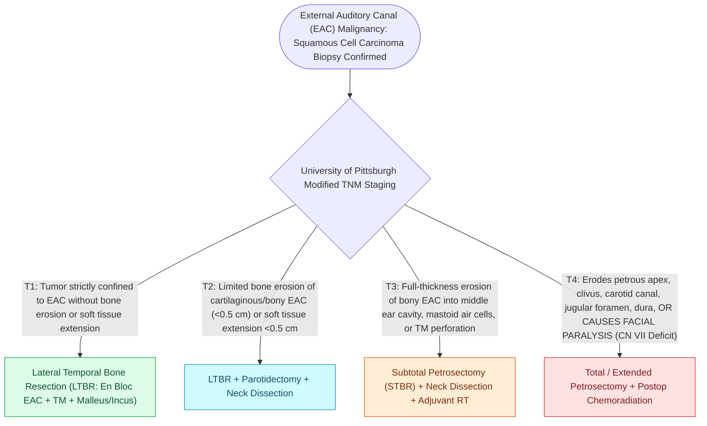

# The University of Pittsburgh staging system classifies external auditory canal carcinoma from T1 canal limited to T4 medial wall and facial paralysis

## Active Recall

> [!question]- What are the precise anatomic T-stage definitions (T1 through T4) in the modified University of Pittsburgh staging system for external auditory canal (EAC) squamous cell carcinoma?
> *Answer / Clinical Rationale*: - **T1**: Tumor strictly limited to the **external auditory canal (EAC)** without bony erosion and with **no soft tissue extension** ($0\text{ cm}$). - **T2**: Tumor with **limited bony erosion of the EAC** (not full-thickness) OR **soft tissue extension $<0.5\text{ cm}$**. - **T3**: Tumor with **full-thickness erosion of the bony EAC** with soft tissue extension $<0.5\text{ cm}$, OR tumor involving the **middle ear cleft and/or mastoid**, OR presenting with **cervical lymph node metastasis (N1)**. - **T4**: Tumor eroding the **cochlea, petrous apex, medial wall of the middle ear**, carotid canal, jugular foramen, or dura; OR soft tissue extension **$>0.5\text{ cm}$** (infratemporal fossa, parotid); OR presence of **facial nerve paresis / paralysis ($CN\ VII$)**.

> [!question]- How does the Pittsburgh T-stage dictate the extent of surgical resection (Sleeve resection vs Lateral Temporal Bone Resection vs Subtotal / Total Temporal Bone Resection)?
> *Answer / Clinical Rationale*: - **T1 (Selected superficial non-bony)**: Wide local excision or **sleeve resection** of the canal skin and cartilage. - **T1 (Deep) and T2**: **Lateral Temporal Bone Resection (LTBR)**: En bloc removal of the bony EAC, tympanic membrane, malleus, and incus lateral to the facial nerve. - **T3 and Selected T4**: **Subtotal Temporal Bone Resection (STBR)**: LTBR plus exenteration of the middle ear, mastoid, otic capsule (cochlea, labyrinth), and petrous apex with facial nerve rerouting or sacrifice. - **T4 with Internal Carotid / Dural Invasion**: **Total Temporal Bone Resection (TTBR)** with vascular control, dural resection, and free flap reconstruction $\pm$ adjuvant radiation.

> [!question]- Why does facial nerve paralysis automatically upstage an EAC carcinoma to T4 disease regardless of tumor size?
> *Answer / Clinical Rationale*: Facial nerve paralysis indicates direct malignant neural perineural invasion or extensive bony erosion through the Fallopian canal into the temporal bone substance, carrying an ominous drop in 5-year overall survival from $>80\%$ (T1/T2) down to $<20-30\%$ (T4), mandating radical en bloc resection, total parotidectomy, neck dissection, and adjuvant chemoradiotherapy.

## Core Clinical & Mechanistic Principles

Primary **squamous cell carcinoma of the temporal bone** arises predominantly from the keratinizing epithelium of the [[Malignant necrotizing otitis externa is an invasive pseudomonal skull base osteomyelitis in elderly diabetic patients|external]] auditory canal:

### Pittsburgh Staging System Definitions and Resection Extent

### Critical Surgical Landmarks and Craft Nuances
- **Lateral Temporal Bone Resection (LTBR)**:
  - En bloc resection bounded by the **middle cranial fossa dura superiorly**, **sigmoid sinus posteriorly**, **temporomandibular joint / parotid anteriorly**, and **jugular bulb inferiorly**.
  - Transection through the incudostapedial joint and tensor tympani tendon allows removal of the canal cylinder with the intact eardrum, malleus, and incus without violating tumor margins.
- **Parotidectomy and Neck Dissection Integration**:
  - The lymphatic drainage of the EAC tracks into the **preauricular parotid lymph nodes**, **infra-auricular nodes**, and **Levels II–III of the neck**.
  - All T2–T4 carcinomas mandate an en bloc **superficial or total parotidectomy** and **ipsilateral elective neck dissection (Levels II–IV)**.

## Connected Concepts & Graph Traversal
- **Facial Nerve Segments**: [[The facial nerve traverses six distinct anatomical segments from the pons to the parotid gland|CN VII Anatomical Landmarks]]
- **Temporal Bone Trauma**: [[Temporal bone longitudinal and transverse fractures cause delayed or immediate facial paralysis|Temporal Bone Fractures]]
- **Malignant Otitis Externa**: [[Malignant necrotizing otitis externa is an invasive pseudomonal skull base osteomyelitis in elderly diabetic patients|Malignant Otitis Externa Differential]]
- **Local Invasion Pathway**: [[The external auditory canal cartilaginous third harbors Fissures of Santorini and Foramen of Huschke as routes of disease spread|EAC Fissures of Santorini & Foramen of Huschke]]
- **Translabyrinthine Access**: [[The translabyrinthine approach provides direct exposure of the internal auditory canal with complete hearing sacrifice|Translabyrinthine Surgery]]
- **🔗 Free Flap Reconstruction (Head and Neck)**: [[The anterolateral thigh flap provides versatile volume and can be harvested as a chimeric flap|ALT Flap in Skull Base Reconstruction]]
