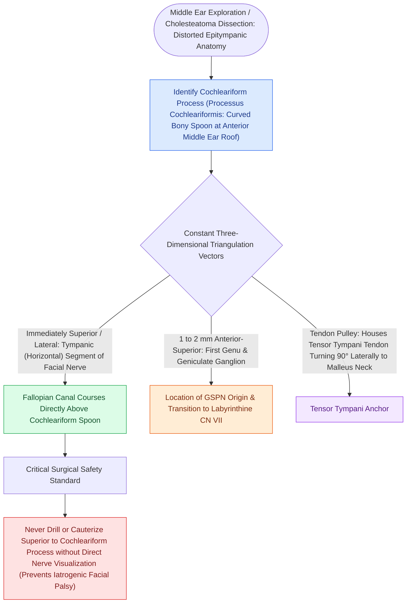

# The cochleariform process serves as the constant middle ear landmark triangulating the geniculate ganglion, tympanic CN VII, and tensor tympani tendon

## Active Recall

> [!question]- Why is the cochleariform process the most dependable landmark for localizing the facial nerve in revision middle ear surgery?
> *Answer / Clinical Rationale*: It is an outgrowth of the **immutable endochondral otic capsule**, meaning it resists bone remodeling and chronic disease erosion, remaining intact when ossicles and canal walls have been destroyed.

> [!question]- What three anatomical structures are triangulated from the cochleariform process?
> *Answer / Clinical Rationale*: (1) The **tensor tympani tendon** heading laterally to the malleus; (2) The **geniculate ganglion** immediately anterosuperior; (3) The **tympanic (horizontal) facial nerve** coursing posteriorly above the oval window.

> [!question]- Where does the tensor tympani tendon insert after turning around the cochleariform pulley?
> *Answer / Clinical Rationale*: Onto the **neck and medial surface of the upper manubrium of the malleus**.

## Core Clinical & Mechanistic Principles
The **cochleariform process** (*processus cochleariformis*) is a small, curved spoon-shaped bony projection located on the medial wall of the middle ear at the anterior end of the oval window niche. It is the single most reliable, indestructible anatomical landmark in the middle ear:

- **The Unyielding Otic Capsule Pole Star**:
  - *Endochondral Anchor*: Because it arises directly from the [[The otic capsule is an immutable endochondral bone that provides fixed surgical reference landmarks|otic capsule]] (the first invariant of temporal bone surgery), the cochleariform process resists osteoclastic erosion and remains intact even when extensive cholesteatoma has eroded the incus, malleus, scutum, and Fallopian canal.
  - *Functional Role*: Serves as the pulley and fulcrum around which the **tensor tympani tendon** makes a right-angle lateral turn to insert onto the neck and medial aspect of the manubrium of the malleus.

- **The Triangulating Landmark Triad**:
  From the tip of the cochleariform process, three critical neurovascular and muscular neighbors are precisely localized:
  1. **Tensor Tympani Tendon (Laterally)**: Exits the cochleariform pulley heading directly lateral toward the malleus neck (dividing this tendon mobilizes the malleus during ossiculoplasty).
  2. **Geniculate Ganglion & First Genu (Anterosuperiorly)**: The geniculate ganglion and the origin of the [[The first genu marks the location of the geniculate ganglion and origin of the greater superficial petrosal nerve|greater superficial petrosal nerve (GSPN)]] lie **$1.0\text{–}2.0\text{ mm}$ immediately anterosuperior** to the cochleariform process beneath the middle cranial fossa floor.
  3. **Tympanic Segment of Facial Nerve (Posteriorly)**: The horizontal tympanic segment of [[The facial nerve traverses six distinct anatomical segments from the pons to the parotid gland|CN VII]] emerges from the geniculate ganglion and courses directly posteriorly **immediately superior to the oval window niche** and inferior to the lateral semicircular canal.

### Surgical Technique & Critical Safety Checks
- **The Revision Surgery Pole Star**: In revision tympanomastoidectomy or severe matrix destruction where the incus is missing and the Fallopian canal is dehiscent, find the cochleariform process first. Once identified, look immediately posterior to define the ceiling of the oval window and verify the exact location of the tympanic facial nerve before using instruments or lasers in the oval window niche.

## Connected Concepts & Graph Traversal
- **Otic Capsule Foundation**: [[The otic capsule is an immutable endochondral bone that provides fixed surgical reference landmarks|Otic Capsule Invariant]]
- **Facial Nerve Segments**: [[The facial nerve traverses six distinct anatomical segments from the pons to the parotid gland|Intratemporal Facial Nerve Ledger]]
- **Stapedotomy Craft**: [[Stapedotomy utilizes a micro-drill or laser fenestration of the posterior footplate|Stapedotomy Operative Technique]]
- **Cholesteatoma Eradication**: [[Primary acquired cholesteatoma arises from retraction pocket invagination of the pars flaccida into Prussak space|Attic Cholesteatoma]]
- **Endoscopic Visualization**: [[Transcanal endoscopic ear surgery TEES provides line-of-sight visualization into the sinus tympani and epitympanum|TEES Line of Sight]]
