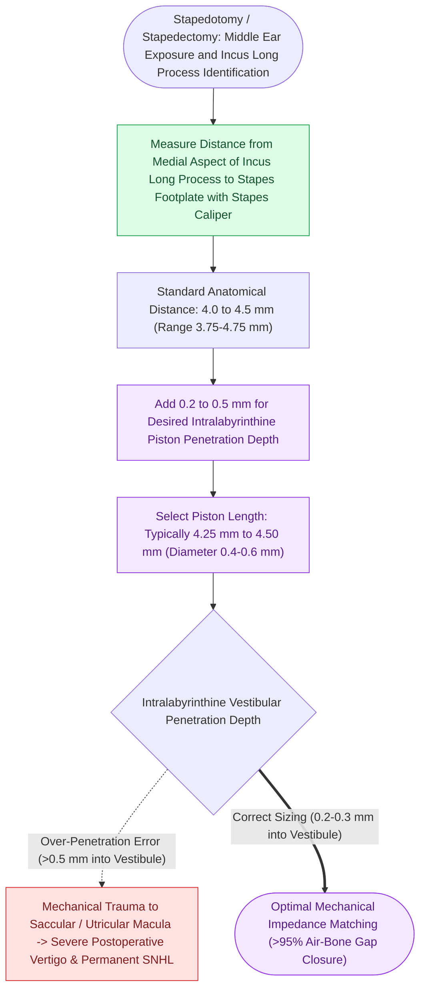

# The distance from the incus long process to the stapes footplate averages four to four point five millimeters

## Active Recall

> [!question]- What is the ideal depth of penetration of a stapedotomy piston into the vestibule?
> *Answer / Clinical Rationale*: **$0.5\text{ mm}$** of penetration into the vestibule perilymph.

> [!question]- What complications occur if a stapedotomy piston is sized too long vs. too short?
> *Answer / Clinical Rationale*: **Too long causes severe vertigo and sensorineural hearing loss** (striking vestibular organs); **too short causes a persistent or recurrent conductive hearing loss** (prosthesis dislodges from fenestra).

## Core Clinical & Mechanistic Principles
Accurate measurement of the distance between the incus and the stapes footplate is the critical determinant of hearing success and vestibule safety in [[Stapedotomy utilizes a micro-drill or laser fenestration of the posterior footplate|stapedotomy]]:
- **Anatomical Measurements**:
  - The distance from the **lateral surface of the incus long process** to the **outer surface of the stapes footplate** measures **$3.75\text{ to }4.0\text{ mm}$** in $>90\%$ of human ears.
  - The ideal insertion depth of the piston into the vestibule perilymph is **$0.5\text{ mm}$** (sufficient to maintain fluid displacement without touching the saccular or utricular membranes).
  - Therefore, the **standard total prosthesis length is $4.25\text{ to }4.5\text{ mm}$** (commonly $4.5\text{ mm}$).
- **The Hazards of Inaccurate Length**:
  - **Too Long ($>4.75\text{–}5.0\text{ mm}$)**: Piston penetrates $>1.0\text{ mm}$ into the vestibule, striking the saccule/utricle, causing **severe positional vertigo, persistent imbalance, and sensorineural hearing loss**.
  - **Too Short ($<4.0\text{ mm}$)**: Piston pulls out of the fenestra when the tympanic membrane displaces laterally, producing a **recurrent conductive air-bone gap**.

### Surgical Technique & Critical Safety Checks
- **Surgical Rule**: Always measure with a graduated measuring rod; never guess or assume standard length.

## Connected Concepts & Graph Traversal
- **Laser Stapedotomy Safety**: [[Laser stapedotomy reduces mechanical trauma and footplate mobilization compared to manual perforators|Laser Stapedotomy]]
- **Stapes Fixation Pathology**: [[Otosclerosis is characterized by abnormal bone remodeling of the otic capsule causing stapes fixation|Otosclerosis Footplate Pathology]]
- **Floating Footplate Complication**: [[Floating footplate complication during stapedectomy is managed with small inferior fenestration or vein graft|Floating Footplate Complication]]
- **Partial Prosthesis Superstructure**: [[Partial ossicular replacement prosthesis PORP requires an intact and mobile stapes superstructure|PORP Reconstruction]]
- **Middle Ear Lever Advantage**: [[The lever ratio of the malleus to incus provides a one point three to one mechanical advantage|Malleus-to-Incus Lever Ratio]]
