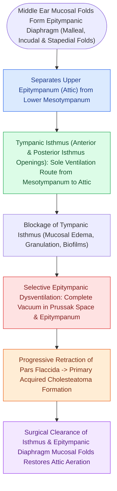

# The epitympanic diaphragm and tympanic isthmus govern attic ventilation and selective epitympanic dysventilation

## Active Recall

> [!question]- Why can an attic cholesteatoma develop in a patient with normal Eustachian tube function and an aerated mesotympanum?
> *Answer / Clinical Rationale*: Due to **selective epitympanic dysventilation**, where a complete tensor fold combined with blockage of the **tympanic isthmus** isolates the epitympanum, creating localized negative pressure and pars flaccida retraction.

> [!question]- What are the anatomical boundaries of Prussak's space, and where does it drain?
> *Answer / Clinical Rationale*: Bound laterally by the **pars flaccida**, medially by the **malleus neck**, inferiorly by the **lateral process**, and superiorly by the **lateral malleal fold**; it drains posteriorly through the **posterior pouch of von Tröltsch** into the superior incudal space.

> [!question]- What is the surgical maneuver performed during endoscopic ear surgery to bypass a blocked tympanic isthmus?
> *Answer / Clinical Rationale*: **Tensor fold resection (transcanal epitympanic ventilation)** to create direct airflow between the protympanum/supratubal recess and the epitympanum.

## Core Clinical & Mechanistic Principles
The middle ear cleft functions as a compartmentalized aerodynamic system partitioned by mucosal folds analogous to fascial planes in the neck. The epitympanum (attic) is aerated via discrete anatomical gates:

- **The Epitympanic Diaphragm & Tympanic Isthmus**:
  - *Epitympanic Diaphragm*: Composed of the **tensor fold**, anterior/lateral/posterior **incudomalleal folds**, and the ossicular bodies themselves. This diaphragm creates a physical horizontal septum separating the **epitympanum** superiorly from the **mesotympanum** inferiorly.
  - *Tympanic Isthmus*: The primary normal aeration gate between the mesotympanum and epitympanum, bounded anteriorly by the tensor tympani tendon and posteriorly by the stapes and pyramidal eminence.
  - *Anterior Epitympanic Recess*: Aerated via the supratubal recess when the tensor fold is incomplete; a complete (horizontal) tensor fold isolates the anterior attic from direct Eustachian tube airflow.

- **Prussak's Space & Drainage Mechanics**:
  - *Boundaries*:
    - **Lateral Wall**: Pars flaccida (Shrapnell's membrane, lacking a middle fibrous layer).
    - **Medial Wall**: Neck of the malleus.
    - **Floor**: Lateral (short) process of the malleus.
    - **Roof**: Lateral malleal mucosal fold.
  - *Drainage Route*: Prussak's space does *not* ventilate directly through the tympanic isthmus. Instead, it ventilates posteriorly via the **posterior pouch of von Tröltsch** into the superior incudal space, and from there to the aditus ad antrum.

- **Selective Epitympanic Dysventilation & Cholesteatoma Routes**:
  - *Selective Epitympanic Dysventilation*: Occurs when a **complete tensor fold is present and mucosal swelling or scarring blocks the tympanic isthmus**. Even with a fully patent, normally functioning Eustachian tube and a well-aerated mesotympanum, the epitympanum experiences isolated chronic negative pressure, driving selective pars flaccida retraction.
  - *Two Classic Cholesteatoma Propagation Highways*:
    1. **Attic Pathway (Pars Flaccida Retraction)**: Pars flaccida $\rightarrow$ [[Primary acquired cholesteatoma arises from retraction pocket invagination of the pars flaccida into Prussak space|Prussak's space]] $\rightarrow$ posterior pouch of von Tröltsch $\rightarrow$ superior incudal space $\rightarrow$ aditus ad antrum $\rightarrow$ mastoid antrum.
    2. **Posterosuperior Mesotympanic Pathway (Pars Tensa Retraction)**: Posterosuperior tensa retraction $\rightarrow$ incudostapedial joint $\rightarrow$ retrotympanum $\rightarrow$ [[The facial recess is bounded by the facial nerve, chorda tympani, and fossa incudis|facial recess]] and **sinus tympani** (the primary site of recidivism).

### Surgical Technique & Critical Safety Checks
- **Tensor Fold Resection in Endoscopic Ear Surgery (TEES)**: During transcanal endoscopic management of attic retraction pockets, sharp micro-resection of a complete tensor fold restores direct ventilation from the Eustachian tube / supratubal recess to the anterior epitympanum, preventing recurrent retraction.

## Connected Concepts & Graph Traversal
- **Prussak Invagination**: [[Primary acquired cholesteatoma arises from retraction pocket invagination of the pars flaccida into Prussak space|Prussak Space Cholesteatoma]]
- **Endoscopic Ear Surgery**: [[Transcanal endoscopic ear surgery TEES provides line-of-sight visualization into the sinus tympani and epitympanum|TEES Line of Sight]]
- **Cortical Mastoidectomy**: [[Complete cortical mastoidectomy unroofs the mastoid antrum and establishes dependent middle ear drainage|Mastoidectomy Gate Sequence]]
- **Otic Capsule Foundation**: [[The otic capsule is an immutable endochondral bone that provides fixed surgical reference landmarks|Otic Capsule Invariant]]
- **Facial Recess Keyhole**: [[The facial recess is bounded by the facial nerve, chorda tympani, and fossa incudis|Facial Recess Boundaries]]
