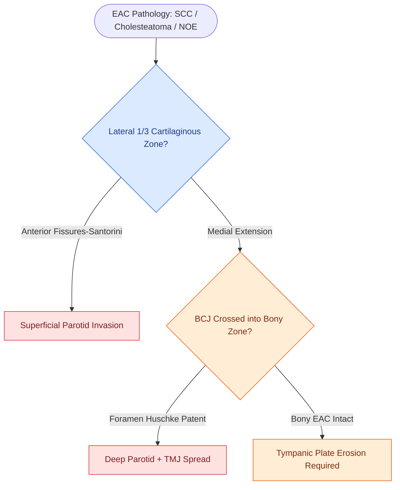

# The external auditory canal cartilaginous third harbors Fissures of Santorini and Foramen of Huschke as routes of disease spread

## Active Recall

> [!question]- What are the Fissures of Santorini, and why do they matter surgically?
> *Answer / Clinical Rationale*: The Fissures of Santorini are **natural anterior clefts in the cartilaginous external auditory canal (EAC)** that provide a direct anatomical conduit for infection, tumor, or cholesteatoma to spread **anteriorly into the superficial parotid gland**. Because these fissures are inherent to the fibrocartilaginous EAC skeleton, there is no fascial barrier — disease traverses them freely. This explains why anterior EAC tumors (particularly squamous cell carcinoma and necrotizing otitis externa) can invade the parotid without obvious soft-tissue destruction.

> [!question]- How does the Foramen of Huschke differ from the Fissures of Santorini in its disease spread vector, and when does it persist into adulthood?
> *Answer / Clinical Rationale*: The Foramen of Huschke is an **anteroinferior bony defect** in the tympanic plate that normally **obliterates during childhood development**. When patent in adults, it creates a conduit from the bony EAC floor directly to the **deep parotid lobe and temporomandibular joint (TMJ)**. Unlike the Santorini fissures (cartilaginous, superficial parotid), the Huschke foramen communicates deeper — making it a route for EAC tumors to invade the TMJ space and for parotid pathology to simulate EAC pain. Persistence into adulthood is a well-recognized anatomical variant.

> [!question]- What is the auricular blood supply, and which two named arteries constitute it?
> *Answer / Clinical Rationale*: The auricle receives dual supply from the **external carotid artery** system via: (1) the **superficial temporal artery** (anterior auricular surface), and (2) the **posterior auricular artery** (posterior auricular surface). This dual supply makes the auricle robust to reconstructive procedures but means posterior auricular tumors can involve the postauricular groove and mastoid skin.

## Core Clinical & Mechanistic Principles

The external auditory canal (EAC) is divided into two functionally and anatomically distinct zones that dictate disease behavior and surgical planning.

### Zone Architecture: Lateral Cartilaginous vs. Medial Bony EAC

**The EAC** divides sharply at the **bony-cartilaginous junction (BCJ)**:

| Zone | Composition | Skin Features | Clinical Significance |
| :--- | :--- | :--- | :--- |
| Lateral 1/3 | Fibrocartilaginous | Hair follicles, ceruminous glands | Source of otitis externa, cerumen, exostoses |
| Medial 2/3 | Bony (tympanic plate) | No cerumen glands, no hair follicles | Thin, adherent skin; vulnerable to trauma |

**Key Links**: [[The University of Pittsburgh staging system classifies external auditory canal carcinoma from T1 canal limited to T4 medial wall and facial paralysis|EAC SCC Staging]] • Necrotizing otitis externa classically involves the cartilaginous zone

The BCJ itself is not a barrier — disease from the cartilaginous zone spreads medially along the skin.

### Disease Spread Routes: The Two Named Pathways

The critical surgical danger of the cartilaginous EAC lies in two anatomical defects that bypass normal tissue planes:

1. **Fissures of Santorini** — *Anterior, cartilaginous EAC → superficial parotid*
   - Natural vertical clefts in the fibrocartilaginous anterior EAC wall
   - Present in virtually all individuals; they are developmental, not pathological
   - Any anterior EAC pathology (SCC, cholesteatoma, necrotizing OE) may traverse these fissures into the **superficial lobe of the parotid gland** without crossing through fascia
   - Surgically: even apparent T1 anterior EAC lesions must prompt consideration of parotid involvement

2. **Foramen of Huschke** — *Anteroinferior bony EAC → deep parotid lobe and TMJ*
   - Anteroinferior tympanic plate defect; normally closes by ~5 years of age but **persists in a significant minority of adults**
   - When patent: creates a direct conduit between the bony EAC floor and the **deep parotid lobe** and **temporomandibular joint capsule**
   - Clinical trap: TMJ pain or a deep parotid mass that presents with EAC symptoms — may represent disease traversing this foramen in either direction

### Auricular Blood Supply

The **auricle** is supplied entirely by the **external carotid artery** system:
- **Superficial temporal artery** → anterior auricle and helical root
- **Posterior auricular artery** → posterior conchal surface and mastoid skin

## Connected Concepts & Graph Traversal
- **Carcinoma Staging**: [[The University of Pittsburgh staging system classifies external auditory canal carcinoma from T1 canal limited to T4 medial wall and facial paralysis|EAC Carcinoma Staging]]
- **Disease Mechanism**: [[Malignant necrotizing otitis externa is an invasive pseudomonal skull base osteomyelitis in elderly diabetic patients|Necrotizing Otitis Externa Skull Base Spread]]
- **Surgical Craft**: [[Canal wall down mastoidectomy lowers the facial ridge and exteriorizes the mastoid into the ear canal|Canal Wall Down Mastoidectomy]]
- **Differential Diagnosis**: [[Keratosis obturans and external auditory canal cholesteatoma differ in clinical presentation, bone erosion patterns, and systemic associations|EAC Cholesteatoma vs Keratosis Obturans]]
- **🔗 Embryological Tract (Pediatrics)**: [[First branchial cleft anomalies present as periauricular cysts or sinus tracts parallel to the external auditory canal|First Branchial Cleft Tracts]]
- **Facial Nerve Safety**: [[The infant mastoid lacks a developed tip placing the facial nerve in a subcutaneous vulnerable position at the stylomastoid foramen|Stylomastoid Foramen Vulnerability]]
