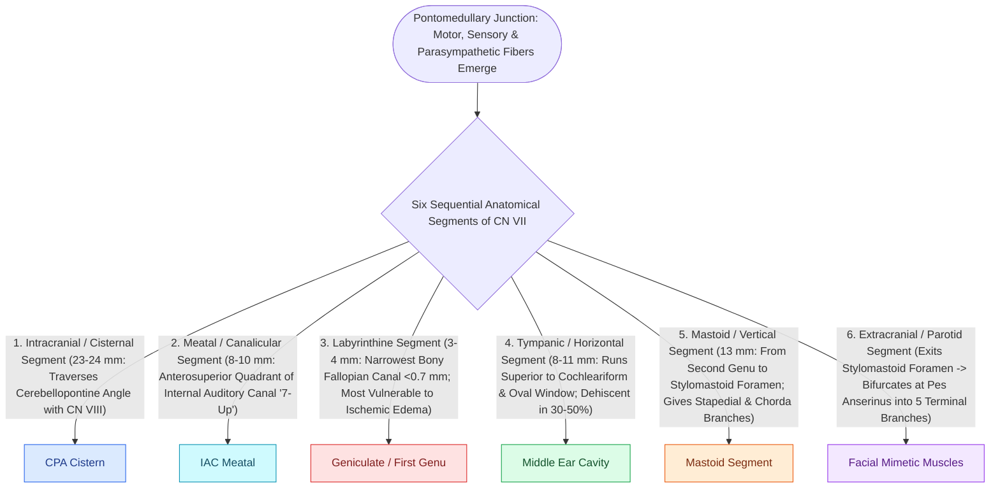

# The facial nerve traverses six distinct anatomical segments from the pons to the parotid gland

## Active Recall

> [!question]- Why is the labyrinthine segment the primary site of pathology in Bell's palsy, and what is its diameter?
> *Answer / Clinical Rationale*: The labyrinthine segment passes through the **meatal foramen ($0.6\text{–}0.7\text{ mm}$)**, the narrowest point of the Fallopian canal. Because it lacks epineurial expansion room and collateral vascularity, inflammatory edema causes rapid circumferential strangulation.

> [!question]- What is the spatial relationship between the descending mastoid segment of CN VII and the lateral semicircular canal?
> *Answer / Clinical Rationale*: The mastoid segment descends in the **plane of, and never lateral to, the lateral semicircular canal**.

> [!question]- What structure points directly toward the second genu of the facial nerve during mastoidectomy?
> *Answer / Clinical Rationale*: The **short process of the incus** resting in the fossa incudis.

## Core Clinical & Mechanistic Principles
The **facial nerve (CN VII)** has the longest intra-osseous course of any cranial nerve ($\approx 30\text{ mm}$ within the temporal bone). Embryologically, the nerve precedes the bone, meaning the temporal bone ossifies around the tenant—explaining why the nerve is frequently dehiscent, displaced in congenital atresia, and subject to variable canal trajectories:

- **The Intratemporal Facial Nerve Ledger**:
  - **Meatal Segment ($8\text{–}10\text{ mm}$)**: Traverses the anterosuperior quadrant of the Internal Auditory Canal (IAC), positioned above the transverse crest and anterior to Bill's bar ("7-up, Coke down"). Compressed from behind by CPA/IAC vestibular schwannomas.
  - **Labyrinthine Segment ($3\text{–}5\text{ mm}$)**: Runs between the cochlea anteriorly and the vestibule posteriorly. Enters the **meatal foramen ($0.6\text{–}0.7\text{ mm}$ diameter)**, the narrowest point of the entire Fallopian canal. Lacks epineurial redundancy or collateral vascular supply; inflammatory edema causes circumferential strangulation (Bell's palsy, Ramsay Hunt), which provides the anatomical rationale for middle cranial fossa decompression *of this specific segment*.
  - **Geniculate Ganglion & First Genu**: Positioned immediately anterosuperior to the [[The cochleariform process serves as the constant middle ear landmark triangulating the geniculate ganglion, tympanic CN VII, and tensor tympani tendon|cochleariform process]] beneath the middle fossa floor. Dehiscent to middle fossa dura in **$\approx 15\%$** of normal ears (vulnerable to middle fossa retractor stretch). First structure injured in otic-capsule-sparing (longitudinal) temporal bone fractures. Gives off the **Greater Superficial Petrosal Nerve (GSPN)** (carries parasympathetic secretomotor fibers to the lacrimal gland, serves as the surface marker for the petrous ICA, and unites with the deep petrosal to form the Vidian nerve).
  - **Tympanic (Horizontal) Segment ($10\text{–}12\text{ mm}$)**: Traverses the medial wall of the middle ear **below the lateral semicircular canal and above the oval window**. Naturally **dehiscent in $30\text{–}50\%$ of normal ears** (most commonly directly over the oval window niche, where it can overhang the stapes footplate).
  - **Second Genu**: Located at/just anteroinferior to the posterior limb of the lateral semicircular canal. The **short process of the incus** in the fossa incudis points directly toward the second genu. Primary site of drill burr injury during mastoidectomy when chasing disease medial to the incus.
  - **Mastoid (Vertical) Segment ($12\text{–}14\text{ mm}$)**: Descends through the anterior mastoid wall in the **exact plane of, and never lateral to, the lateral semicircular canal**. Gives off the **nerve to the stapedius** and the **chorda tympani** (which ascends into the middle ear through the iter chordae posterius). Terminates at the **stylomastoid foramen**, delivered reliably by following the **digastric ridge** anteriorly.
  - **Extratemporal Segment ($15\text{–}20\text{ mm}$)**: Exits the stylomastoid foramen, bifurcates at the pes anserinus within the parotid gland into temporofacial and cervicofacial divisions.

### The Five Operative Safety Aphorisms
1. **The Lateral Canal Plane Rule**: The descending mastoid facial nerve is *never lateral to the plane of the lateral semicircular canal*.
2. **The Incus Pointer Rule**: The nerve is *never lateral to the short process of the incus*.
3. **The Digastric Delivery Rule**: The *digastric ridge walked anteriorly* consistently delivers the stylomastoid foramen.
4. **Skeletonization vs Exposure**: *Skeletonize, do not expose*. Leave an ultra-thin eggshell bone layer over the pink nerve sheath; use diamond burrs, stroke strictly parallel to the nerve's longitudinal axis, and irrigate continuously to prevent thermal conduction injury.
5. **The Incus Landmark & Hostage Principle**: The incus short process identifies the second genu, but a spinning drill burr touching the incus transmits direct acoustic and mechanical shear to the stapes and cochlea, causing sensorineural hearing loss. *Identify the incus to protect it, then stay off it*.

### Finding Algorithms by Direction of Approach
- **From the Mastoid**: Lateral semicircular canal $\rightarrow$ fossa incudis $\rightarrow$ second genu $\rightarrow$ digastric ridge $\rightarrow$ stylomastoid foramen.
- **From the Middle Ear**: Cochleariform process $\rightarrow$ tympanic segment $\rightarrow$ oval window ceiling.
- **From the Middle Fossa**: GSPN traced retrograde to the geniculate ganglion, or meatal plane / arcuate eminence bisection when GSPN is unroofed.
- **In Congenital Atresia**: Assume anterior and lateral displacement of the mastoid segment; trust *only* otic capsule landmarks.

## Connected Concepts & Graph Traversal
- **Cochleariform Landmark**: [[The cochleariform process serves as the constant middle ear landmark triangulating the geniculate ganglion, tympanic CN VII, and tensor tympani tendon|Cochleariform Process Triangulation]]
- **Labyrinthine Vulnerability**: [[The labyrinthine segment is the narrowest portion of the Fallopian canal and most vulnerable to edema|Labyrinthine Segment]]
- **Geniculate Ganglion**: [[The first genu marks the location of the geniculate ganglion and origin of the greater superficial petrosal nerve|Geniculate Ganglion & GSPN]]
- **Bell's Palsy**: [[Acute Bell's palsy presents with unilateral lower motor neuron facial paralysis treated with early oral steroids|Bell's Palsy]]
- **Facial Recess Keyhole**: [[The facial recess is bounded by the facial nerve, chorda tympani, and fossa incudis|Facial Recess Boundaries]]
- **Posterior Tympanotomy**: [[Posterior tympanotomy facial recess approach opens the corridor between CN VII and chorda tympani|Posterior Tympanotomy Craft]]
- **🔗 Referred Otalgia (Head and Neck)**: [[Referred otalgia originates from shared sensory pathways of cranial nerves V, VII, IX, X, and cervical roots C2-C3|Referred Otalgia Dashboard]]
