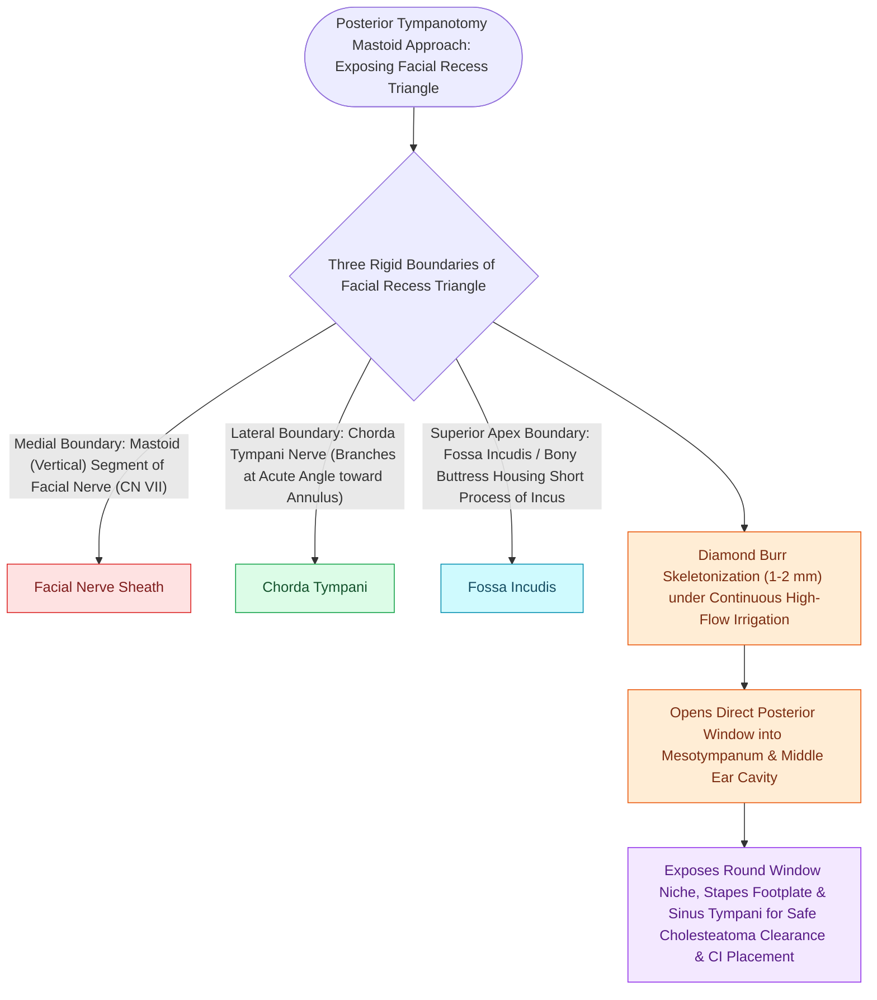

# The facial recess is bounded by the facial nerve, chorda tympani, and fossa incudis

## Active Recall

> [!question]- Where is the facial recess located relative to the facial nerve compared to the sinus tympani?
> *Answer / Clinical Rationale*: The **facial recess lies LATERAL** to the facial nerve, whereas the **sinus tympani lies MEDIAL** to the facial nerve.

> [!question]- What structures define the superior and lateral boundaries of the facial recess?
> *Answer / Clinical Rationale*: The **fossa incudis superiorly** and the **chorda tympani nerve laterally**.

## Core Clinical & Mechanistic Principles
The **facial recess (suprapyramidal recess)** is an anatomical depression on the posterior wall of the tympanic cavity that forms the surgical corridor for transmastoid middle ear access:
- **Triangular Boundaries**:
  - **Medial Boundary**: The descending mastoid (vertical) segment of the **facial nerve (CN VII)**.
  - **Lateral Boundary**: The **chorda tympani nerve** (running within the posterior tympanic canaliculus / chordal ridge) and the fibrous tympanic annulus.
  - **Superior Boundary (Base)**: The **fossa incudis** (housing the short process of the incus and posterior incudal ligament) / incus buttress.
  - **Inferior Boundary (Apex)**: The junction where the chorda tympani branches off the facial nerve (typically $3\text{–}5\text{ mm}$ above the stylomastoid foramen).
  - **Apertures of the Chorda Tympani**:
    - *Entrance (Iter Chordae Posterius)*: The chorda tympani emerges from the descending facial canal and enters the posterior middle ear cavity through a discrete bony aperture termed the **iter chordae posterius** (posterior aperture of the chordal canaliculus), located just lateral to the pyramidal eminence at the level of the upper third of the tympanic membrane.
    - *Exit (Petrotympanic / Huguier Fissure)*: After crossing the medial neck of the malleus and lateral surface of the incus long process, the chorda exits the middle ear anteriorly through the **petrotympanic fissure (Glaserian fissure / Huguier canal)** to enter the infratemporal fossa, joining the lingual nerve.
- **Distinction from Sinus Tympani**:
  - The **facial recess lies LATERAL** to the vertical facial nerve.
  - The **sinus tympani lies MEDIAL** to the facial nerve (cannot be directly viewed via transmastoid [[Posterior tympanotomy facial recess approach opens the corridor between CN VII and chorda tympani|posterior tympanotomy]]; requires endoscopic or transcanal visualization).

### Surgical Technique & Critical Safety Checks
- **Thermal Safety**: Continuous irrigation prevents thermal neuropraxia to the facial nerve during drilling in the facial recess.

## Connected Concepts & Graph Traversal
- **Facial Recess Approach**: [[Posterior tympanotomy facial recess approach opens the corridor between CN VII and chorda tympani|Posterior Tympanotomy Surgical Craft]]
- **Cochlear Implantation**: [[Round window and extended round window insertions minimize intracochlear acoustic trauma|Round Window Insertion Corridor]]
- **TEES Endoscopy**: [[Transcanal endoscopic ear surgery TEES provides line-of-sight visualization into the sinus tympani and epitympanum|TEES & Sinus Tympani Visual]]
- **Incus Landmark**: [[The cochleariform process serves as the constant middle ear landmark triangulating the geniculate ganglion, tympanic CN VII, and tensor tympani tendon|Cochleariform Constant & Incus Fossa]]
- **Mastoidectomy Principles**: [[Complete cortical mastoidectomy unroofs the mastoid antrum and establishes dependent middle ear drainage|Cortical Mastoidectomy Saucerization]]
