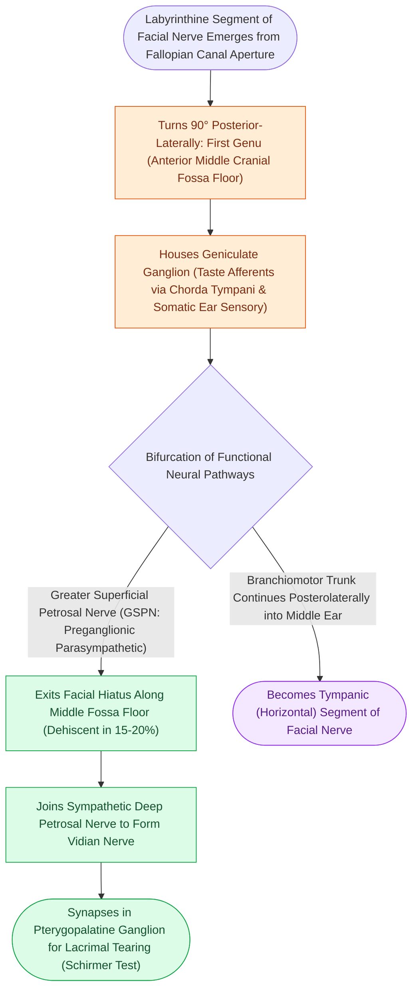

# The first genu marks the location of the geniculate ganglion and origin of the greater superficial petrosal nerve

## Active Recall

> [!question]- What preganglionic parasympathetic nerve arises from the geniculate ganglion to supply the lacrimal gland?
> *Answer / Clinical Rationale*: The **Greater Superficial Petrosal Nerve (GSPN)**.

> [!question]- What clinical test evaluates parasympathetic function of the GSPN at the geniculate ganglion?
> *Answer / Clinical Rationale*: The **Schirmer test** (measuring tear production on filter paper strips).

## Core Clinical & Mechanistic Principles
The **first genu (anterior bend)** of the facial nerve lies in the anterior middle cranial fossa floor, marking the transition from the [[The labyrinthine segment is the narrowest portion of the Fallopian canal and most vulnerable to edema|labyrinthine segment]] to the horizontal tympanic segment:
- **Geniculate Ganglion Functional Neuroanatomy**:
  - Houses the **pseudounipolar sensory cell bodies** for:
    1. **Taste (Special Sensory)**: From the anterior two-thirds of the tongue (via chorda tympani).
    2. **General Somatic Sensation**: From the posterior external auditory canal skin, conchal bowl, and tympanic membrane (via Arnold's and Ramsay Hunt cutaneous branches).
- **The Greater Superficial Petrosal Nerve (GSPN)**:
  - Arises directly from the anterior aspect of the geniculate ganglion.
  - Carries **preganglionic parasympathetic secretomotor fibers** to the **pterygopalatine (sphenopalatine) ganglion**, which innervates the **lacrimal gland**, nasal mucosal glands, and palatine glands.
- **Topographical Topography & Surgical Hazards**:
  - The geniculate ganglion is naturally **dehiscent (lacks overlying bone) in $15\text{–}20\%$ of normal temporal bones**, exposing it directly to the middle fossa dura.
  - Traction on the GSPN during middle cranial fossa surgery can avulse the geniculate ganglion, causing facial paralysis and total dry eye (xerophthalmia).

### Surgical Technique & Critical Safety Checks
- **Topognostic Schirmer Test**: Measures lacrimation; a $>50\%$ reduction in tear production in the affected ear indicates a facial nerve lesion **at or proximal to the geniculate ganglion**.

## Connected Concepts & Graph Traversal
- **Intratemporal Fallopian Course**: [[The facial nerve traverses six distinct anatomical segments from the pons to the parotid gland|CN VII Anatomical Segments]]
- **Labyrinthine Fallopian Segment**: [[The labyrinthine segment is the narrowest portion of the Fallopian canal and most vulnerable to edema|Labyrinthine Segment Fallopian Canal]]
- **Middle Fossa Schwannoma Route**: [[The middle cranial fossa approach provides hearing preservation for intracanalicular schwannomas with lateral fundus extension|Middle Cranial Fossa Approach]]
- **Facial Schwannoma Predilection**: [[Facial nerve schwannomas present with slow progressive paralysis or facial twitching along the Fallopian canal|Facial Schwannoma along Fallopian Canal]]
- **Facial Fallopian Decompression**: [[Transmastoid and middle cranial fossa facial nerve decompression relieves canalicular compression|Middle Fossa CN VII Decompression]]
