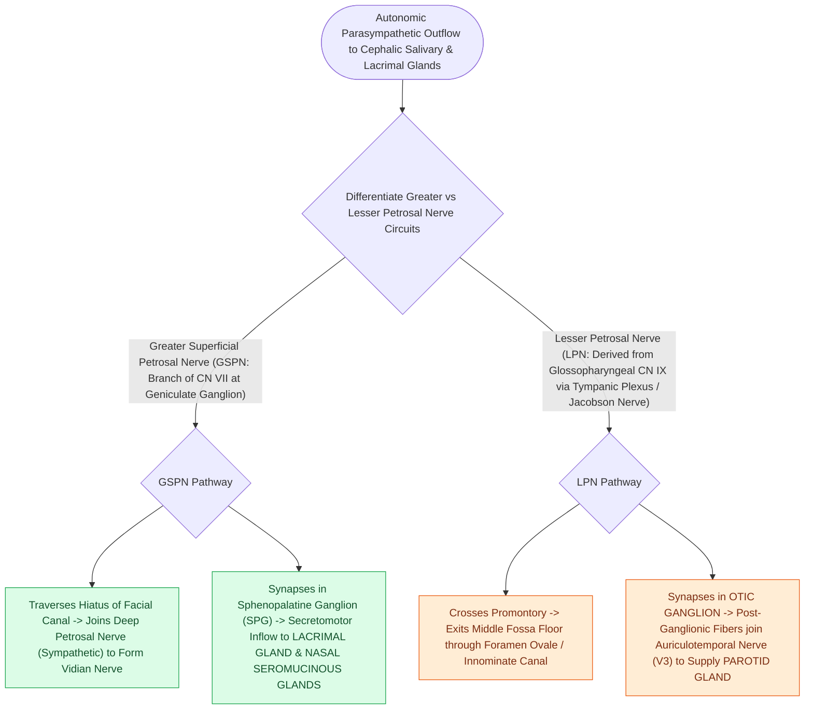

# The greater and lesser petrosal nerves function as parasympathetic couriers connecting middle ear nerves to the lacrimal and parotid glands

## Active Recall

> [!question]- What is the complete neural pathway of the Greater Superficial Petrosal Nerve (GSPN)?
> *Answer / Clinical Rationale*: Originates at the **geniculate ganglion of CN VII**, courses over the petrous ICA to join the deep petrosal nerve as the **Vidian nerve**, synapses in the **pterygopalatine ganglion**, and supplies secretomotor fibers to the **lacrimal gland**.

> [!question]- How does the Lesser Petrosal Nerve pathway explain the pathophysiology of Frey syndrome?
> *Answer / Clinical Rationale*: Parasympathetic pre-ganglionic fibers from **Jacobson's nerve (CN IX)** form the lesser petrosal nerve to synapse in the otic ganglion; post-ganglionic fibers travel via the **auriculotemporal nerve** to the parotid. After parotidectomy, these severed secretomotor axons aberrantly re-innervate cutaneous sweat glands.

> [!question]- What middle ear structure is targeted in tympanic neurectomy for refractory drooling?
> *Answer / Clinical Rationale*: **Jacobson's nerve (tympanic branch of CN IX)** on the middle ear promontory, which severs the parasympathetic secretomotor supply to the parotid gland.

## Core Clinical & Mechanistic Principles
The temporal bone houses two parallel parasympathetic conduits—the **Greater Superficial Petrosal Nerve (GSPN)** and the **Lesser Petrosal Nerve**—that act as couriers transmitting pre-ganglionic secretomotor fibers from middle ear nerves to major exocrine target glands:

- **1. Greater Superficial Petrosal Nerve (GSPN — CN VII to Lacrimal Gland)**:
  - *Origin*: Arises from the **geniculate ganglion (first genu of CN VII)**.
  - *Course*: Emerges into the middle cranial fossa through the *hiatus for the greater petrosal nerve*, running anteromedially in a groove directly over the **horizontal segment of the petrous internal carotid artery (ICA)** (serving as the carotid's primary surface landmark).
  - *Vidian Formation*: Traverses the foramen lacerum where it unites with the **deep petrosal nerve** (postganglionic sympathetic fibers from the internal carotid plexus) to form the **Vidian nerve (nerve of the pterygoid canal)**.
  - *Synapse & Target*: Synapses in the **pterygopalatine (sphenopalatine) ganglion**; post-ganglionic fibers hitchhike along zygomatic (V2) and lacrimal (V1) branches to innervate the **lacrimal gland** and nasal mucosa.
  - *Topognostic Tool*: Proximal CN VII lesions at or medial to the [[The first genu marks the location of the geniculate ganglion and origin of the greater superficial petrosal nerve|geniculate ganglion]] cause **dry eye** (positive Schirmer's test, $\le 5\text{ mm}$ wetting at 5 min).

- **2. Lesser Petrosal Nerve (CN IX to Parotid Gland)**:
  - *Origin*: Arises from the **tympanic plexus on the promontory**, which is formed by **Jacobson's nerve (tympanic branch of CN IX)**.
  - *Course*: Ascends through the middle ear, emerges onto the middle fossa floor through the superior tympanic canaliculus, and exits the skull base through the **foramen ovale** (or *canaliculus innominatus*).
  - *Synapse & Target*: Synapses in the **otic ganglion** (located medial to CN V3 just below foramen ovale); post-ganglionic parasympathetic secretomotor fibers hitchhike on the **auriculotemporal nerve (CN V3)** to innervate the **parotid gland**.

- **The Three Clinical Payloads of the Lesser Petrosal Circuit**:
  1. **Glomus Tympanicum Paraganglioma**: Arises from paraganglionic glomus bodies clustered along Jacobson's nerve on the middle ear promontory (manifesting as [[Jugular paragangliomas arise from the glomus body in the adventitia of the jugular bulb|pulsatile tinnitus]] and a red middle ear mass).
  2. **Frey Syndrome (Gustatory Sweating)**: Occurs after parotidectomy when severed post-ganglionic auriculotemporal parasympathetic fibers aberrantly regenerate to re-innervate overlying cutaneous cholinergic sweat glands.
  3. **Tympanic Neurectomy**: Historical and modern surgical transection of Jacobson's nerve across the middle ear promontory to eliminate secretomotor drive and reduce intractable drooling (sialorrhea).

### Surgical Technique & Critical Safety Checks
- **Middle Cranial Fossa Skull Base Dissection**: During middle fossa exposure for vestibular schwannoma or facial nerve decompression, the GSPN is identified anteriorly and followed retrograde to safely unroof the geniculate ganglion. Bipolar coagulation must be used with caution over the GSPN to prevent thermal injury to the underlying petrous ICA.

## Connected Concepts & Graph Traversal
- **Facial Nerve Ledger**: [[The facial nerve traverses six distinct anatomical segments from the pons to the parotid gland|Facial Nerve Segments & Geniculate Ganglion]]
- **Cochleariform Constant**: [[The cochleariform process serves as the constant middle ear landmark triangulating the geniculate ganglion, tympanic CN VII, and tensor tympani tendon|Cochleariform Process Triangulation]]
- **🔗 Frey Syndrome Mechanism (Head and Neck)**: [[Frey syndrome results from aberrant auriculotemporal reinnervation of sweat glands after parotidectomy|Frey Syndrome Pathophysiology]]
- **🔗 Referred Otalgia (Head and Neck)**: [[Referred otalgia originates from shared sensory pathways of cranial nerves V, VII, IX, X, and cervical roots C2-C3|Jacobson's Nerve in Referred Otalgia]]
- **Otic Capsule Foundation**: [[The otic capsule is an immutable endochondral bone that provides fixed surgical reference landmarks|Otic Capsule Invariant]]
