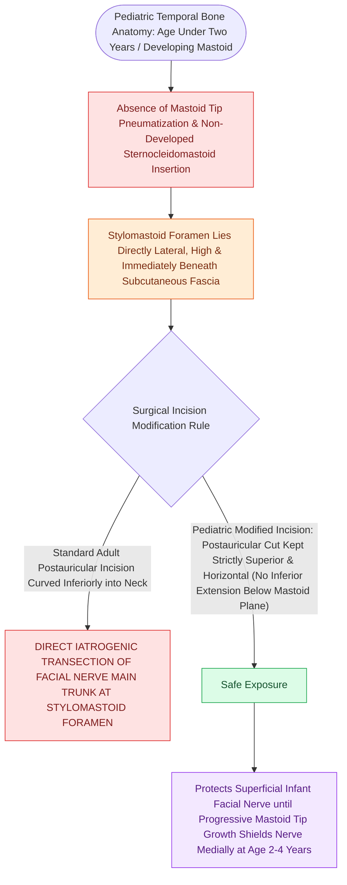

# The infant mastoid lacks a developed tip placing the facial nerve in a subcutaneous vulnerable position at the stylomastoid foramen

## Active Recall

> [!question]- Why is the main trunk of the facial nerve at extreme risk during a postauricular incision in an infant under 2 years of age?
> *Answer / Clinical Rationale*: Because the **mastoid tip has not yet developed**, placing the **stylomastoid foramen and facial nerve directly in a superficial, subcutaneous position** without bony overhang.

> [!question]- What is the Foramen of Huschke, and what symptoms can it cause?
> *Answer / Clinical Rationale*: A persistent developmental defect in the **anteroinferior bony external auditory canal** from incomplete tympanic ring fusion, causing communication with the TMJ / parotid (salivary otorrhea, temporomandibular joint herniation, otalgia with chewing).

> [!question]- Through what anatomical structures does necrotizing otitis externa escape the cartilaginous EAC into the parotid and skull base?
> *Answer / Clinical Rationale*: Through the **Fissures of Santorini** in the anteroinferior cartilaginous canal wall.

## Core Clinical & Mechanistic Principles
The infant temporal bone differs fundamentally from the adult framework in its degree of pneumatization, development of the mastoid process, and closure of embryonic fissures:

- **Absent Mastoid Tip & Subcutaneous Facial Nerve ($<2\text{ Years}$)**:
  - *Embryological Development*: The mastoid process does not exist at birth. It forms postnatally as the sternocleidomastoid (SCM) muscle exerts traction during head-lifting, crawling, and upright walking, completing its descent around **$2\text{ to }3\text{ years of age}$**.
  - *Surgical Vulnerability*: In infants and young children under 2 years, the **stylomastoid foramen lies superficial and directly subcutaneous** on the lateral surface of the skull base without bony mastoid tip protection.
  - *Incision Modification*: Standard adult postauricular incision and inferior soft-tissue elevation will cause direct transection of [[The facial nerve traverses six distinct anatomical segments from the pons to the parotid gland|CN VII]]. In infants, the postauricular incision must be placed **superior and posterior**, curving well back over the squama, and dissection must strictly avoid deep inferior traction over the rudimentary mastoid.

- **Incomplete Tympanic Ring & Foramen of Huschke**:
  - The tympanic bone at birth is a delicate, C-shaped ring. Bony growth proceeds from anterior and posterior prominences that fuse around age 5.
  - *Foramen of Huschke (Patent Foramen Tympanicum)*: Incomplete fusion leaves a persistent **$2\text{–}4\text{ mm}$ defect in the anteroinferior bony EAC wall** in up to $5\%$ of adults.
  - *Clinical Significance*: Creates a direct non-neoplastic communication between the external auditory canal and the **temporomandibular joint (TMJ) / deep parotid lobe**, presenting as mastication-induced otalgia, parotid-EAC fistulae (salivary otorrhea), or anterior canal herniation during jaw closure.

- **Fissures of Santorini (Incisurae Santorinici)**:
  - Vertical clefts in the anterior and inferior **cartilaginous external auditory canal** filled with fibrous tissue.
  - Serve as the primary anatomical conduit through which **[[Malignant necrotizing otitis externa is an invasive pseudomonal skull base osteomyelitis in elderly diabetic patients|necrotizing otitis externa (NOE)]]** and EAC squamous cell carcinoma escape the canal to invade the parotid gland, infratemporal fossa, and skull base.

### Surgical Technique & Critical Safety Checks
- **Pediatric Cortical Mastoidectomy Approach**: When operating on an infant with acute coalescent mastoiditis or subperiosteal abscess, make the skin incision $1.0\text{–}1.5\text{ cm}$ posterior to the postauricular crease, strictly superior to the level of the external auditory canal, and identify the temporal line and MacEwen's triangle before touching the inferior mastoid bone.

## Connected Concepts & Graph Traversal
- **Facial Nerve Segments**: [[The facial nerve traverses six distinct anatomical segments from the pons to the parotid gland|CN VII Anatomical Segments]]
- **Otic Capsule Invariant**: [[The otic capsule is an immutable endochondral bone that provides fixed surgical reference landmarks|Otic Capsule Foundation]]
- **Necrotizing Otitis Externa**: [[Malignant necrotizing otitis externa is an invasive pseudomonal skull base osteomyelitis in elderly diabetic patients|Necrotizing Otitis Externa & Fissures of Santorini]]
- **Pediatric Acute Mastoiditis**: [[Acute coalescent mastoiditis causes trabecular osteoclasis and subperiosteal abscess formation|Acute Coalescent Mastoiditis]]
- **🔗 Great Auricular Nerve (FPRS)**: [[The great auricular nerve emerges at Erb's point and is vulnerable during rhytidectomy|Great Auricular Nerve Anatomy]]
