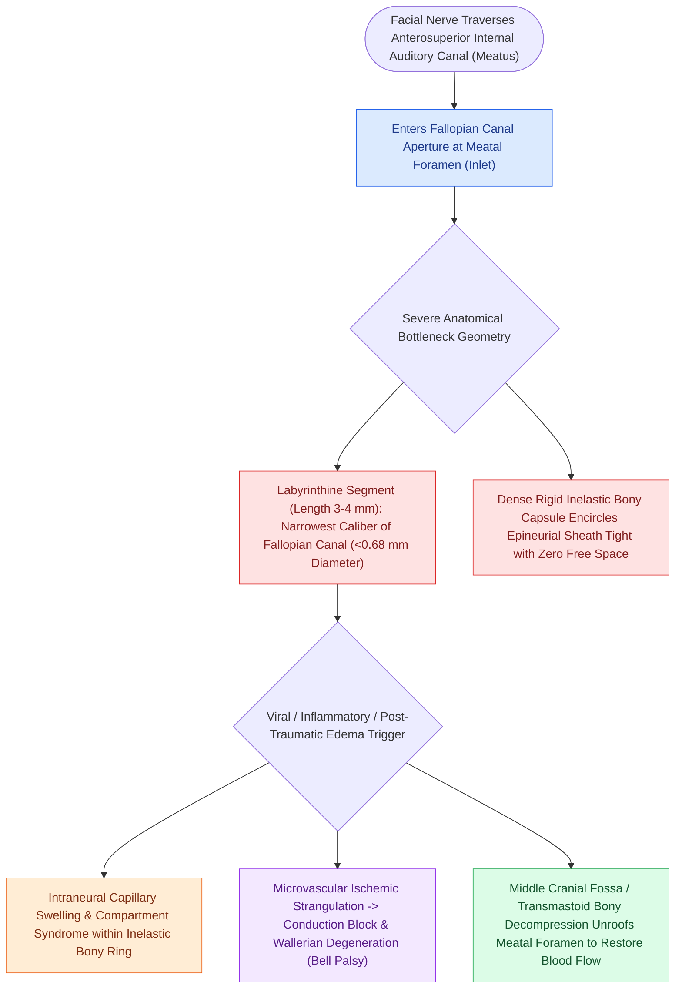

# The labyrinthine segment is the narrowest portion of the Fallopian canal and most vulnerable to edema

## Active Recall

> [!question]- Why is the labyrinthine segment the primary site of facial nerve injury in Bell's palsy?
> *Answer / Clinical Rationale*: Because it is the **narrowest point in the Fallopian canal ($0.68\text{ mm}$)** and a **vascular watershed zone**, making the nerve vulnerable to compartment syndrome when inflamed.

> [!question]- Why is transmastoid decompression alone insufficient for Bell's palsy?
> *Answer / Clinical Rationale*: Because transmastoid access cannot reach the **meatal foramen and labyrinthine segment**, which is the true site of entrapment.

## Core Clinical & Mechanistic Principles
The **labyrinthine segment** of the facial nerve extends from the fundus of the internal auditory canal (IAC) to the [[The first genu marks the location of the geniculate ganglion and origin of the greater superficial petrosal nerve|geniculate ganglion]]:
- **The "Bottleneck" Anatomical Geometry**:
  - The entrance into the Fallopian canal at the fundus of the IAC (**the meatal foramen**) measures only **$0.68\text{ mm}$ in diameter**.
  - The nerve occupies **$>83\%$ of the cross-sectional area** of the bony canal at this site (compared to $30\text{–}50\%$ in the mastoid segment).
  - The fibrous epineurium is densely adherent to the surrounding bone.
- **Watershed Microvascular Architecture**:
  - The labyrinthine segment is a microvascular **watershed zone** between the anterior inferior cerebellar artery (AICA / internal auditory artery) medially and the superficial petrosal artery (from the middle meningeal) laterally.
- **Pathophysiological Consequence in Bell's Palsy & Trauma**:
  - Any viral inflammation (HSV-1 reactivation), edema, or microvascular insult causes **rapid compartmental compression of the nerve against the rigid bony meatal foramen**.
  - Venous return is obstructed $\r\r\rightarrow$ elevated intraneural pressure $\r\r\rightarrow$ capillary ischemia $\r\r\rightarrow$ conduction block (neurapraxia) progressing to axonal degeneration (axonotmesis).

### Surgical Technique & Critical Safety Checks
- **Surgical Decompression Mandate**: In severe cases requiring surgical decompression, the **meatal foramen and labyrinthine segment MUST be unroofed** (via [[The middle cranial fossa approach provides hearing preservation for intracanalicular schwannomas with lateral fundus extension|middle cranial fossa approach]]); decompressing the mastoid segment alone is completely ineffective.

## Connected Concepts & Graph Traversal
- **First Genu Junction**: [[The first genu marks the location of the geniculate ganglion and origin of the greater superficial petrosal nerve|First Genu & Geniculate Ganglion]]
- **Intratemporal Fallopian Course**: [[The facial nerve traverses six distinct anatomical segments from the pons to the parotid gland|Fallopian Canal Segments]]
- **Idiopathic Acute Edema**: [[Acute Bell's palsy presents with unilateral lower motor neuron facial paralysis treated with early oral steroids|Bell's Palsy Pathophysiology]]
- **Surgical Fallopian Decompression**: [[Transmastoid and middle cranial fossa facial nerve decompression relieves canalicular compression|Middle Fossa CN VII Decompression]]
- **Electrodiagnostic ENoG Degeneration**: [[Electroneuronography showing greater than ninety percent degeneration within fourteen days indicates severe facial nerve axonal injury|ENoG Degeneration Criteria]]
