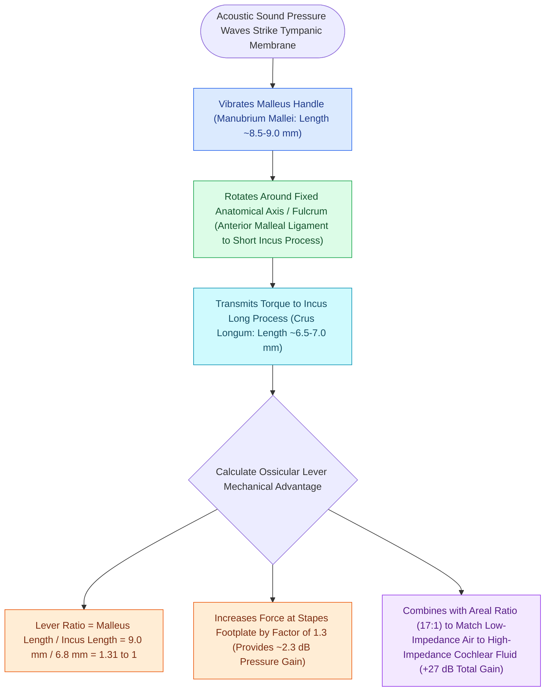

# The lever ratio of the malleus to incus provides a one point three to one mechanical advantage

## Active Recall

> [!question]- What is the mechanical lever ratio of the malleus to the incus in the human middle ear?
> *Answer / Clinical Rationale*: Approximately **$1.3:1$** (providing $\approx 2.3\text{ dB}$ of pressure gain).

> [!question]- Why does preserving the malleus handle during ossiculoplasty improve postoperative hearing outcomes?
> *Answer / Clinical Rationale*: It preserves the **$1.3:1$ ossicular lever advantage** and maintains radial tension on the tympanic membrane.

## Core Clinical & Mechanistic Principles
The **ossicular lever** is the mechanical lever system formed by the articulated malleus and incus rotating around a common anatomical axis of rotation:
- **Anatomical Axis of Rotation**:
  - Defined by a line passing through the anterior malleolar ligament (at the anterior process of the malleus) and the posterior incudal ligament (in the fossa incudis).
- **Lever Arm Measurements**:
  - **Effort Arm (Malleus)**: Length from the axis of rotation to the umbo of the malleus ($\approx 8.5\text{–}9.0\text{ mm}$).
  - **Load Arm (Incus)**: Length from the axis of rotation to the tip of the long process of the incus ($\approx 6.5\text{–}7.0\text{ mm}$).
- **The Mathematical Lever Advantage**:
  $$\text{Lever Ratio} = \frac{\text{Length of Malleus}}{\text{Length of Incus}} = \frac{8.5\text{ mm}}{6.5\text{ mm}} \approx 1.31 : 1$$
- **Pressure Gain**:
  $$\text{Gain (dB)} = 20 \log_{10}(1.31) \approx 2.34\text{ dB}$$

### Surgical Technique & Critical Safety Checks
- **Clinical Significance in Ossiculoplasty**: Preserving the malleus handle during [[Partial ossicular replacement prosthesis PORP requires an intact and mobile stapes superstructure|ossicular reconstruction]] maintains this $1.3:1$ mechanical advantage and tensions the neo-tympanic membrane, yielding significantly lower residual air-bone gaps compared to reconstructions without a malleus.

## Connected Concepts & Graph Traversal
- **Areal Impedance Gain**: [[The tympanic membrane areal ratio of seventeen to one provides the primary impedance gain|Tympanic Membrane Areal Ratio]]
- **Total Middle Ear Transformer**: [[The middle ear transformer ratio provides twenty-seven decibels of acoustic impedance matching|Middle Ear Transformer Ratio]]
- **Incus-to-Footplate Length**: [[The distance from the incus long process to the stapes footplate averages four to four point five millimeters|Incus Long Process Distance]]
- **Partial Ossicular Reconstruction**: [[Partial ossicular replacement prosthesis PORP requires an intact and mobile stapes superstructure|PORP Reconstruction]]
- **Austin-Kartush Classification**: [[The Austin-Kartush classification categorizes ossicular chain defects based on the presence of the malleus handle and stapes arch|Austin-Kartush Classification]]
