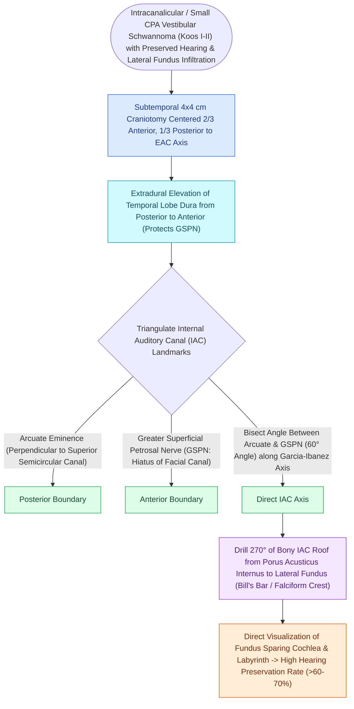

# The middle cranial fossa approach provides hearing preservation for intracanalicular schwannomas with lateral fundus extension

## Active Recall

> [!question]- What is the primary anatomical advantage of the MCF approach over the retrosigmoid approach for [[Vestibular schwannomas arise from the Schwann cell sheath of the inferior or superior vestibular nerve|vestibular schwannoma]]?
> *Answer / Clinical Rationale*: It provides **complete direct visualization of the extreme lateral fundus of the IAC** without opening the labyrinth.

> [!question]- What two surface landmarks on the floor of the middle cranial fossa are used to triangulate the axis of the IAC?
> *Answer / Clinical Rationale*: The **Greater Superficial Petrosal Nerve (GSPN) anteriorly** and the **arcuate eminence (superior semicircular canal) posteriorly**.

## Core Clinical & Mechanistic Principles
The **Middle Cranial Fossa (MCF) approach** (subtemporal extradural approach) provides superior exposure of the **entire length of the internal auditory canal (IAC)**, specifically accessing the **extreme lateral fundus** while preserving hearing:
- **Primary Indications**:
  - **Intracanalicular vestibular schwannomas (Koos Stage I)** or small CPA tumors ($<1.0\text{–}1.5\text{ cm}$) with **excellent serviceable preoperative hearing** (PTA $\le 30\text{ dB}$, WRS $\ge 70\%$).
  - Superior Semicircular Canal Dehiscence ([[Superior semicircular canal dehiscence SCDS presents with Tullio phenomenon and sound-induced vertigo|SCDS]]) repair.
  - [[Transmastoid and middle cranial fossa facial nerve decompression relieves canalicular compression|Facial nerve decompression]] of the [[The labyrinthine segment is the narrowest portion of the Fallopian canal and most vulnerable to edema|labyrinthine segment]] / meatal foramen.
- **Surgical Step-by-Step Execution**:
  1. $4\times 4\text{-cm}$ temporal craniotomy centered over the zygomatic root.
  2. Extradural elevation of the temporal lobe to expose the petrous ridge.
  3. **Landmark Identification**: Identify the **[[The first genu marks the location of the geniculate ganglion and origin of the greater superficial petrosal nerve|Greater Superficial Petrosal Nerve]] (GSPN)**, **arcuate eminence** (superior semicircular canal), and **foramen spinosum** (middle meningeal artery).
  4. **Garcia-Ibanez Bisection Technique**: The IAC lies along the line bisecting the angle between the GSPN and the arcuate eminence.
  5. Unroof the superior bony wall of the IAC from the porus acusticus to the **lateral fundus**, directly exposing **Bill's bar** and the facial nerve.

### Surgical Technique & Critical Safety Checks
- **Technical Hazards & Limitations**:
  - **Temporal Lobe Retraction**: Prolonged retraction can cause temporal lobe contusion, edema, seizures, or aphasia (in dominant hemisphere); relative contraindication in patients $>65\text{ years}$.
  - **Comparative Cranial Nerve VII Morbidity**: Compared to both the translabyrinthine and retrosigmoid suboccipital corridors, the **middle cranial fossa approach carries the highest relative risk of acute and permanent facial nerve (CN VII) paresis or paralysis**. Because the facial nerve courses anterosuperiorly in the IAC, it sits directly between the surgical trajectory from above and the underlying vestibular schwannoma (arising from the inferior or superior vestibular nerve), mandating careful dissection over and around the mobilized motor trunk.

## Connected Concepts & Graph Traversal
- **Koos Grading Staging**: [[Koos grading system classifies vestibular schwannomas from Stage I intracanalicular to Stage IV brainstem compression|Koos Stage I Intracanalicular]]
- **Translabyrinthine Sacrifice Route**: [[The translabyrinthine approach provides direct exposure of the internal auditory canal with complete hearing sacrifice|Translabyrinthine Approach]]
- **Retrosigmoid Hearing Route**: [[The retrosigmoid suboccipital approach allows hearing preservation for small to medium vestibular schwannomas|Retrosigmoid Approach]]
- **Intraoperative Cranial Monitoring**: [[Intraoperative facial nerve and cochlear nerve monitoring minimize cranial nerve morbidity in skull base surgery|Intraoperative CN VII/VIII Monitoring]]
- **Facial Fallopian Decompression**: [[Transmastoid and middle cranial fossa facial nerve decompression relieves canalicular compression|Middle Fossa CN VII Decompression]]
