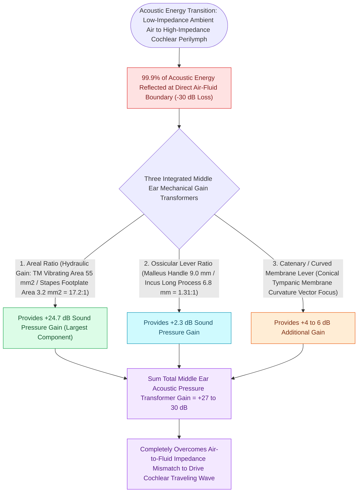

# The middle ear transformer ratio provides twenty-seven decibels of acoustic impedance matching

## Active Recall

> [!question]- Why does ossicular chain discontinuity behind an INTACT tympanic membrane produce a 50–60 dB conductive loss, whereas isolated stapes fixation produces only ~30 dB?
> *Answer / Clinical Rationale*: Behind an intact drum, sound waves are **shielded equally from both the oval and round windows**, eliminating the essential phase and pressure differential between windows; in stapes fixation, acoustic sound waves still strike the round window directly to generate fluid movement.

> [!question]- What are the numerical values for the areal ratio and ossicular lever ratio in the human middle ear?
> *Answer / Clinical Rationale*: Areal ratio is **$\approx 17:1$** ($55\ \text{mm}^2 : 3.2\ \text{mm}^2$); ossicular lever ratio is **$1.3:1$** (malleus manubrium to incus long process).

> [!question]- Which transformer mechanism contributes the largest proportion of total acoustic gain?
> *Answer / Clinical Rationale*: The **Areal Ratio** ($\approx 17:1$), contributing $\approx 25\text{ dB}$ of the total $27\text{–}30\text{ dB}$ gain.

## Core Clinical & Mechanistic Principles
The primary physiological role of the middle ear is to overcome the severe **acoustic impedance mismatch** between air ($Z_{\text{air}} \approx 400\ \text{Rayls}$) and inner ear perilymph fluid ($Z_{\text{fluid}} \approx 1,500,000\ \text{Rayls}$):
- **Without the Middle Ear**: An acoustic wave striking perilymph fluid directly reflects **$99.9\%$ of sound energy** ($0.1\%$ transmission), creating an immediate **$30\text{-dB}$ conductive attenuation**.

- **The Three Mechanical Transformer Mechanisms**:
  1. **Areal Ratio ($\approx 17:1$ to $21:1$)**: Effective vibrating area of the tympanic membrane ($55\ \text{mm}^2$, excluding peripheral non-vibrating zone) relative to the stapes footplate ($3.2\ \text{mm}^2$). Provides $\approx 25\text{ dB}$ of gain (the dominant impedance transformer).
  2. **Ossicular Lever Ratio ($1.3:1$)**: Length of the manubrium of the malleus ($8.5\text{–}9.0\text{ mm}$) relative to the long process of the incus ($6.5\text{–}7.0\text{ mm}$). Provides $\approx 2.3\text{ dB}$ of gain.
  3. **Catenary / Curved Membrane Lever ($2.0:1$)**: The conical, curved radial fibers of the tympanic membrane buckle, increasing force at the umbo. Provides $\approx 6\text{ dB}$ of gain.
- **Total Acoustic Gain**: Combined transformer ratio multiplies sound pressure by **$\approx 22\times \text{ to } 44\times$**, recovering **$\approx 27\text{–}30\text{ dB}$** of acoustic energy.

- **Conductive Hearing Loss Magnitudes by Pathological Mechanism**:
  - *Pure Stapes Fixation / Transformer Bypass*: $\approx 25\text{–}30\text{ dB}$ air-bone gap (sound reaches the oval window via direct air conduction without middle ear [[Hearing aid selection is driven by audiometric configuration and verified with real-ear measurement|amplification]]).
  - *TM Perforation with Intact Chain*: $\approx 10\text{–}35\text{ dB}$ loss (proportional to surface area of perforation; reduces effective [[The tympanic membrane areal ratio of seventeen to one provides the primary impedance gain|areal ratio]] and catenary lever).
  - *Ossicular Discontinuity with Intact Drum (The Maximal Conductive Loss)*: **$\approx 50\text{–}60\text{ dB}$ maximal flat conductive hearing loss**. *Biophysical Mechanism*: The intact drum physically shields the oval window and round window equally, eliminating the phase difference and acoustic sound pressure differential between the two windows, while the severed ossicular chain provides zero mechanical transfer.

### Surgical Technique & Critical Safety Checks
- **Audiogram Translation Rule**: A conductive air-bone gap of $50\text{–}60\text{ dB}$ on an audiogram with an intact tympanic membrane is diagnostic of **ossicular chain discontinuity** (typically incudostapedial joint erosion), rather than isolated otosclerotic stapes fixation.

## Connected Concepts & Graph Traversal
- **Areal Ratio Detail**: [[The tympanic membrane areal ratio of seventeen to one provides the primary impedance gain|Areal Ratio Physiology]]
- **Ossicular Lever Detail**: [[The lever ratio of the malleus to incus provides a one point three to one mechanical advantage|Ossicular Lever Mechanics]]
- **Otic Capsule Foundation**: [[The otic capsule is an immutable endochondral bone that provides fixed surgical reference landmarks|Otic Capsule Invariant]]
- **Stapedotomy Craft**: [[Stapedotomy utilizes a micro-drill or laser fenestration of the posterior footplate|Stapedotomy Technique]]
- **Tympanoplasty Grafting**: [[Underlay and overlay tympanoplasty techniques have distinct advantages and complication profiles|Tympanoplasty Techniques]]
- **Cartilage Island Shield**: [[Cartilage island tympanoplasty resists negative middle ear pressure and recurrent retraction|Cartilage Tympanoplasty]]
