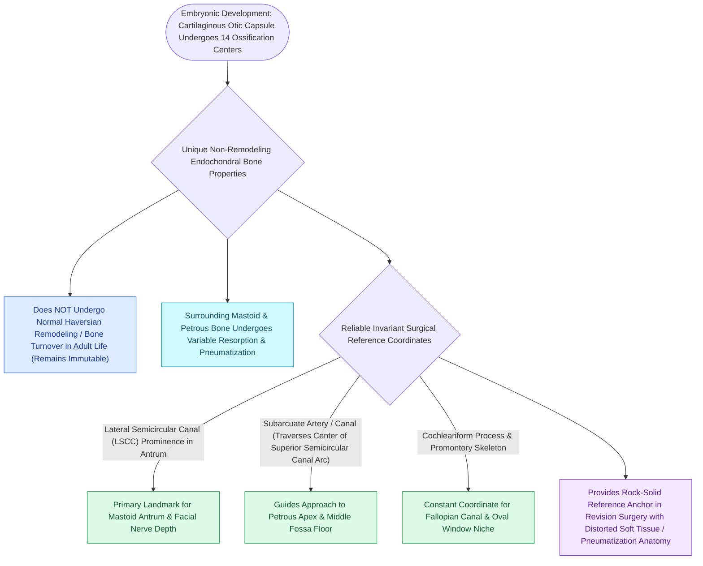

# The otic capsule is an immutable endochondral bone that provides fixed surgical reference landmarks

## Active Recall

> [!question]- Why do otic capsule landmarks remain reliable even in ears with extensive cholesteatoma or prior surgery?
> *Answer / Clinical Rationale*: The otic capsule is composed of **endochondral bone that completes ossification by 20 weeks of gestation and ceases Haversian remodeling**, preserving fixed spatial geometry (lateral canal, cochleariform, oval window).

> [!question]- What is the cardinal surgical rule regarding mastoid air cells during temporal bone drilling?
> *Answer / Clinical Rationale*: **Landmark on the otic capsule and facial nerve, never on air cells**, because variable pneumatization and false septa (Körner's septum) can masquerade as the antrum.

> [!question]- What embryological tissue layer forms the deepest middle/inner ear structure (the membranous labyrinth)?
> *Answer / Clinical Rationale*: **Invaginated otic placodal ectoderm** that became encased within the petrous otic capsule.

## Core Clinical & Mechanistic Principles
Temporal bone surgery is organized around **three core anatomical invariants** that establish a stable 3D coordinate system regardless of pathology, chronic infection, or congenital malformation:

- **The Three Temporal Bone Invariants**:
  1. **The Otic Capsule Never Moves and Never Remodels**:
     - *Endochondral Ossification*: The otic capsule is dense endochondral bone that ossifies completely from 14 cartilaginous centers by **$\approx 20\text{ weeks}$ of gestation**, reaches adult size at birth, and ceases all Haversian remodeling.
     - *Immutable Reference Landmarks*: Because it does not remodel, otic capsule landmarks—the **lateral semicircular canal dome, cochleariform process, oval window, and promontory**—remain fixed, durable, and trustworthy even in severe cholesteatoma erosion, revision surgery, or syndromic anomalies.
     - *Pathology Corollaries*: Labyrinthine fistulae do not heal by osteogenesis; [[Otosclerosis is characterized by abnormal bone remodeling of the otic capsule causing stapes fixation|otosclerosis]] represents the capsule's unique abnormal remodeling disease (initiating at the fissula ante fenestram); and the capsule appears as the densest radio-opaque bone on high-resolution CT.
  2. **The Facial Nerve is the Path Everything is Measured Against**:
     - Embryologically, [[The facial nerve traverses six distinct anatomical segments from the pons to the parotid gland|CN VII]] reaches its destination before the surrounding temporal bone ossifies. The bone accommodates the tenant, explaining why congenital malformations displace the nerve anteriorly/laterally and why natural bony dehiscences (up to 50% at the oval window) occur frequently.
  3. **Pneumatization is the Great Variable**:
     - Mastoid air-cell development varies from hyper-pneumatized cellular bones to dense sclerotic blocks with a forward sigmoid sinus and low-hanging tegmen.
     - *Operating Rule*: **Landmark on the capsule and nerve, never on air cells**. Air cells can imitate the antrum (Körner's septum trap), but the lateral semicircular canal cannot imitate anything.

- **The Germ-Layer Depth Gauge**:
  - Traversed laterally to medially:
    1. **Ectoderm**: EAC skin, squamous outer layer of the tympanic membrane.
    2. **Neural Crest Mesenchyme**: Middle fibrous layer of the tympanic membrane, ossicular chain.
    3. **Endoderm**: Middle ear and Eustachian tube mucosa.
    4. **Invaginated Placodal Ectoderm**: The **membranous labyrinth**—the deepest structure is embryologically external surface ectoderm that invaginated and became encased within the endochondral capsule.

### Surgical Technique & Critical Safety Checks
- **CT Pre-Operative Navigation**: In distorted revision cases or congenital atresia, identify the dense otic capsule on axial and coronal CT slices first; measure the distance from the capsule to the tegmen and sigmoid sinus before planning the surgical vector.

## Connected Concepts & Graph Traversal
- **Cochleariform Constant**: [[The cochleariform process serves as the constant middle ear landmark triangulating the geniculate ganglion, tympanic CN VII, and tensor tympani tendon|Cochleariform Process Triangulation]]
- **Facial Nerve Ledger**: [[The facial nerve traverses six distinct anatomical segments from the pons to the parotid gland|Facial Nerve Segments & Aphorisms]]
- **Otosclerosis Remodeling**: [[Otosclerosis is characterized by abnormal bone remodeling of the otic capsule causing stapes fixation|Otosclerosis Otic Capsule Remodeling]]
- **Labyrinthine Fistula**: [[Labyrinthine fistula from cholesteatoma erosions most frequently involves the lateral semicircular canal|Labyrinthine Fistula of Lateral Canal]]
- **Temporal Bone Fractures**: [[Temporal bone longitudinal and transverse fractures cause delayed or immediate facial paralysis|Otic Capsule Sparing vs Violating Fractures]]
