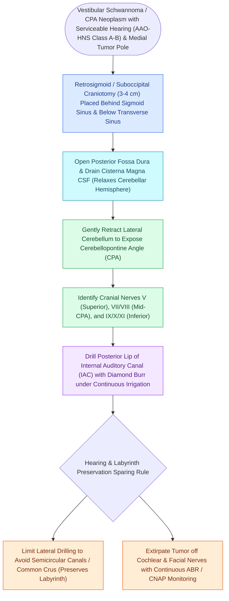

# The retrosigmoid suboccipital approach allows hearing preservation for small to medium vestibular schwannomas

## Active Recall

> [!question]- Why is drilling the posterior wall of the IAC limited to 6–8 mm in the retrosigmoid approach?
> *Answer / Clinical Rationale*: To avoid penetrating the **posterior semicircular canal and common crus**, which would destroy inner ear hearing.

> [!question]- What is the primary advantage of the retrosigmoid approach over the translabyrinthine approach?
> *Answer / Clinical Rationale*: It provides the opportunity for **hearing preservation** by leaving the labyrinth intact.

## Core Clinical & Mechanistic Principles
The **retrosigmoid (suboccipital) approach** provides a posterior corridor to the cerebellopontine angle, allowing tumor resection while **attempting hearing preservation**:
- **Indications**:
  - [[Vestibular schwannomas arise from the Schwann cell sheath of the inferior or superior vestibular nerve|Vestibular schwannomas]] with **serviceable preoperative hearing** (AAO-HNS Class A/B; PTA $\le 50\text{ dB}$, WRS $\ge 50\%$) extending into the CPA cistern.
  - Large/giant CPA tumors ($>3\text{–}4\text{ cm}$) compressing the brainstem where hearing preservation or tumor decompression is targeted.
  - Meningiomas, epidermoids, and microvascular decompression for trigeminal neuralgia (Janetta procedure) or hemifacial spasm.
- **Surgical Step-by-Step Execution**:
  1. Retrosigmoid craniotomy placed immediately posterior and inferior to the junction of the **transverse and sigmoid sinuses**.
  2. Incise dura; gently retract the cerebellar hemisphere with dynamic CSF release from the cisterna magna.
  3. Expose the CPA portion of the tumor, identifying CN VII and VIII at the brainstem root entry zone.
  4. **Drill the Posterior Lip of the Porus Acusticus**: Skeletonize the posterior wall of the IAC to expose the intracanalicular tumor component.
  5. **The Fundus Limitation & Semicircular Canal Hazard**:
     - The **posterior semicircular canal (PSCC)** and the **common crus** lie immediately lateral to the posterior wall of the IAC.
     - Drilling more than **$6.0\text{–}8.0\text{ mm}$ lateral to the porus** risks opening the labyrinth, causing **immediate complete hearing loss**.

### Surgical Technique & Critical Safety Checks
- **The Fundus Blind Spot**: Tumors extending into the extreme lateral fundus of the IAC cannot be fully visualized without risking labyrinthine injury; requires angled endoscopic visualization or conversion.

## Connected Concepts & Graph Traversal
- **Translabyrinthine Sacrifice Route**: [[The translabyrinthine approach provides direct exposure of the internal auditory canal with complete hearing sacrifice|Translabyrinthine Approach]]
- **Middle Cranial Fossa Route**: [[The middle cranial fossa approach provides hearing preservation for intracanalicular schwannomas with lateral fundus extension|Middle Cranial Fossa Approach]]
- **Koos Staging System**: [[Koos grading system classifies vestibular schwannomas from Stage I intracanalicular to Stage IV brainstem compression|Koos Staging System]]
- **Intraoperative ABR Monitoring**: [[Intraoperative facial nerve and cochlear nerve monitoring minimize cranial nerve morbidity in skull base surgery|Intraoperative Cranial Monitoring]]
- **Post-Op CSF Fistula Care**: [[Cerebrospinal fluid CSF leak and pseudomeningocele require lumbar drainage, fat obliteration, and re-exploration|CSF Leak Lumbar Drainage]]
