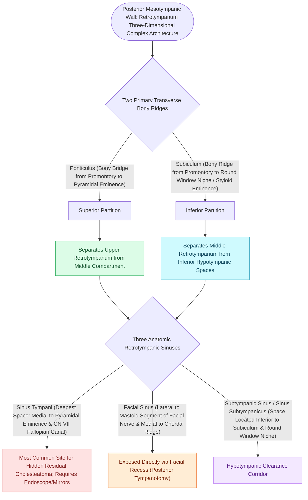

# The retrotympanum is partitioned into sinus tympani, facial sinus, and subtympanic sinus by the ponticulus and subiculum

## Active Recall

> [!question]- What are the precise anatomical boundaries of the sinus tympani, and why is it the most common site of residual middle ear cholesteatoma?
> *Answer / Clinical Rationale*: The **sinus tympani** is bounded **medially** by the otic capsule (posterior labyrinth/vestibule), **laterally** by the descending mastoid segment of the facial nerve ($CN\ VII$) and pyramidal eminence, **superiorly** by the **ponticulus** (bony bridge from promontory to pyramidal eminence), and **inferiorly** by the **subiculum** (bony ridge from promontory to styloid complex). Because it lies deep and medial to the facial nerve, it cannot be visualized via direct line-of-sight through a posterior tympanotomy or standard canal wall up tympanoplasty, requiring 45-degree angled endoscopes (TEES) or angled mirrors to avoid leaving matrix behind.

> [!question]- What anatomical structures separate the sinus tympani from the facial recess (facial sinus) and the subtympanic sinus (sinus subtympanicus)?
> *Answer / Clinical Rationale*: (1) The **facial nerve (tympanic/mastoid junction)** separates the *medially positioned* **sinus tympani** from the *laterally positioned* **facial recess** (bounded laterally by the chorda tympani). (2) The **ponticulus** separates the *posterior sinus* (superiorly) from the *sinus tympani* (inferiorly). (3) The **subiculum** separates the *sinus tympani* (superiorly) from the *subtympanic sinus / sinus subtympanicus* (inferiorly, adjacent to the round window niche).

> [!question]- How is the sinus tympani classified surgically by depth according to the Marchioni and Piccirillo classification?
> *Answer / Clinical Rationale*: **Type A (Small)**: Shallow sinus not extending posterior to the facial nerve canal. **Type B (Medium)**: Extends posterior to the mastoid facial nerve but not medial to it. **Type C (Deep / Retrofacial)**: Deeply pneumatic sinus extending posterior AND medial to the facial nerve toward the posterior semicircular canal, posing high risk of facial nerve injury and residual disease during microscopic clearance.

## Core Clinical & Mechanistic Principles

The **retrotympanum** is the posterior compartment of the middle ear cavity lying posterior to the promontory and labyrinthine wall. It contains critical anatomical recesses that harbor microscopic epithelial remnants in [[Primary acquired cholesteatoma arises from retraction pocket invagination of the pars flaccida into Prussak space|cholesteatoma]] surgery:

### Surgical Technique & Craft Nuances
- **Transcanal Endoscopic Ear Surgery (TEES) Clearance**:
  - Rigid $3.0\text{ mm}$ 0-degree, 30-degree, and 45-degree endoscopes bypass the line-of-sight obstruction of the posterior bony canal wall.
  - An angled curved suction and curette are placed under direct video visualization into the depth of the retrofacial pocket.
- **Danger Zone**: Blind instrumentation with straight instruments behind the second genu of the facial nerve risks:
  1. Direct mechanical transection or thermal injury to the **vertical/tympanic CN VII**.
  2. Subluxation of the **stapes superstructure** or fracture of the stapes crura if pulling traction on cholesteatoma adherent to the stapedius tendon.
  3. [[Labyrinthine fistula from cholesteatoma erosions most frequently involves the lateral semicircular canal|Labyrinthine fistula]] creation into the **posterior semicircular canal ampulla** in Type C retrofacial extensions.

## Connected Concepts & Graph Traversal
- **Surgical Access**: [[Posterior tympanotomy facial recess approach opens the corridor between CN VII and chorda tympani|Posterior Tympanotomy Corridor]]
- **Endoscopic Visualization**: [[Transcanal endoscopic ear surgery TEES provides line-of-sight visualization into the sinus tympani and epitympanum|TEES in Middle Ear Surgery]]
- **Facial Nerve Landmark**: [[The cochleariform process serves as the constant middle ear landmark triangulating the geniculate ganglion, tympanic CN VII, and tensor tympani tendon|Cochleariform Process Landmark]]
- **Cholesteatoma Pathophysiology**: [[Primary acquired cholesteatoma arises from retraction pocket invagination of the pars flaccida into Prussak space|Primary Acquired Cholesteatoma]]
- **Attic Ventilation Barriers**: [[The epitympanic diaphragm and tympanic isthmus govern attic ventilation and selective epitympanic dysventilation|Epitympanic Diaphragm & Isthmus]]
- **Facial Nerve Segments**: [[The facial nerve traverses six distinct anatomical segments from the pons to the parotid gland|CN VII Anatomical Segments]]
