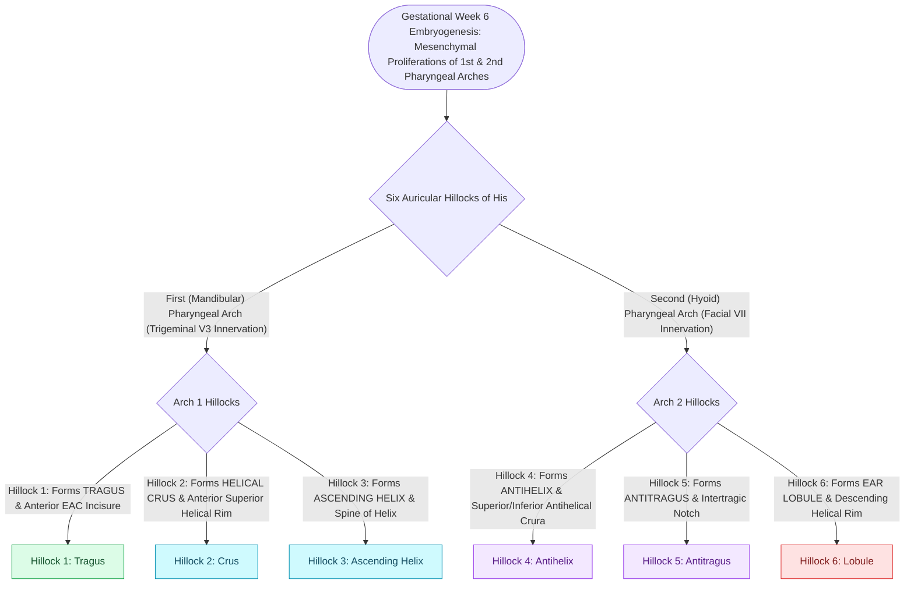

# The six auricular hillocks of His derive from the first and second branchial arches to form the pinna

## Active Recall

> [!question]- Which specific anatomical parts of the auricle derive from Hillocks 1–3 (first branchial arch) versus Hillocks 4–6 (second branchial arch)?
> *Answer / Clinical Rationale*: **Hillocks 1–3** derive from the mandibular (first) branchial arch: Hillock 1 forms the **tragus**, Hillock 2 forms the **crus helicis**, and Hillock 3 forms the **ascending helix**. **Hillocks 4–6** derive from the hyoid (second) branchial arch: Hillock 4 forms the **antihelix / superior helix**, Hillock 5 forms the **antitragus**, and Hillock 6 forms the **lobule**.

> [!question]- What is the embryological mechanism and precise surgical relationship of a congenital preauricular sinus or cyst?
> *Answer / Clinical Rationale*: A preauricular sinus arises from **incomplete fusion or entrapped ectodermal tissue between the first and second branchial arch hillocks** (specifically between Hillock 1 and Hillock 2). The tract consistently originates **anterior to the crus helicis** and travels deep toward the temporalis fascia, running immediately superficial to the parotid capsule, requiring supra-auricular superficial temporal fascial dissection during surgical excision to avoid recurrence.

> [!question]- What four distinct nerve pathways provide sensory innervation to the lateral and medial auricle?
> *Answer / Clinical Rationale*: (1) **Auriculotemporal nerve ($V_3$)**: Tragus, crus helicis, anterior superior helix, anterior EAC wall. (2) **Greater auricular nerve ($C_2, C_3$)**: Posterior-inferior pinna (lobule, antitragus, concha, medial mastoid surface). (3) **Lesser occipital nerve ($C_2$)**: Superior-posterior medial surface and superior helix. (4) **Arnold's nerve (auricular branch of CN X)** with contributions from **Jacobson's nerve (CN IX)** and **CN VII (Ramsay Hunt sensory branch)**: Conchal bowl, antihelix fossa, and posterior external auditory canal (eliciting the Arnold ear-cough reflex when stimulated).

## Core Clinical & Mechanistic Principles

The external ear develops during the **sixth week of embryonic gestation** through the proliferation of six distinct mesenchymal swellings called the **auricular hillocks of His**, flanking the first [[Each branchial arch packages one nerve, one artery, one cartilage bar, and one muscle group|branchial]] (pharyngeal) groove:

### Surgical Technique & Craft Nuances
- **Preauricular Sinus Excision (Supra-Auricular Approach)**:
  - Methylene blue dye injection into the punctum highlights the arborizing sinus tract.
  - An elliptical incision around the punctum is extended superiorly into the preauricular crease.
  - Dissection must proceed down to the **temporalis fascia**, taking a cuff of cartilage at the anterior crus of the helix to ensure complete removal of entrapped ectoderm and eliminate the $15-20\%$ recurrence rate of simple unroofing.
- **Auricular Field Block for Office Surgery**:
  - Infiltrate local anesthetic in a **ring block pattern**: 
    - Superior and anterior: Blocks the **auriculotemporal nerve ($V_3$)**.
    - Inferior and posterior: Blocks the **greater auricular nerve ($C_2, C_3$)** and **lesser occipital nerve ($C_2$)**.
    - Conchal bowl infiltration: Directly blocks the **Arnold nerve (CN X)** and **CN VII** sensory branches for comfortable canal incisions or punch biopsies.

## Connected Concepts & Graph Traversal
- **🔗 Embryological Framework (Pediatrics)**: [[Each branchial arch packages one nerve, one artery, one cartilage bar, and one muscle group|Branchial Arch Package Principles]]
- **Congenital Auricular Anomalies**: [[Congenital aural atresia candidacy is graded by the ten-point Jahrsdoerfer scale|Jahrsdoerfer Atresia Grading]]
- **🔗 Microtia Reconstruction (FPRS)**: [[Microtia autologous costal cartilage framework stages balance four-stage Brent and two-stage Nagata reconstruction protocols|Nagata & Brent Microtia Reconstruction]]
- **Auricular Trauma & Hematoma**: [[Auricular hematoma evacuation and bolster compression prevents permanent cauliflower ear deformity|Auricular Hematoma Compression]]
- **Herpes Zoster Oticus**: [[Ramsay Hunt syndrome herpes zoster oticus presents with severe facial paralysis, otalgia, and auricular vesicles|Ramsay Hunt Syndrome]]
- **Cranial Nerve Exits**: [[The twelve cranial nerves are evaluated by functional components, skull base exits, and clinical reflexes|Twelve Cranial Nerves Assessment]]
