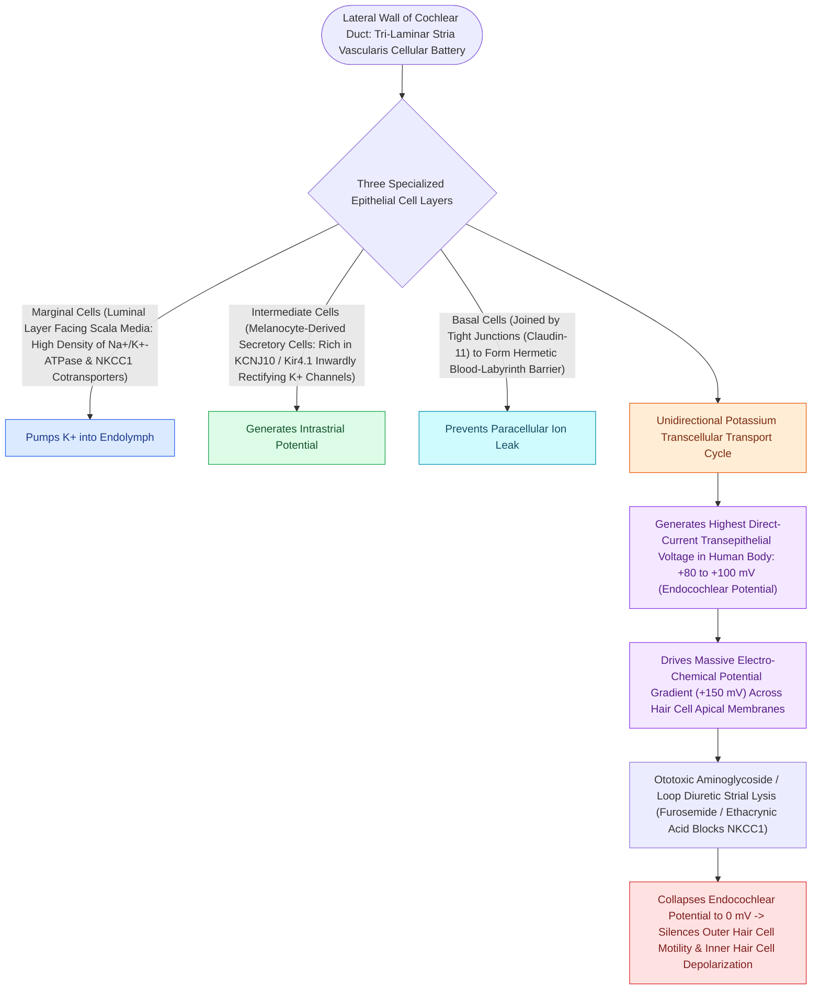

# The stria vascularis generates the endocochlear potential of positive eighty millivolts

## Active Recall

> [!question]- What is the magnitude of the endocochlear potential, and which tissue produces it?
> *Answer / Clinical Rationale*: **$+80\text{ to }+100\text{ mV}$**, generated by the **stria vascularis** on the lateral wall of the scala media.

> [!question]- What is the total electrochemical driving force across the hair cell stereocilia during transduction?
> *Answer / Clinical Rationale*: Approximately **$140\text{ to }150\text{ mV}$** (combining the $+80\text{ mV}$ endolymph potential with the $-70\text{ mV}$ intracellular potential).

## Core Clinical & Mechanistic Principles
The **stria vascularis** located on the lateral wall of the scala media is the metabolic powerhouse of the inner ear, responsible for generating and maintaining the **Endocochlear Potential (EP)**:
- **Electrochemical Composition of Endolymph**:
  - High Potassium ($\text{K}^+ \approx 140\text{–}160\text{ mEq/L}$) and low Sodium ($\text{Na}^+ \approx 1\text{–}2\text{ mEq/L}$), closely resembling intracellular fluid.
  - Maintained at a resting electrical potential of **$+80\text{ to }+100\text{ mV}$** relative to perilymph.
- **The Cellular Battery Architecture (3 Layers)**:
  1. **Marginal Cells**: Face the endolymphatic space; express **KCNQ1 / KCNE1** potassium channels and secrete $\text{K}^+$ into endolymph.
  2. **Intermediate Cells**: Contain melanin pigments (melanocytes); express **KCNJ10 (Kir4.1)** channels that pump $\text{K}^+$ into the intrastrial space, generating the $+80\text{ mV}$ potential.
  3. **Basal Cells**: Form tight junctions (claudin-11) isolating the stria from the spiral ligament.

### Surgical Technique & Critical Safety Checks
- **Hair Cell Driving Force**: The $+80\text{ mV}$ EP combined with the $-45\text{ to }-70\text{ mV}$ intracellular hair cell potential creates a massive **$140\text{–}150\text{ mV}$ electrochemical gradient** driving rapid $\text{K}^+$ influx when stereocilia tip links open.
- **Pathology**: Genetic mutations in *KCNQ1/KCNE1* cause [[Jervell and Lange-Nielsen syndrome combines congenital profound sensorineural hearing loss with a prolonged QT interval|Jervell and Lange-Nielsen syndrome]] (congenital profound SNHL + prolonged QT arrhythmia).

## Connected Concepts & Graph Traversal
- **Prestin Outer Hair Cell Motor**: [[Outer hair cell electromotility driven by prestin amplifies cochlear micromechanics|Prestin Outer Hair Cell Motors]]
- **Basilar Membrane Tonotopy**: [[The traveling wave along the basilar membrane establishes tonotopic frequency organization|Basilar Membrane Tonotopy]]
- **Ototoxic Strial Disruption**: [[Platinum and aminoglycoside ototoxicity mandates baseline and serial high-frequency audiometric monitoring|Ototoxicity Mechanisms]]
- **Endolymphatic Expansion**: [[Endolymphatic hydrops results from impaired resorption of endolymph within the endolymphatic sac|Endolymphatic Hydrops]]
- **Sensory Presbycusis**: [[Presbycusis produces symmetric high-frequency sensorineural loss with disproportionate speech-in-noise decline|Strial Presbycusis]]
