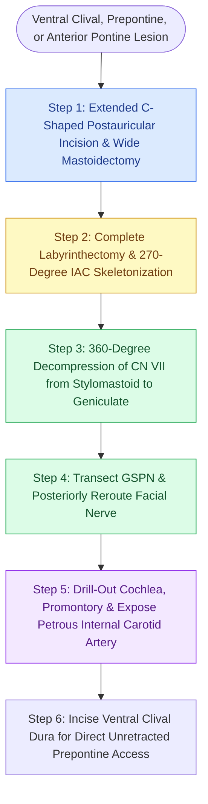

# The transcochlear approach expands the translabyrinthine corridor through posterior facial nerve rerouting and cochlear drill-out to access the prepontine space and ventral clivus

## Active Recall

> [!question]- How does the transcochlear approach modify the standard translabyrinthine approach to access anterior petroclival tumors?
> *Answer / Clinical Rationale*: The transcochlear approach (originally described by House and Hitselberger) begins with a complete translabyrinthine exposure, but subsequently performs a 360-degree bony skeletonization of the entire Fallopian canal from the stylomastoid foramen to the geniculate ganglion. The greater superficial petrosal nerve is sharply transected, allowing the facial nerve to be completely mobilized out of its canal and transposed posteriorly into the mastoid cavity. Drilling out the cochlea, promontory, and anterior petrous apex then converts the surgical field into a direct, unhindered corridor to the prepontine cistern, ventral clivus, and basilar artery without requiring brain retraction.
>
> [!question]- What is the expected postoperative facial nerve functional outcome following anterior transposition in a transcochlear approach?
> *Answer / Clinical Rationale*: Posterior transposition of the intact facial nerve inevitably disrupts the epineurial and perineurial vascular arcade and stretches axonal fibers, resulting in immediate postoperative facial palsy that typically recovers to House-Brackmann Grade III or IV over 6 to 12 months. Patients must be counseled that normal Grade I facial symmetry is exceedingly rare following extensive nerve rerouting.

## Core Clinical & Mechanistic Principles

Surgical management of anterior skull base and petroclival lesions—including clival chordomas, petroclival meningiomas, large invasive epidermoids, and extensive recurrent vestibular schwannomas—is constrained by the rigid architecture of the temporal bone and brainstem. While the standard [[The translabyrinthine approach provides direct exposure of the internal auditory canal with complete hearing sacrifice|translabyrinthine approach]] provides direct lateral access to the cerebellopontine angle and internal auditory canal with zero cerebellar retraction, its anterior viewing angle is strictly blocked by the intact Fallopian canal and the dense otic capsule of the cochlea.

The transcochlear approach overcomes these constraints by systematically sacrificing the non-functioning cochlea and rerouting [[The facial nerve traverses six distinct anatomical segments from the pons to the parotid gland|segments of the facial nerve]]. Following complete mastoidectomy and labyrinthectomy, the descending mastoid, tympanic, and labyrinthine segments of cranial nerve VII are skeletonized circumferentially. By transecting the greater superficial petrosal nerve (GSPN) at the first genu, the nerve is freed from its anterior tether and mobilized into a groove along the posterior mastoid wall.

With the facial nerve safely displaced posteriorly, the surgeon drills away the promontory, basal cochlear turn, and apex of the petrous bone up to the posterior border of the vertical and horizontal internal carotid artery. This radical petrosectomy establishes a panoramic, direct linear trajectory to the ventral brainstem, basilar artery, anterior inferior cerebellar artery (AICA), and clival dura. Because the viewing vector is strictly perpendicular to the prepontine cistern, extensive tumor resection proceeds with minimal to zero temporal lobe or brainstem retraction, dramatically mitigating postoperative cerebral edema and contusion.

### Operative Technique Step-by-Step

1. **Incision and Soft Tissue Handling**: A large C-shaped postauricular incision is curved 4 to 5 cm behind the pinna, extending from the temporal line down to the anterior border of the sternocleidomastoid muscle. The external auditory canal is transected, everted, and blind-sac closed with a two-layer watertight suture closure.
2. **Mastoidectomy & Labyrinthectomy**: A wide canal wall down mastoidectomy is executed. The sigmoid sinus, middle fossa dura, and sinodural angle are skeletonized. The lateral, posterior, and superior semicircular canals are drilled out completely down to the vestibule.
3. **Facial Nerve 360-Degree Skeletonization**: Using 2 to 3 mm diamond burrs with continuous irrigation, bone over the Fallopian canal is thinned to an eggshell translucency from the stylomastoid foramen up through the second genu, tympanic segment, and first genu. The bone is gently lifted off with a micro-curette.
4. **Posterior Rerouting**: The GSPN is identified at the geniculate ganglion and sharply transected with micro-scissors. The facial nerve is mobilized out of the Fallopian canal from distal to proximal and reflected posteriorly over the sigmoid sinus, cushioned in moist neurosurgical cottonoids.
5. **Cochlear Drill-Out and Carotid Skeletonization**: The promontory and basal/apical turns of the cochlea are excised with diamond drills. Bone is removed anteriorly until the fibrous periosteum of the petrous internal carotid artery is delineated.
6. **Dural Opening and Closure**: The posterior fossa and anterior petroclival dura are opened. Tumor resection is executed under direct line-of-sight microsurgical visualization. Closure requires harvesting a large autologous abdominal fat graft to obliterate the petrosectomy cavity, combined with a vascularized temporalis myofascial flap to prevent CSF rhinorrhea.

## Connected Concepts & Graph Traversal
- **Parent Corridor**: [[The translabyrinthine approach provides direct exposure of the internal auditory canal with complete hearing sacrifice]]
- **Nerve Rerouting Comparison**: [[Fisch infratemporal fossa approach Type A mobilizes the facial nerve and exposes the jugular foramen]]
- **Hearing Preservation Alternative**: [[The retrosigmoid suboccipital approach allows hearing preservation for small to medium vestibular schwannomas]]
- **Superior Corridor Alternative**: [[The middle cranial fossa approach provides hearing preservation for intracanalicular schwannomas with lateral fundus extension]]
- **Anatomical Foundation**: [[The otic capsule is an immutable endochondral bone that provides fixed surgical reference landmarks]]
- **Complication Rescue**: [[High-stakes lateral skull base neurotologic complications require rapid multimodal emergency salvage]]
