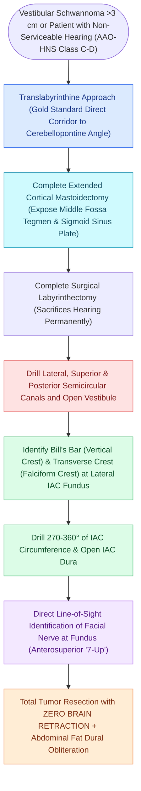

# The translabyrinthine approach provides direct exposure of the internal auditory canal with complete hearing sacrifice

## Active Recall

> [!question]- What anatomical structure separates the facial nerve from the superior vestibular nerve in the upper IAC fundus?
> *Answer / Clinical Rationale*: **Bill's bar (the vertical crest of bone)**.

> [!question]- What are the major clinical advantages of the translabyrinthine approach over the retrosigmoid approach?
> *Answer / Clinical Rationale*: It requires **zero brain retraction**, provides **early definitive identification of the facial nerve at the fundus**, and has the lowest rate of persistent postoperative headache.

> [!question]- How is postoperative CSF rhinorrhea prevented during closure of a translabyrinthine craniotomy?
> *Answer / Clinical Rationale*: The **Eustachian tube orifice and aditus ad antrum are permanently sealed with muscle plugs and bone wax**, and the entire surgical cavity is packed with an **autologous abdominal fat graft**.

## Core Clinical & Mechanistic Principles
The **translabyrinthine approach** (standardized by William House in 1964) provides the most direct lateral surgical corridor to the internal auditory canal and cerebellopontine angle:
- **Core Indications**:
  - [[Vestibular schwannomas arise from the Schwann cell sheath of the inferior or superior vestibular nerve|Vestibular schwannomas]] of any size (Koos I–IV) in patients with **non-serviceable pre-existing hearing** (AAO-HNS Class C/D; pure-tone average $>50\text{ dB}$, word recognition score $<50\%$).
  - Large/giant tumors ($>3.0\text{ cm}$) where hearing preservation is impossible.
  - Revision skull base surgery or previous mastoid disease.
- **Surgical Step-by-Step Execution**:
  1. Extended postauricular C-incision; wide complete [[Complete cortical mastoidectomy unroofs the mastoid antrum and establishes dependent middle ear drainage|cortical mastoidectomy]] with skeletonization of the middle fossa tegmen and sigmoid sinus.
  2. **Trautmann's Triangle Exposure**: Decompress the presigmoid posterior fossa dura within **Trautmann's triangle** (bounded by the **superior petrosal sinus** superiorly, the **sigmoid sinus** posteriorly, and the **bony labyrinth / posterior semicircular canal** anteriorly).
  3. **Complete Labyrinthectomy**: Systematically drill the lateral, superior, and posterior semicircular canals and the vestibule (**completely sacrifices cochlear and vestibular function**).
  4. **IAC Skeletonization ($270^\circ$)**: Unroof the superior, posterior, and inferior walls of the internal auditory canal from porus acusticus to fundus.
  5. **Identify Bill's Bar & Transverse Crest**: Locate **Bill's bar (vertical crest)** separating the facial nerve anterosuperiorly from the superior vestibular nerve posterosuperiorly ("7-up, Coke down").
  6. **Dural Incision & Tumor Resection**: Open presigmoid and IAC dura; mobilize the tumor capsule away from the facial nerve with continuous intraoperative electromyographic neuromonitoring; permanently plug the Eustachian tube and aditus ad antrum with muscle/fascia and obliterate the mastoid defect with an **autologous abdominal fat graft**.

### Surgical Technique & Critical Safety Checks
- **Major Advantages**: **Zero brain retraction** (no temporal lobe or cerebellar retraction); early, definitive identification of the facial nerve at the fundus of the IAC; lowest rate of postoperative headache.
- **CSF Leak Prevention & Eustachian Tube Obliteration**: To prevent paradoxical **CSF rhinorrhea via the middle ear**, the surgeon must pack the aditus ad antrum, incus interposition fossa, and **Eustachian tube orifice with muscle/fascia and bone wax**, followed by multi-strip **abdominal fat graft obliteration of the entire mastoidectomy defect**.

## Connected Concepts & Graph Traversal
- **Retrosigmoid Hearing Preservation**: [[The retrosigmoid suboccipital approach allows hearing preservation for small to medium vestibular schwannomas|Retrosigmoid Suboccipital Approach]]
- **Middle Cranial Fossa Approach**: [[The middle cranial fossa approach provides hearing preservation for intracanalicular schwannomas with lateral fundus extension|Middle Cranial Fossa Approach]]
- **Intraoperative Cranial Monitoring**: [[Intraoperative facial nerve and cochlear nerve monitoring minimize cranial nerve morbidity in skull base surgery|Intraoperative Facial & Cochlear Monitoring]]
- **IAC Lipoma Management**: [[Internal auditory canal lipomas demonstrate T1 hyperintensity with fat saturation signal loss and mandate conservative observation|IAC Lipoma vs Schwannoma]]
- **Vestibular Schwannoma Pathology**: [[Vestibular schwannomas arise from the Schwann cell sheath of the inferior or superior vestibular nerve|Vestibular Schwannoma Pathology]]
- **CSF Leak Management**: [[Spontaneous CSF otorrhea from tegmen dehiscence requires multilayer middle fossa or transmastoid repair|Temporal Bone CSF Leak Repair]]
- **Extended Ventral Clival Exposure**: [[The transcochlear approach expands the translabyrinthine corridor through posterior facial nerve rerouting and cochlear drill-out to access the prepontine space and ventral clivus|Transcochlear Approach]]
